<h1 align="center">Awesome Presentation Prompts</h1>

<p align="center"><i>Prompts for PowerPoint decks, with the slides they make.</i></p>

<p align="center">
  <a href="LICENSE"></a>
  <a href="https://tosea.ai/prompts/presentations"></a>
  <a href="https://github.com/ToseaAI/awesome-presentation-prompts/stargazers"></a>
  <a href="https://github.com/ToseaAI/awesome-presentation-prompts/network/members"></a>
</p>

231 copy-ready prompts for building presentation decks with AI, grouped by what the deck is for. 136 of them come with an example slide, so you can see the kind of result before you run one.

The prompts are plain text, so they work in ChatGPT, Claude, Gemini and Copilot. They come from the guides on the [Tosea](https://tosea.ai) blog. Tosea turns a prompt and your source files into an editable deck.

> 231 prompts across 6 scenarios. [→ Search the library on Tosea](https://tosea.ai/prompts/presentations)

## Featured

<table align="center"><tr>
<td align="center" width="25%"><a href="#tosea-207">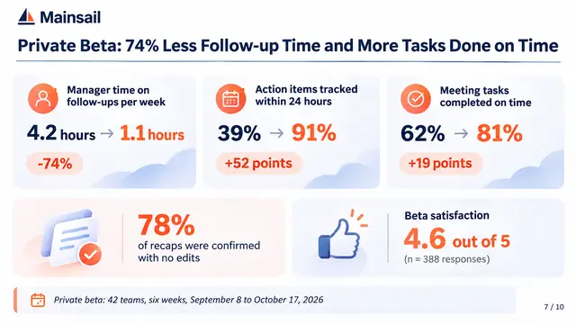</a><br><sub>Product launch deck from a product brief</sub></td>
<td align="center" width="25%"><a href="#tosea-263">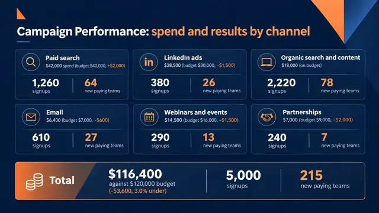</a><br><sub>Monthly marketing report template</sub></td>
<td align="center" width="25%"><a href="#tosea-209">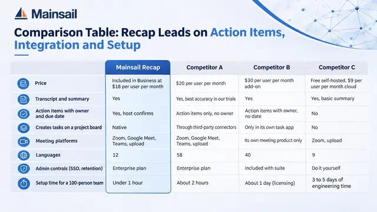</a><br><sub>Competitive analysis deck with positioning map</sub></td>
<td align="center" width="25%"><a href="#tosea-210">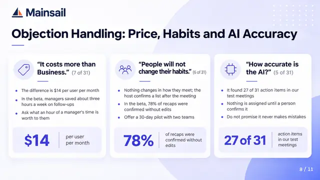</a><br><sub>Sales enablement deck for account executives</sub></td>
</tr></table>

## Table of Contents

- [Marketing](#marketing) · *15 prompts, 9 with an example slide*
- [Consulting](#consulting) · *65 prompts, 60 with an example slide*
- [Business](#business) · *47 prompts, 23 with an example slide*
- [Finance](#finance) · *18 prompts, 5 with an example slide*
- [Research](#research) · *65 prompts, 39 with an example slide*
- [Design](#design) · *21 prompts, 0 with an example slide*
- [How to use a prompt](#how-to-use-a-prompt)
- [Contributing](#contributing)
- [License](#license)

## How to use a prompt

1. Pick a prompt and copy it. Replace anything in `[brackets]` with your own details.
2. Attach the material the prompt refers to: a brief, a report, notes or screenshots. A prompt with no source material gets a generic deck.
3. Run it. In Tosea you review the outline first, then generate the slides and export an editable PowerPoint file.

Each entry says what the prompt returns: a full deck, a single slide, an outline, a restyle of existing slides, speaker notes, or an add-on rule you paste after another prompt. "Generated in Tosea" under a slide means it came from running that exact prompt in Tosea. "Example slide" means it illustrates the prompt but was made another way.

<a id="marketing"></a>
## Marketing

Launch decks, monthly marketing reports, competitive analysis and sales enablement.

> The marketing example decks use a made-up company, Mainsail, and made-up numbers.

<a id="tosea-207"></a>
### 01. Product launch deck from a product brief

`TOSEA-207` · Full deck · 10 slides

Creates a 10-slide launch deck from a brief, pain-point notes and screenshots, ending with a go-to-market timeline and call to action.

<p align="center"><a href="images/tosea-207.webp"></a><br><sub>Generated in Tosea</sub></p>

<details>
<summary><b>Prompt</b> (click to expand, then use the copy button)</summary>

```text
Create a 10-slide product launch deck for a new AI productivity feature. Use the attached product brief, customer pain-point notes, and screenshots. Follow the existing brand template. Include a launch narrative, positioning, key benefits, competitive differentiation, go-to-market timeline, and a final call-to-action slide.
```

</details>

**[→ Open on Tosea](https://tosea.ai/prompts/presentations/marketing#tosea-207)** · from the guide [How to Use Codex to Generate Marketing Slides for Market Research & Product Decks](https://tosea.ai/blog/how-to-use-codex-generate-marketing-slides)

---

<a id="tosea-208"></a>
### 02. Product demo deck from screenshots

`TOSEA-208` · Full deck · 8 slides

Builds an 8-slide demo deck with one product moment per slide, large readable screenshots and a short presenter note on each.

<p align="center"><a href="images/tosea-208.webp">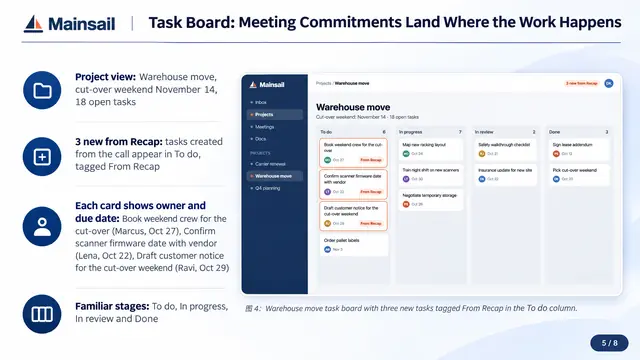</a><br><sub>Generated in Tosea</sub></p>

<details>
<summary><b>Prompt</b> (click to expand, then use the copy button)</summary>

```text
Build an 8-slide product demo deck using the screenshots in this folder. Each slide should show one product moment, explain the user value, and include a concise presenter note. Keep screenshots large and readable. Use the existing brand deck as the visual reference.
```

</details>

**[→ Open on Tosea](https://tosea.ai/prompts/presentations/marketing#tosea-208)** · from the guide [How to Use Codex to Generate Marketing Slides for Market Research & Product Decks](https://tosea.ai/blog/how-to-use-codex-generate-marketing-slides)

---

<a id="tosea-209"></a>
### 03. Competitive analysis deck with positioning map

`TOSEA-209` · Full deck · 8 slides

Compares your product with three competitors in a table, positioning map and strengths list, then proposes objective sales messaging.

<p align="center"><a href="images/tosea-209.webp"></a><br><sub>Generated in Tosea</sub></p>

<details>
<summary><b>Prompt</b> (click to expand, then use the copy button)</summary>

```text
Create a competitive analysis deck comparing our product with Competitor A, Competitor B, and Competitor C. Use the attached research notes. Include a comparison table, positioning map, strengths and weaknesses, and recommended sales messaging. Keep the tone objective and evidence-based.
```

</details>

**[→ Open on Tosea](https://tosea.ai/prompts/presentations/marketing#tosea-209)** · from the guide [How to Use Codex to Generate Marketing Slides for Market Research & Product Decks](https://tosea.ai/blog/how-to-use-codex-generate-marketing-slides)

---

<a id="tosea-210"></a>
### 04. Sales enablement deck for account executives

`TOSEA-210` · Full deck · 11 slides

Covers buyer personas, discovery questions, objection handling, competitor talk tracks and demo guidance, with speaker notes per slide.

<p align="center"><a href="images/tosea-210.webp"></a><br><sub>Generated in Tosea</sub></p>

<details>
<summary><b>Prompt</b> (click to expand, then use the copy button)</summary>

```text
Generate a sales-enablement deck for account executives selling our new enterprise plan. Use the attached product messaging, customer objections, and sales notes. Include buyer personas, discovery questions, objection handling, competitor talk tracks, and demo guidance. Add speaker notes for each slide.
```

</details>

**[→ Open on Tosea](https://tosea.ai/prompts/presentations/marketing#tosea-210)** · from the guide [How to Use Codex to Generate Marketing Slides for Market Research & Product Decks](https://tosea.ai/blog/how-to-use-codex-generate-marketing-slides)

---

<a id="tosea-211"></a>
### 05. Brand template rules summary before new slides

`TOSEA-211` · Add-on rule

Reads an existing brand deck and lists its slide size, type styles, palette, logo placement, chart style and spacing rules first.

<details>
<summary><b>Prompt</b> (click to expand, then use the copy button)</summary>

```text
First inspect the existing brand deck. Identify the slide size, title style, body-text style, color palette, logo placement, image treatment, chart style, and spacing rules. Summarize these rules before generating new slides.
```

</details>

**[→ Open on Tosea](https://tosea.ai/prompts/presentations/marketing#tosea-211)** · from the guide [How to Use Codex to Generate Marketing Slides for Market Research & Product Decks](https://tosea.ai/blog/how-to-use-codex-generate-marketing-slides)

---

<a id="tosea-212"></a>
### 06. Slide-by-slide outline for approval before the deck

`TOSEA-212` · Outline

Asks for each slide's title, core message, evidence, visual and presenter note, and holds the PPTX until you approve the outline.

<details>
<summary><b>Prompt</b> (click to expand, then use the copy button)</summary>

```text
Before creating the deck, propose a slide-by-slide outline. For each slide, include the title, core message, source evidence, recommended visual, and presenter note. Do not generate the PPTX until I approve the outline.
```

</details>

**[→ Open on Tosea](https://tosea.ai/prompts/presentations/marketing#tosea-212)** · from the guide [How to Use Codex to Generate Marketing Slides for Market Research & Product Decks](https://tosea.ai/blog/how-to-use-codex-generate-marketing-slides)

---

<a id="tosea-213"></a>
### 07. Exact product claims rule for marketing slides

`TOSEA-213` · Add-on rule

Keeps approved claims word for word and marks missing evidence as needs verification instead of inventing quotes, prices or metrics.

<details>
<summary><b>Prompt</b> (click to expand, then use the copy button)</summary>

```text
Preserve all approved product claims exactly as written. Do not invent customer quotes, pricing, performance numbers, or competitor claims. If evidence is missing, mark it as needs verification instead of filling it in.
```

</details>

**[→ Open on Tosea](https://tosea.ai/prompts/presentations/marketing#tosea-213)** · from the guide [How to Use Codex to Generate Marketing Slides for Market Research & Product Decks](https://tosea.ai/blog/how-to-use-codex-generate-marketing-slides)

---

<a id="tosea-214"></a>
### 08. Editable text and native charts instruction

`TOSEA-214` · Add-on rule

Requires real PowerPoint text and native bar, line and pie charts, and forbids turning whole slides into images.

<details>
<summary><b>Prompt</b> (click to expand, then use the copy button)</summary>

```text
Create the deck as an editable PPTX. Keep text as editable PowerPoint text. Use native charts for simple bar, line, pie, and histogram visuals when practical. Do not rasterize full slides. Use image assets only for screenshots, illustrations, and complex visuals.
```

</details>

**[→ Open on Tosea](https://tosea.ai/prompts/presentations/marketing#tosea-214)** · from the guide [How to Use Codex to Generate Marketing Slides for Market Research & Product Decks](https://tosea.ai/blog/how-to-use-codex-generate-marketing-slides)

---

<a id="tosea-215"></a>
### 09. Consistent visual direction for a marketing deck

`TOSEA-215` · Add-on rule

Sets one SaaS-style illustration style and B2B tone for the deck and saves the image notes so later slides can match.

<details>
<summary><b>Prompt</b> (click to expand, then use the copy button)</summary>

```text
Define a consistent visual direction for this marketing deck. Use clean SaaS-style illustrations, realistic product context, and a polished B2B visual tone. Save the image prompts or visual notes so future slides can match the same direction.
```

</details>

**[→ Open on Tosea](https://tosea.ai/prompts/presentations/marketing#tosea-215)** · from the guide [How to Use Codex to Generate Marketing Slides for Market Research & Product Decks](https://tosea.ai/blog/how-to-use-codex-generate-marketing-slides)

---

<a id="tosea-216"></a>
### 10. Final visual QA pass on a rendered deck

`TOSEA-216` · Restyle

Renders every slide to an image and fixes clipped text, overlap, uneven spacing, font substitution and layout drift before saving.

<details>
<summary><b>Prompt</b> (click to expand, then use the copy button)</summary>

```text
Render the deck to slide images. Review every slide for clipped text, overlap, inconsistent spacing, unreadable screenshots, font substitution, layout drift, and visual-style mismatch. Fix all issues before saving the final PPTX.
```

</details>

**[→ Open on Tosea](https://tosea.ai/prompts/presentations/marketing#tosea-216)** · from the guide [How to Use Codex to Generate Marketing Slides for Market Research & Product Decks](https://tosea.ai/blog/how-to-use-codex-generate-marketing-slides)

---

<a id="tosea-243"></a>
### 11. Customer feedback pain points deck

`TOSEA-243` · Full deck · 7 slides

Sorts customer feedback transcripts into the top three pain points with quotes and maps each one to a possible product improvement.

<p align="center"><a href="images/tosea-243.webp">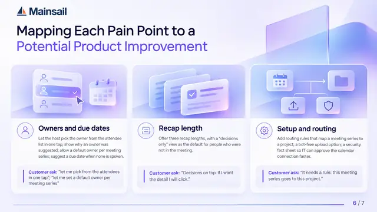</a><br><sub>Generated in Tosea</sub></p>

<details>
<summary><b>Prompt</b> (click to expand, then use the copy button)</summary>

```text
Read the customer feedback transcripts in this document. Create a presentation for the product development team that categorizes the top 3 pain points with supporting quotes. Use a professional but empathetic tone. Include a slide mapping each pain point to a potential product improvement.
```

</details>

**[→ Open on Tosea](https://tosea.ai/prompts/presentations/marketing#tosea-243)** · from the guide [Best AI Prompts for Professional Document-to-PPT Transformation](https://tosea.ai/blog/best-ai-prompts-document-to-ppt)

---

<a id="tosea-263"></a>
### 12. Monthly marketing report template

`TOSEA-263` · Full deck · 12 slides

Sets an 11-slide monthly report from executive summary to recommendations, with slide counts per section and two brand hex colors.

<p align="center"><a href="images/tosea-263.webp"></a><br><sub>Generated in Tosea</sub></p>

<details>
<summary><b>Prompt</b> (click to expand, then use the copy button)</summary>

```text
Create a monthly marketing report template with the following sections: Executive Summary (1 slide), Campaign Performance Overview (2 slides showing spend and results by channel), Conversion Funnel Analysis (1 slide), Content Marketing Performance (2 slides on blog traffic and engagement), SEO Progress (1 slide on rankings and organic traffic), Paid Advertising Deep Dive (3 slides on ad performance and optimization opportunities), and Strategic Recommendations (1 slide). Use our corporate color scheme: navy blue (#1B365D) and orange accent (#FF6B35).
```

</details>

**[→ Open on Tosea](https://tosea.ai/prompts/presentations/marketing#tosea-263)** · from the guide [How to Create Professional Monthly Marketing Reports in 15 Minutes with AI](https://tosea.ai/blog/professional-monthly-marketing-reports-with-ai)

---

<a id="tosea-269"></a>
### 13. Creative marketing pitch deck

`TOSEA-269` · Full deck · 12 slides

Builds a 12-slide marketing pitch with bold type, high-contrast color and full-bleed image placeholders, each slide opening on an emotional hook.

<p align="center"><a href="images/tosea-269.webp">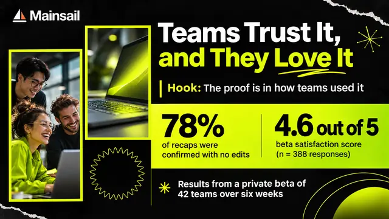</a><br><sub>Generated in Tosea</sub></p>

<details>
<summary><b>Prompt</b> (click to expand, then use the copy button)</summary>

```text
Build a 12-slide marketing pitch deck for [product/brand] targeting [audience]. Use bold typography, high-contrast colors, and full-bleed imagery placeholders. Each slide should lead with an emotional hook before presenting supporting data. Tone should be energetic and aspirational.
```

</details>

**[→ Open on Tosea](https://tosea.ai/prompts/presentations/marketing#tosea-269)** · from the guide [60+ Best AI Prompts for PowerPoint Presentations (2026)](https://tosea.ai/blog/best-ai-prompts-powerpoint-presentations-2026)

---

<a id="tosea-277"></a>
### 14. Competitor comparison bar chart slide

`TOSEA-277` · Single slide

Compares your product with three competitors on five dimensions in a horizontal bar chart, your bars in brand color and theirs in gray.

<p align="center"><a href="images/tosea-277.webp">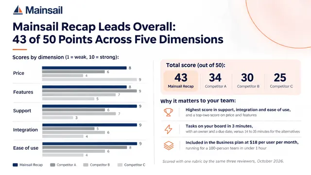</a><br><sub>Generated in Tosea</sub></p>

<details>
<summary><b>Prompt</b> (click to expand, then use the copy button)</summary>

```text
Generate a comparison slide showing our product against three competitors across five dimensions: price, features, support, integration, and ease of use. Use a horizontal bar chart with color-coded bars by competitor. Highlight our product's bar in the brand primary color and show competitor bars in muted gray.
```

</details>

**[→ Open on Tosea](https://tosea.ai/prompts/presentations/marketing#tosea-277)** · from the guide [60+ Best AI Prompts for PowerPoint Presentations (2026)](https://tosea.ai/blog/best-ai-prompts-powerpoint-presentations-2026)

---

<a id="tosea-286"></a>
### 15. Client update deck from a monthly marketing report

`TOSEA-286` · Full deck · 8 slides

Converts a monthly marketing report into an eight-slide client update with one slide per channel and a budget reconciliation.

<p align="center"><a href="images/tosea-286.webp">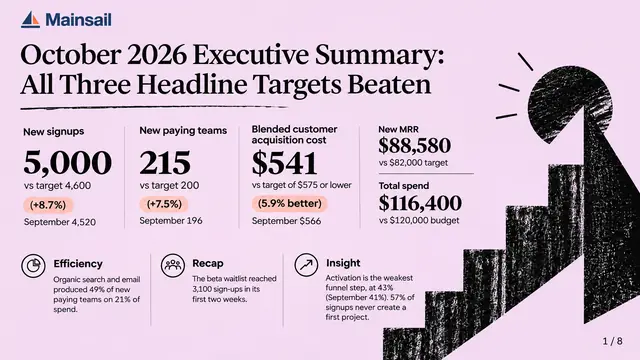</a><br><sub>Generated in Tosea</sub></p>

<details>
<summary><b>Prompt</b> (click to expand, then use the copy button)</summary>

```text
Convert this monthly marketing report into an eight-slide client update. Slide 1: executive summary with three key metrics vs targets. Slides 2-4: one slide per channel (paid, organic, email) showing performance, insights, and next month's plan. Slide 5: competitive intelligence summary. Slide 6: budget reconciliation. Slide 7: month ahead priorities. Slide 8: questions and discussion.
```

</details>

**[→ Open on Tosea](https://tosea.ai/prompts/presentations/marketing#tosea-286)** · from the guide [60+ Best AI Prompts for PowerPoint Presentations (2026)](https://tosea.ai/blog/best-ai-prompts-powerpoint-presentations-2026)

---

<a id="consulting"></a>
## Consulting

Strategy frameworks in the layouts consulting decks use: matrices, issue trees, answer-first storylines.

> Names such as "McKinsey-style" describe a slide layout convention. This project is not affiliated with or endorsed by any of the firms named.

<a id="tosea-021"></a>
### 01. Critical success factors slide

`TOSEA-021` · Single slide · Bain-style

Scores industry importance against company strength and names the two capabilities that deserve more investment.

<p align="center"><a href="images/tosea-021.webp">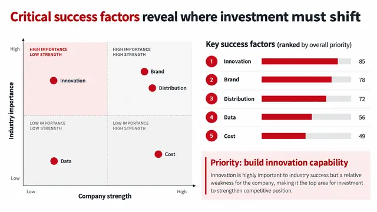</a><br><sub>Generated in Tosea</sub></p>

<details>
<summary><b>Prompt</b> (click to expand, then use the copy button)</summary>

```text
Build one KSF slide for [industry] from the attached evidence. Identify two capabilities for incremental investment.

List five to eight factors. Score industry importance and company strength separately from 1 to 5. If pairwise scores exist, show the 0, 1, 2 rule, totals, and normalized weights, and check that each pair sums to 2.

Add an importance-versus-strength matrix, ranked factors, and a resource-shift recommendation. Cite scores and mark evidence gaps. Do not invent survey results.
```

</details>

**[→ Open on Tosea](https://tosea.ai/prompts/presentations/critical-success-factors-prompt#tosea-021)** · part of [Critical success factors prompt for PowerPoint](https://tosea.ai/prompts/presentations/critical-success-factors-prompt) · from the guide [How to Build a Bain-Style Strategy PowerPoint with AI: KSF, Scenario Analysis and Org DNA](https://tosea.ai/blog/bain-style-ksf-scenario-org-dna-powerpoint-ai)

---

<a id="tosea-022"></a>
### 02. Four-scenario analysis slide

`TOSEA-022` · Single slide · Bain-style

Builds a 2x2 of plausible futures from two ranked uncertainties and ends with no-regret moves and triggers.

<p align="center"><a href="images/tosea-022.webp">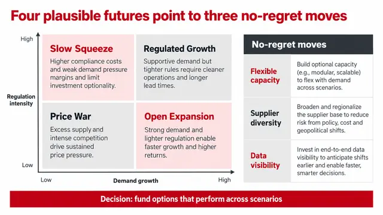</a><br><sub>Generated in Tosea</sub></p>

<details>
<summary><b>Prompt</b> (click to expand, then use the copy button)</summary>

```text
Build a four-scenario slide for [company] through [year]. Decide which investments to fund, preserve, or defer.

Use the attached evidence. Separate trends from uncertainties, rank the uncertainties, and select two independent axes.

For each scenario, add a name, implications, indicators, and triggers. End with no-regret moves, preserved options, and scenario actions. Do not invent probabilities or market forecasts that the sources do not contain.
```

</details>

**[→ Open on Tosea](https://tosea.ai/prompts/presentations/scenario-analysis-prompt#tosea-022)** · part of [Scenario analysis prompt for PowerPoint](https://tosea.ai/prompts/presentations/scenario-analysis-prompt) · from the guide [How to Build a Bain-Style Strategy PowerPoint with AI: KSF, Scenario Analysis and Org DNA](https://tosea.ai/blog/bain-style-ksf-scenario-org-dna-powerpoint-ai)

---

<a id="tosea-023"></a>
### 03. Organizational DNA diagnostic slide

`TOSEA-023` · Single slide · Bain-style

Scores decision rights, information, motivators and structure, then links the largest gaps to three owned actions.

<p align="center"><a href="images/tosea-023.webp">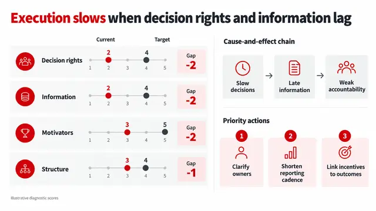</a><br><sub>Generated in Tosea</sub></p>

<details>
<summary><b>Prompt</b> (click to expand, then use the copy button)</summary>

```text
Build one Organizational DNA slide from the attached evidence. Identify three interventions to improve execution.

Score decision rights, information, motivators, and structure from 1 to 5. Show current and target scores, evidence, and response ranges. Link symptoms to mechanisms.

Recommend three actions with owner, timing, measure, and dependency. Check that the title names the lowest-scoring blocks and that every large gap has an action or an explanation. Mark conflicts and avoid personality diagnoses or single-factor conclusions.
```

</details>

**[→ Open on Tosea](https://tosea.ai/prompts/presentations/organizational-dna-prompt#tosea-023)** · part of [Organizational DNA prompt for PowerPoint](https://tosea.ai/prompts/presentations/organizational-dna-prompt) · from the guide [How to Build a Bain-Style Strategy PowerPoint with AI: KSF, Scenario Analysis and Org DNA](https://tosea.ai/blog/bain-style-ksf-scenario-org-dna-powerpoint-ai)

---

<a id="tosea-054"></a>
### 04. RFM analysis executive overview slide

`TOSEA-054` · Single slide · Deloitte-style

Defines recency, frequency and monetary value for executives and turns them into four priority segments with one action each.

<p align="center"><a href="images/tosea-054.webp">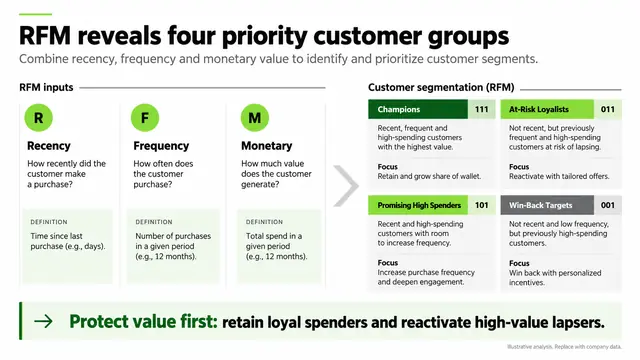</a><br><sub>Generated in Tosea</sub></p>

<details>
<summary><b>Prompt</b> (click to expand, then use the copy button)</summary>

```text
Create one 16:9 executive RFM analysis slide for a customer strategy review.

Show Recency, Frequency, and Monetary value with one plain-English definition and one calculation note for each. Present four priority segments: 111 Champions, 011 At-Risk Loyalists, 101 Promising High Spenders, and 001 Win-Back Targets. Add one action for every segment and finish with a conclusion-led recommendation.

Use a white background, black type, vivid green highlights, pale mint support areas, and a precise consulting grid. Do not use logos. Label every figure as actual, estimated, or illustrative. Do not invent missing data.
```

</details>

**[→ Open on Tosea](https://tosea.ai/prompts/presentations/rfm-analysis-prompts#tosea-054)** · part of [RFM analysis prompts for PowerPoint](https://tosea.ai/prompts/presentations/rfm-analysis-prompts) · from the guide [How to Make a Deloitte-Style RFM Analysis PowerPoint with AI](https://tosea.ai/blog/deloitte-style-rfm-analysis-powerpoint-ai)

---

<a id="tosea-055"></a>
### 05. Eight-segment RFM action map

`TOSEA-055` · Single slide · Deloitte-style

Lays out all eight RFM codes from 000 to 111 on a value-by-activity grid with an action and owner per cell.

<p align="center"><a href="images/tosea-055.webp">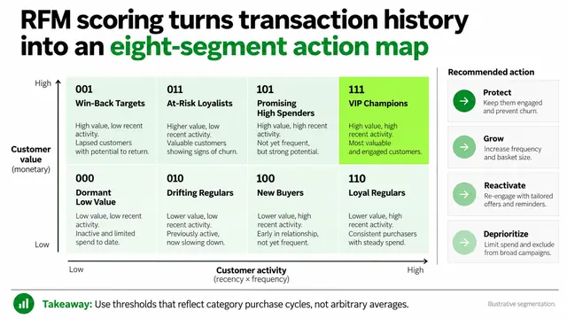</a><br><sub>Generated in Tosea</sub></p>

<details>
<summary><b>Prompt</b> (click to expand, then use the copy button)</summary>

```text
Build one 16:9 RFM customer action map using the eight binary combinations from 000 to 111.

For every cell, show segment name, behavioral description, recommended action, and owner. Use customer activity on the horizontal axis and customer value on the vertical axis. Read every code in R-F-M order, so all high-value codes (ending in 1) sit in the top row. Highlight 111 as the priority group. Add the scoring threshold, analysis period, observation date, and customer count in a source note.

Use a restrained green consulting palette and a conclusion-led title. Keep the original data and terminology. Flag any segment that lacks an agreed treatment.
```

</details>

**[→ Open on Tosea](https://tosea.ai/prompts/presentations/rfm-analysis-prompts#tosea-055)** · part of [RFM analysis prompts for PowerPoint](https://tosea.ai/prompts/presentations/rfm-analysis-prompts) · from the guide [How to Make a Deloitte-Style RFM Analysis PowerPoint with AI](https://tosea.ai/blog/deloitte-style-rfm-analysis-powerpoint-ai)

---

<a id="tosea-056"></a>
### 06. RFM segment treatment plan slide

`TOSEA-056` · Single slide · Deloitte-style

Sets objective, channel, timing, owner and success metric for three segments, plus a holdout-based measurement strip.

<p align="center"><a href="images/tosea-056.webp">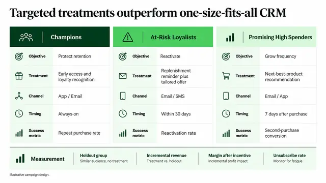</a><br><sub>Generated in Tosea</sub></p>

<details>
<summary><b>Prompt</b> (click to expand, then use the copy button)</summary>

```text
Create one 16:9 CRM treatment slide for three RFM segments: Champions, At-Risk Loyalists, and Promising High Spenders.

For each segment, specify objective, treatment, channel, trigger timing, owner, and success metric. Add a measurement strip covering holdout group, incremental revenue, margin after incentive, unsubscribe rate, and test duration. Separate source facts from proposed actions.

Use a white background, dark green headers, lime emphasis, compact tables, and generous whitespace. Do not claim that a treatment works unless experimental results are provided.
```

</details>

**[→ Open on Tosea](https://tosea.ai/prompts/presentations/rfm-analysis-prompts#tosea-056)** · part of [RFM analysis prompts for PowerPoint](https://tosea.ai/prompts/presentations/rfm-analysis-prompts) · from the guide [How to Make a Deloitte-Style RFM Analysis PowerPoint with AI](https://tosea.ai/blog/deloitte-style-rfm-analysis-powerpoint-ai)

---

<a id="tosea-057"></a>
### 07. RFM industry fit slide

`TOSEA-057` · Single slide · Deloitte-style

Rates how well RFM fits six sectors and states the adjustment each one needs before the model drives decisions.

<p align="center"><a href="images/tosea-057.webp">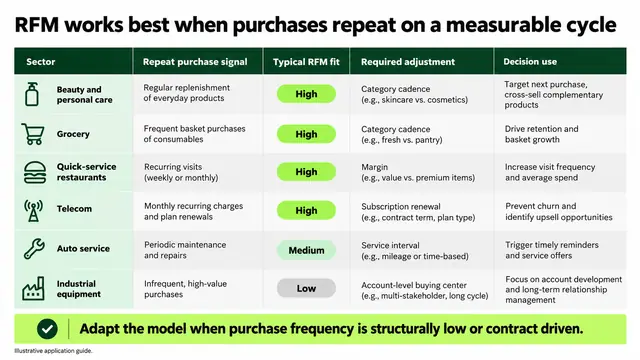</a><br><sub>Generated in Tosea</sub></p>

<details>
<summary><b>Prompt</b> (click to expand, then use the copy button)</summary>

```text
Create one 16:9 industry applicability slide for the RFM model.

Compare beauty, grocery, quick-service restaurants, telecom, auto service, and industrial equipment. For each sector, show repeat purchase signal, typical RFM fit, required adjustment, and decision use. Rate fit as high, medium, or low only when the stated purchase logic supports the rating.

Use a simple consulting table with green emphasis and one takeaway banner. Mark the content as an application guide rather than empirical evidence.
```

</details>

**[→ Open on Tosea](https://tosea.ai/prompts/presentations/rfm-analysis-prompts#tosea-057)** · part of [RFM analysis prompts for PowerPoint](https://tosea.ai/prompts/presentations/rfm-analysis-prompts) · from the guide [How to Make a Deloitte-Style RFM Analysis PowerPoint with AI](https://tosea.ai/blog/deloitte-style-rfm-analysis-powerpoint-ai)

---

<a id="tosea-062"></a>
### 08. Business Systems Planning roadmap slide

`TOSEA-062` · Single slide · PwC-style

Maps core processes to data domains and sequences an information systems roadmap in three waves, without invented dependencies.

<p align="center"><a href="images/tosea-062.webp">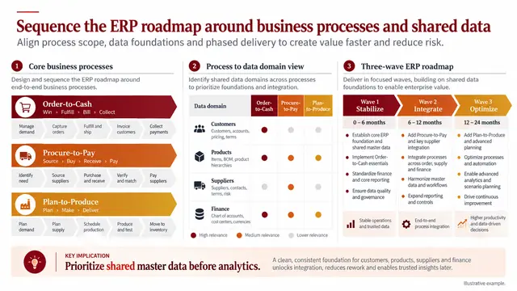</a><br><sub>Generated in Tosea</sub></p>

<details>
<summary><b>Prompt</b> (click to expand, then use the copy button)</summary>

```text
Create one 16:9 information systems roadmap slide from the supplied process inventory, application map, data domains, risks, and timing. Show core processes, a process-to-data matrix, and three implementation waves. Write an action title, flag missing evidence, label assumptions, and never invent dependencies. Use burgundy, orange, amber, charcoal, and white.
```

</details>

**[→ Open on Tosea](https://tosea.ai/prompts/presentations/business-systems-planning-prompt#tosea-062)** · part of [Business Systems Planning prompt for PowerPoint](https://tosea.ai/prompts/presentations/business-systems-planning-prompt) · from the guide [How to Build a PwC-Style Management Consulting PowerPoint with AI: 6 Practical Frameworks](https://tosea.ai/blog/pwc-style-management-consulting-powerpoint-frameworks)

---

<a id="tosea-063"></a>
### 09. Enterprise capability self-assessment slide

`TOSEA-063` · Single slide · PwC-style

Scores six capabilities from 1 to 5 against your rubric, compares current and target levels and marks disputed scores.

<p align="center"><a href="images/tosea-063.webp">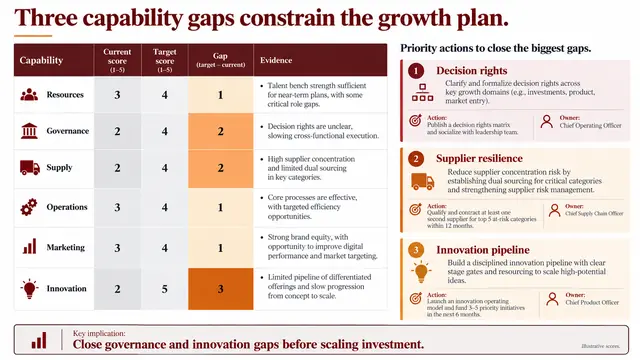</a><br><sub>Generated in Tosea</sub></p>

<details>
<summary><b>Prompt</b> (click to expand, then use the copy button)</summary>

```text
Create a capability assessment slide from the interviews and operating data. Score six named capabilities from 1 to 5 using the supplied rubric. Compare current and target scores, cite evidence, and highlight the three largest gaps. Add an action and owner. Mark disputed scores instead of averaging conflicting evidence.
```

</details>

**[→ Open on Tosea](https://tosea.ai/prompts/presentations/enterprise-self-assessment-prompt#tosea-063)** · part of [Enterprise self-assessment prompt for PowerPoint](https://tosea.ai/prompts/presentations/enterprise-self-assessment-prompt) · from the guide [How to Build a PwC-Style Management Consulting PowerPoint with AI: 6 Practical Frameworks](https://tosea.ai/blog/pwc-style-management-consulting-powerpoint-frameworks)

---

<a id="tosea-064"></a>
### 10. Management support system (GMSS) architecture slide

`TOSEA-064` · Single slide · PwC-style

Stacks four layers from source data to executive cockpit and adds a daily, weekly and monthly decision cadence.

<p align="center"><a href="images/tosea-064.webp">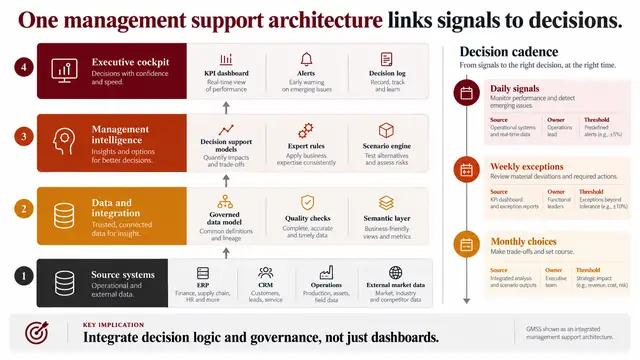</a><br><sub>Generated in Tosea</sub></p>

<details>
<summary><b>Prompt</b> (click to expand, then use the copy button)</summary>

```text
Create an integrated management support architecture with four layers: sources, governed data, decision support and expert rules, and executive cockpit. Add daily, weekly, and monthly cadence with source, owner, and threshold. Separate automated alerts from human approvals. Show lineage and control gaps. Do not present GMSS as a standardized product.
```

</details>

**[→ Open on Tosea](https://tosea.ai/prompts/presentations/management-support-system-prompt#tosea-064)** · part of [Management support system (GMSS) prompt for PowerPoint](https://tosea.ai/prompts/presentations/management-support-system-prompt) · from the guide [How to Build a PwC-Style Management Consulting PowerPoint with AI: 6 Practical Frameworks](https://tosea.ai/blog/pwc-style-management-consulting-powerpoint-frameworks)

---

<a id="tosea-065"></a>
### 11. Weighted decision matrix slide

`TOSEA-065` · Single slide · PwC-style

Scores three options on weighted criteria, checks that weights total 100 percent and tests the two most uncertain weights.

<p align="center"><a href="images/tosea-065.webp">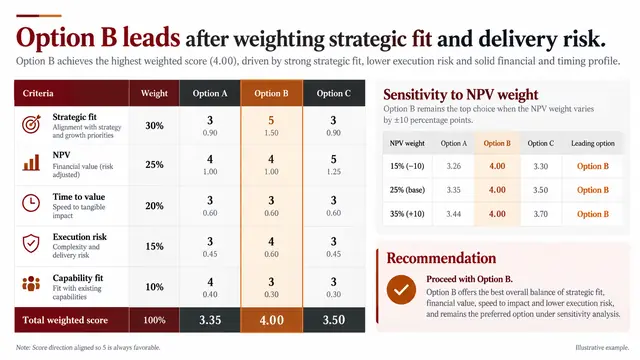</a><br><sub>Generated in Tosea</sub></p>

<details>
<summary><b>Prompt</b> (click to expand, then use the copy button)</summary>

```text
Build a weighted decision matrix for three options using supplied criteria, weights, evidence, and 1-to-5 rules. Show each weighted contribution and verify that weights total 100 percent. Test the two most uncertain weights. Highlight the leader, threshold risks, and why management should accept or reject the ranking.
```

</details>

**[→ Open on Tosea](https://tosea.ai/prompts/presentations/decision-matrix-prompt#tosea-065)** · part of [Weighted decision matrix prompt for PowerPoint](https://tosea.ai/prompts/presentations/decision-matrix-prompt) · from the guide [How to Build a PwC-Style Management Consulting PowerPoint with AI: 6 Practical Frameworks](https://tosea.ai/blog/pwc-style-management-consulting-powerpoint-frameworks)

---

<a id="tosea-066"></a>
### 12. Stakeholder power-interest map slide

`TOSEA-066` · Single slide · PwC-style

Maps stakeholders by power and interest, sizes them by influence and adds an engagement plan with message, channel and owner.

<p align="center"><a href="images/tosea-066.webp">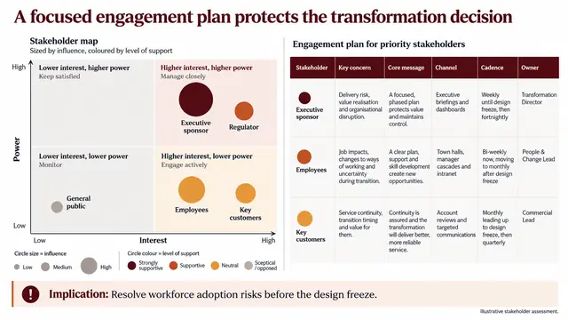</a><br><sub>Generated in Tosea</sub></p>

<details>
<summary><b>Prompt</b> (click to expand, then use the copy button)</summary>

```text
Create a stakeholder slide from the transformation plan. Map power and interest, size markers by influence, and color them by support. Add an engagement plan with concern, message, channel, cadence, and owner. Cite evidence for each placement. Flag missing voices and conflicts between formal and informal influence.
```

</details>

**[→ Open on Tosea](https://tosea.ai/prompts/presentations/stakeholder-analysis-prompt#tosea-066)** · part of [Stakeholder analysis prompt for PowerPoint](https://tosea.ai/prompts/presentations/stakeholder-analysis-prompt) · from the guide [How to Build a PwC-Style Management Consulting PowerPoint with AI: 6 Practical Frameworks](https://tosea.ai/blog/pwc-style-management-consulting-powerpoint-frameworks)

---

<a id="tosea-067"></a>
### 13. Force field analysis slide

`TOSEA-067` · Single slide · PwC-style

Scores driving and restraining forces from 1 to 5 and gives the two most actionable restraints an owner and timing.

<p align="center"><a href="images/tosea-067.webp">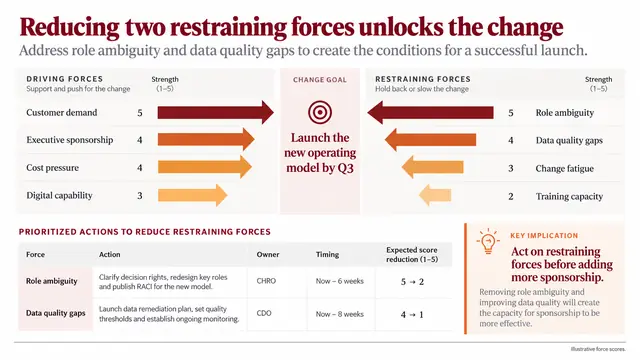</a><br><sub>Generated in Tosea</sub></p>

<details>
<summary><b>Prompt</b> (click to expand, then use the copy button)</summary>

```text
Create a force field slide for the stated goal. Separate evidence-backed driving and restraining forces, score each from 1 to 5, and scale arrow length to strength. For the two most actionable restraints, add action, owner, timing, and expected reduction. Separate facts from perceptions and cite each score.
```

</details>

**[→ Open on Tosea](https://tosea.ai/prompts/presentations/force-field-analysis-prompt#tosea-067)** · part of [Force field analysis prompt for PowerPoint](https://tosea.ai/prompts/presentations/force-field-analysis-prompt) · from the guide [How to Build a PwC-Style Management Consulting PowerPoint with AI: 6 Practical Frameworks](https://tosea.ai/blog/pwc-style-management-consulting-powerpoint-frameworks)

---

<a id="tosea-072"></a>
### 14. 3C market entry slide

`TOSEA-072` · Single slide · McKinsey-style

Organizes customer, company and competitor evidence around one market entry decision and ends in a route-to-market call.

<p align="center"><a href="images/tosea-072.webp">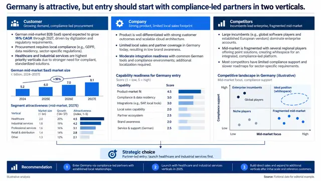</a><br><sub>Generated in Tosea</sub></p>

<details>
<summary><b>Prompt</b> (click to expand, then use the copy button)</summary>

```text
Create one 16:9 executive strategy slide using a 3C analysis for market entry.

Decision: Should our company enter Germany, where should it start, and which route to market should it use?
Audience: CEO and growth committee.

Use Customer, Company, and Competitors sections plus a recommendation bar. Cover demand, priority segments, company economics and capabilities, leading competitors, channel advantages, and underserved spaces.

Use a conclusion-led title, navy and light blue, white background, and compact sources. Do not invent figures. Check that segment values add up to the market total and that growth labels match the chart. Mark missing evidence as data required.
```

</details>

**[→ Open on Tosea](https://tosea.ai/prompts/presentations/3c-analysis-prompts#tosea-072)** · part of [3C analysis prompts for PowerPoint](https://tosea.ai/prompts/presentations/3c-analysis-prompts) · from the guide [How to Make a McKinsey Strategy Consulting PowerPoint with AI: 3C and Value Chain](https://tosea.ai/blog/mckinsey-strategy-consulting-powerpoint-3c-value-chain)

---

<a id="tosea-073"></a>
### 15. 3C product positioning slide

`TOSEA-073` · Single slide · McKinsey-style

Ranks customer criteria, scores company gaps and maps competitors to choose one value proposition with proof points.

<p align="center"><a href="images/tosea-073.webp">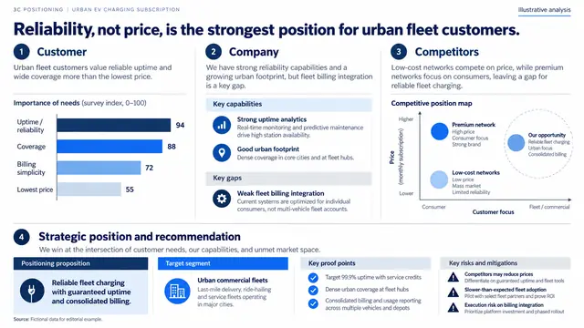</a><br><sub>Generated in Tosea</sub></p>

<details>
<summary><b>Prompt</b> (click to expand, then use the copy button)</summary>

```text
Build one 16:9 product positioning slide using the 3C framework.

Decision: Which position should our EV charging subscription own with urban fleet operators?

Show ranked customer criteria, a company capability scorecard with gaps, and competitors on a two-axis map. Finish with one value proposition, three proof points, and the main risks with mitigations. Preserve numbers, units, dates, and sources. If evidence is insufficient, mark the position unproven. Use navy, cyan, and gray with a conclusion-led headline.
```

</details>

**[→ Open on Tosea](https://tosea.ai/prompts/presentations/3c-analysis-prompts#tosea-073)** · part of [3C analysis prompts for PowerPoint](https://tosea.ai/prompts/presentations/3c-analysis-prompts) · from the guide [How to Make a McKinsey Strategy Consulting PowerPoint with AI: 3C and Value Chain](https://tosea.ai/blog/mckinsey-strategy-consulting-powerpoint-3c-value-chain)

---

<a id="tosea-074"></a>
### 16. Value chain cost reduction slide

`TOSEA-074` · Single slide · McKinsey-style

Maps cost share across primary and support activities, flags the three biggest drivers and ranks savings initiatives.

<p align="center"><a href="images/tosea-074.webp">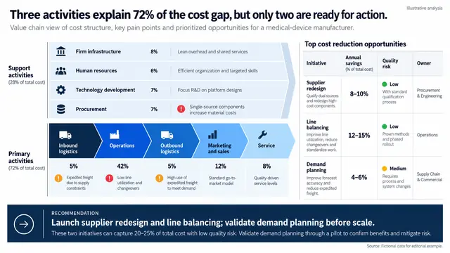</a><br><sub>Generated in Tosea</sub></p>

<details>
<summary><b>Prompt</b> (click to expand, then use the copy button)</summary>

```text
Create one 16:9 value chain cost-reduction slide for a medical-device manufacturer.

Map support activities above primary activities. Show each activity's share of total cost and check that the shares add up to 100%. Highlight the three largest cost drivers. Add an action panel with initiative, impact, quality risk, owner, and dependency. State how much of the gap the priorities explain. Use navy and blue with orange for risk. Keep calculations traceable and do not fabricate benchmarks.
```

</details>

**[→ Open on Tosea](https://tosea.ai/prompts/presentations/value-chain-analysis-prompts#tosea-074)** · part of [Value chain analysis prompts for PowerPoint](https://tosea.ai/prompts/presentations/value-chain-analysis-prompts) · from the guide [How to Make a McKinsey Strategy Consulting PowerPoint with AI: 3C and Value Chain](https://tosea.ai/blog/mckinsey-strategy-consulting-powerpoint-3c-value-chain)

---

<a id="tosea-075"></a>
### 17. Digital process redesign slide

`TOSEA-075` · Single slide · McKinsey-style

Compares current and future process flows by cycle time and handoffs, then sequences simplify, standardize, automate.

<p align="center"><a href="images/tosea-075.webp">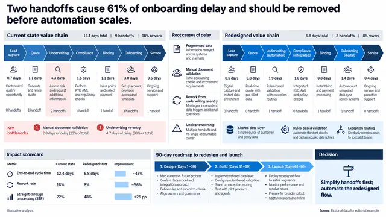</a><br><sub>Generated in Tosea</sub></p>

<details>
<summary><b>Prompt</b> (click to expand, then use the copy button)</summary>

```text
Design one 16:9 digital process redesign slide for insurance onboarding.

Compare current and future flows. Label stages with cycle time, handoffs, rework, and automation. Highlight the two largest bottlenecks and compare KPIs. Sequence the recommendation as simplify handoffs, standardize data, then automate. Use navy and blue, thin connectors, and restrained icons. Preserve source data, check that stage times add up to the stated totals, and separate assumptions from facts.
```

</details>

**[→ Open on Tosea](https://tosea.ai/prompts/presentations/value-chain-analysis-prompts#tosea-075)** · part of [Value chain analysis prompts for PowerPoint](https://tosea.ai/prompts/presentations/value-chain-analysis-prompts) · from the guide [How to Make a McKinsey Strategy Consulting PowerPoint with AI: 3C and Value Chain](https://tosea.ai/blog/mckinsey-strategy-consulting-powerpoint-3c-value-chain)

---

<a id="tosea-076"></a>
### 18. SCP market entry slide

`TOSEA-076` · Single slide · Bain-style

Links an external shock and market concentration to three entry options and a three-year performance view.

<p align="center"><a href="images/tosea-076.webp">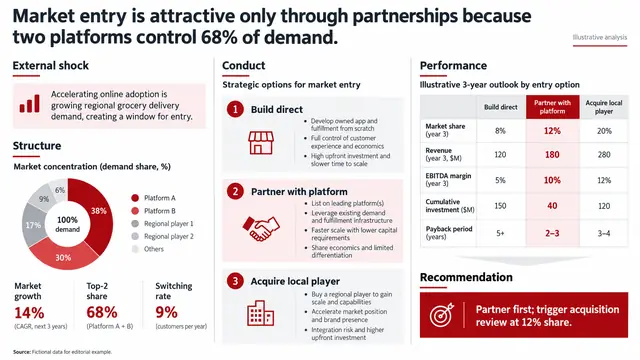</a><br><sub>Generated in Tosea</sub></p>

<details>
<summary><b>Prompt</b> (click to expand, then use the copy button)</summary>

```text
Create one 16:9 executive SCP market-entry slide. Define the market as [product, customer, geography, channel, period]. Use only verified inputs from [sources]. Show the external shock, market structure, conduct options, and 3-year performance scenarios. Include concentration, growth, switching, investment, share, margin, and payback where available. End with a conditional recommendation and trigger. Label assumptions and illustrative values. Do not invent data.
```

</details>

**[→ Open on Tosea](https://tosea.ai/prompts/presentations/scp-analysis-prompts#tosea-076)** · part of [SCP analysis prompts for PowerPoint](https://tosea.ai/prompts/presentations/scp-analysis-prompts) · from the guide [How to Build a Bain-Style SCP Analysis PowerPoint with AI: Complete Guide](https://tosea.ai/blog/bain-style-scp-analysis-powerpoint-ai-guide)

---

<a id="tosea-077"></a>
### 19. SCP pricing strategy slide

`TOSEA-077` · Single slide · Bain-style

Connects market structure to a new pricing approach and compares net price, margin and renewal before and after.

<p align="center"><a href="images/tosea-077.webp">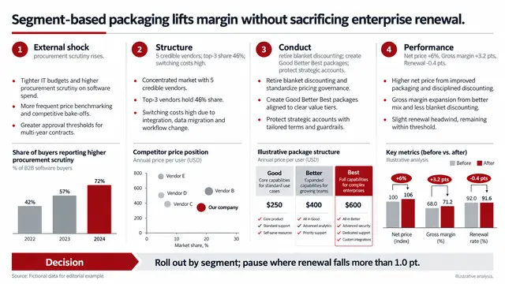</a><br><sub>Generated in Tosea</sub></p>

<details>
<summary><b>Prompt</b> (click to expand, then use the copy button)</summary>

```text
Build one 16:9 SCP pricing slide for [industry]. Use verified competitor prices, shares, switching evidence, customer segments, discounts, renewals, and margins. Show the external shock, structure, current conduct, proposed pricing conduct, and before-versus-after performance. Separate list price from realized net price. Add a rollout rule and a pause threshold. Preserve units, dates, and sources. Do not infer willingness to pay without evidence.
```

</details>

**[→ Open on Tosea](https://tosea.ai/prompts/presentations/scp-analysis-prompts#tosea-077)** · part of [SCP analysis prompts for PowerPoint](https://tosea.ai/prompts/presentations/scp-analysis-prompts) · from the guide [How to Build a Bain-Style SCP Analysis PowerPoint with AI: Complete Guide](https://tosea.ai/blog/bain-style-scp-analysis-powerpoint-ai-guide)

---

<a id="tosea-078"></a>
### 20. SCP supply risk and sourcing slide

`TOSEA-078` · Single slide · Bain-style

Compares staying outsourced, dual sourcing and integrating upstream under disruption scenarios, with a stated break point.

<p align="center"><a href="images/tosea-078.webp">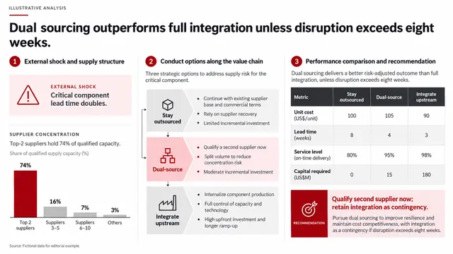</a><br><sub>Generated in Tosea</sub></p>

<details>
<summary><b>Prompt</b> (click to expand, then use the copy button)</summary>

```text
Create one 16:9 SCP supply-risk slide. Use these verified inputs: [supplier shares, qualified capacity, lead time, unit cost, service, capital, disruption scenarios]. Show the external shock and supply structure, then compare Stay outsourced, Dual-source, and Integrate upstream. Calculate performance under at least two disruption scenarios. State the break point at which the recommendation changes. Do not fabricate supplier capacity or savings.
```

</details>

**[→ Open on Tosea](https://tosea.ai/prompts/presentations/scp-analysis-prompts#tosea-078)** · part of [SCP analysis prompts for PowerPoint](https://tosea.ai/prompts/presentations/scp-analysis-prompts) · from the guide [How to Build a Bain-Style SCP Analysis PowerPoint with AI: Complete Guide](https://tosea.ai/blog/bain-style-scp-analysis-powerpoint-ai-guide)

---

<a id="tosea-079"></a>
### 21. SCP regulatory response slide

`TOSEA-079` · Single slide · Bain-style

Traces a rule change from shock to structure, conduct and performance, with a 90-day plan and four KPIs.

<p align="center"><a href="images/tosea-079.webp">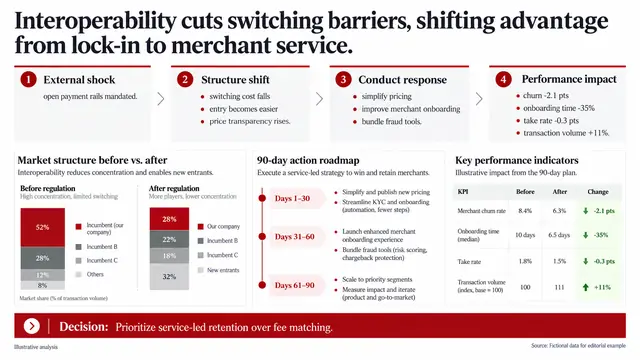</a><br><sub>Generated in Tosea</sub></p>

<details>
<summary><b>Prompt</b> (click to expand, then use the copy button)</summary>

```text
Create one 16:9 SCP regulatory-response slide for [industry and rule]. State the effective date and affected market boundary. Map the chain from external shock to structure shift, conduct response, and performance. Compare market structure before and after, add a 90-day action plan, and track four decision-relevant KPIs. Distinguish regulation text, management assumptions, and modeled effects. Do not claim causality beyond the evidence.
```

</details>

**[→ Open on Tosea](https://tosea.ai/prompts/presentations/scp-analysis-prompts#tosea-079)** · part of [SCP analysis prompts for PowerPoint](https://tosea.ai/prompts/presentations/scp-analysis-prompts) · from the guide [How to Build a Bain-Style SCP Analysis PowerPoint with AI: Complete Guide](https://tosea.ai/blog/bain-style-scp-analysis-powerpoint-ai-guide)

---

<a id="tosea-084"></a>
### 22. PDCA defect reduction slide

`TOSEA-084` · Single slide · Bain-style

Shows eight PDCA steps, a defect Pareto chart and before-and-after quality metrics, ending in a specific Act decision.

<p align="center"><a href="images/tosea-084.webp">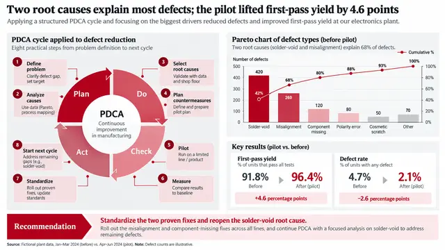</a><br><sub>Generated in Tosea</sub></p>

<details>
<summary><b>Prompt</b> (click to expand, then use the copy button)</summary>

```text
Create one 16:9 executive PDCA slide for manufacturing quality. Audience: plant leadership. Problem: [problem]. Use only these verified inputs: [baseline, defect categories, periods, root-cause evidence, pilot results, targets, sources]. Show the eight PDCA steps, a Pareto chart, and before-versus-after quality metrics. Distinguish proven fixes from unresolved causes. Write a conclusion-led title and a specific Act decision. Use a restrained red, charcoal, gray, and white consulting layout. Label illustrative or estimated values. Do not invent data.
```

</details>

**[→ Open on Tosea](https://tosea.ai/prompts/presentations/pdca-cycle-prompts#tosea-084)** · part of [PDCA cycle prompts for PowerPoint](https://tosea.ai/prompts/presentations/pdca-cycle-prompts) · from the guide [How to Build a Bain-Style PDCA Cycle PowerPoint with AI: Complete Guide](https://tosea.ai/blog/bain-style-pdca-cycle-powerpoint-ai-guide)

---

<a id="tosea-085"></a>
### 23. PDCA project recovery slide

`TOSEA-085` · Single slide · Bain-style

Puts baseline delivery metrics, a cause tree and a four-week pilot on one page, with three measurable gates for scaling.

<p align="center"><a href="images/tosea-085.webp">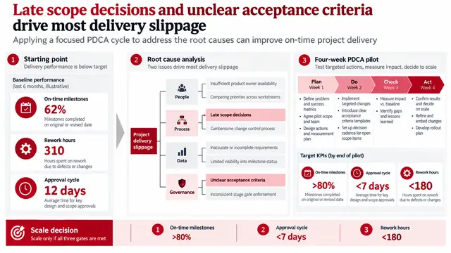</a><br><sub>Generated in Tosea</sub></p>

<details>
<summary><b>Prompt</b> (click to expand, then use the copy button)</summary>

```text
Build one 16:9 PDCA slide for a delayed project or transformation. Use these verified sources: [milestone data, rework, approval times, interviews, process evidence]. Show the baseline on the left, a cause tree in the center, and a four-week Plan-Do-Check-Act pilot on the right. Highlight no more than two primary causes. Define three measurable gates for scaling and include a stop condition. Write an action title that names the cause, not only the delay. Do not fabricate metrics.
```

</details>

**[→ Open on Tosea](https://tosea.ai/prompts/presentations/pdca-cycle-prompts#tosea-085)** · part of [PDCA cycle prompts for PowerPoint](https://tosea.ai/prompts/presentations/pdca-cycle-prompts) · from the guide [How to Build a Bain-Style PDCA Cycle PowerPoint with AI: Complete Guide](https://tosea.ai/blog/bain-style-pdca-cycle-powerpoint-ai-guide)

---

<a id="tosea-086"></a>
### 24. PDCA customer service improvement slide

`TOSEA-086` · Single slide · Bain-style

Breaks repeat contacts down by driver, builds a 5W2H pilot and sorts each fix into standardize, test, revise or stop.

<p align="center"><a href="images/tosea-086.webp">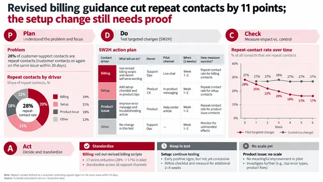</a><br><sub>Generated in Tosea</sub></p>

<details>
<summary><b>Prompt</b> (click to expand, then use the copy button)</summary>

```text
Create one 16:9 customer-service PDCA slide. Problem: [metric and definition]. Segment the baseline by contact driver, channel, or customer group. Use only verified data from [sources]. Build a 5W2H pilot plan with action, owner, channel, timing, and success measure. Compare pilot and control trends. In Act, classify each countermeasure as Standardize, Keep in test, Revise, or Stop. Add limitations and source notes. Do not invent causal claims.
```

</details>

**[→ Open on Tosea](https://tosea.ai/prompts/presentations/pdca-cycle-prompts#tosea-086)** · part of [PDCA cycle prompts for PowerPoint](https://tosea.ai/prompts/presentations/pdca-cycle-prompts) · from the guide [How to Build a Bain-Style PDCA Cycle PowerPoint with AI: Complete Guide](https://tosea.ai/blog/bain-style-pdca-cycle-powerpoint-ai-guide)

---

<a id="tosea-087"></a>
### 25. PDCA finance process cost slide

`TOSEA-087` · Single slide · Bain-style

Pilots process fixes, shows cost, cycle time and error rate before and after, and rates each action in a decision table.

<p align="center"><a href="images/tosea-087.webp">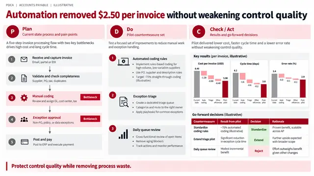</a><br><sub>Generated in Tosea</sub></p>

<details>
<summary><b>Prompt</b> (click to expand, then use the copy button)</summary>

```text
Create one 16:9 finance-process PDCA slide. Map the current process and mark the two largest verified bottlenecks. Pilot these countermeasures: [actions]. Show cost, cycle time, error rate, and control-quality measures before and after. Use a waterfall or variance chart for quantified effects. End with a decision table that labels each action Standardize, Extend, Revise, or Reject, with rationale and owner. Preserve units, periods, and sources. Do not invent savings.
```

</details>

**[→ Open on Tosea](https://tosea.ai/prompts/presentations/pdca-cycle-prompts#tosea-087)** · part of [PDCA cycle prompts for PowerPoint](https://tosea.ai/prompts/presentations/pdca-cycle-prompts) · from the guide [How to Build a Bain-Style PDCA Cycle PowerPoint with AI: Complete Guide](https://tosea.ai/blog/bain-style-pdca-cycle-powerpoint-ai-guide)

---

<a id="tosea-092"></a>
### 26. Executive decision storyline (10 slides)

`TOSEA-092` · Full deck · BCG-style

Builds a 10-slide strategy deck that runs from executive answer to decisions required, using only the attached sources.

<details>
<summary><b>Prompt</b> (click to expand, then use the copy button)</summary>

```text
Create a 10-slide executive strategy presentation based only on the attached source material.

Audience: specify the decision-maker by role
Decision: specify the required action
Evidence: preserve numbers, units, dates, definitions, and page references

Build the storyline in this order:
1. Executive answer
2. Context and decision criteria
3. Tension or performance gap
4. Evidence explaining the gap
5. Strategic options
6. Evaluation against explicit criteria
7. Recommendation and expected value
8. Risks and conditions
9. Implementation roadmap
10. Decisions required

Use action titles, a white canvas, forest green accents, charcoal text, mint structures, and gray. Prefer editable charts, tables, matrices, and diagrams. Add source lines and flag missing evidence.
```

</details>

**[→ Open on Tosea](https://tosea.ai/prompts/presentations/answer-first-storyline-prompts#tosea-092)** · part of [Answer-first storyline prompts for PowerPoint](https://tosea.ai/prompts/presentations/answer-first-storyline-prompts) · from the guide [How to Build a BCG-Style Storyline for a Strategy Consulting PowerPoint](https://tosea.ai/blog/bcg-storyline-consulting-powerpoint-template)

---

<a id="tosea-093"></a>
### 27. Top-down answer-first storyline

`TOSEA-093` · Full deck · BCG-style

Turns an analysis into one recommendation, three supporting arguments and one slide per argument, with no unsupported claims.

<p align="center"><a href="images/tosea-093.webp">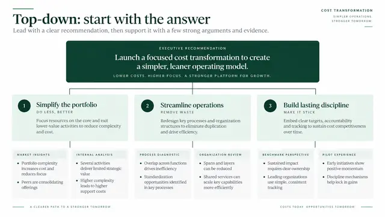</a><br><sub>Generated in Tosea</sub></p>

<details>
<summary><b>Prompt</b> (click to expand, then use the copy button)</summary>

```text
Turn the attached analysis into an answer-first consulting storyline.

Write one recommendation naming action, scope, timing, and expected effect. Break it into three arguments and map source-backed findings under each. Separate facts, assumptions, analysis, and recommendations.

Create one hierarchy summary and one slide per argument. Use conclusion titles, restrained green, thin connectors, consistent margins, and editable objects. Do not add unsupported claims.
```

</details>

**[→ Open on Tosea](https://tosea.ai/prompts/presentations/answer-first-storyline-prompts#tosea-093)** · part of [Answer-first storyline prompts for PowerPoint](https://tosea.ai/prompts/presentations/answer-first-storyline-prompts) · from the guide [How to Build a BCG-Style Storyline for a Strategy Consulting PowerPoint](https://tosea.ai/blog/bcg-storyline-consulting-powerpoint-template)

---

<a id="tosea-094"></a>
### 28. Bottom-up evidence synthesis slide

`TOSEA-094` · Single slide · BCG-style

Groups scattered research findings into themes, keeps contradictions and ends in a decision, after an evidence inventory.

<p align="center"><a href="images/tosea-094.webp">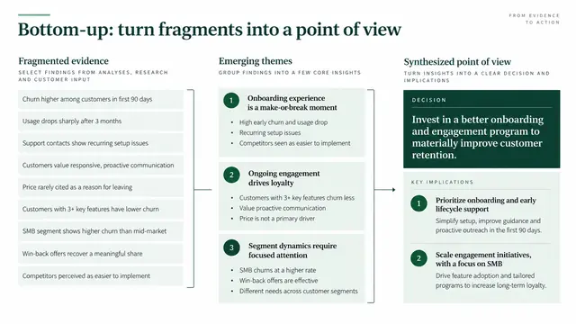</a><br><sub>Generated in Tosea</sub></p>

<details>
<summary><b>Prompt</b> (click to expand, then use the copy button)</summary>

```text
Synthesize the attached research into a bottom-up consulting storyline.

Extract source-linked findings. Remove duplicates but preserve contradictions. Group findings by meaning, name each theme as an insight, then write one point of view, two implications, and a decision.

Before rendering, provide an evidence inventory, proposed groups, gaps, and draft action titles. Create an editable evidence-to-themes-to-decision slide in white, dark green, mint, charcoal, and gray.
```

</details>

**[→ Open on Tosea](https://tosea.ai/prompts/presentations/answer-first-storyline-prompts#tosea-094)** · part of [Answer-first storyline prompts for PowerPoint](https://tosea.ai/prompts/presentations/answer-first-storyline-prompts) · from the guide [How to Build a BCG-Style Storyline for a Strategy Consulting PowerPoint](https://tosea.ai/blog/bcg-storyline-consulting-powerpoint-template)

---

<a id="tosea-095"></a>
### 29. 5W2H and Garbage Can decision framing slide

`TOSEA-095` · Single slide · Bain-style

Frames a messy decision with a 5W2H canvas and maps where problems, solutions, people and timing fail to meet.

<p align="center"><a href="images/tosea-095.webp">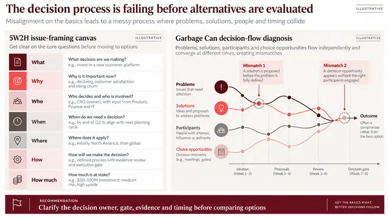</a><br><sub>Generated in Tosea</sub></p>

<details>
<summary><b>Prompt</b> (click to expand, then use the copy button)</summary>

```text
Create one executive decision-framing slide from the attached notes and meeting records. Build a 5W2H canvas covering What, Why, Who, When, Where, How, and How much. On the same page, map Problems, Solutions, Participants, and Choice opportunities across time. Identify where these streams fail to meet. Write a conclusion-led title and recommend one governance change. Use only source evidence and label unresolved questions instead of inventing answers.
```

</details>

**[→ Open on Tosea](https://tosea.ai/prompts/presentations/decision-making-framework-prompts#tosea-095)** · part of [Decision-making framework prompts for PowerPoint](https://tosea.ai/prompts/presentations/decision-making-framework-prompts) · from the guide [How to Build a Bain-Style Consulting PowerPoint with 10 Decision-Making Frameworks](https://tosea.ai/blog/bain-style-powerpoint-decision-making-frameworks)

---

<a id="tosea-097"></a>
### 30. Delphi method forecast slide

`TOSEA-097` · Single slide · Bain-style

Plots every expert estimate by round with median and interquartile range, separating consensus from disagreement.

<p align="center"><a href="images/tosea-097.webp">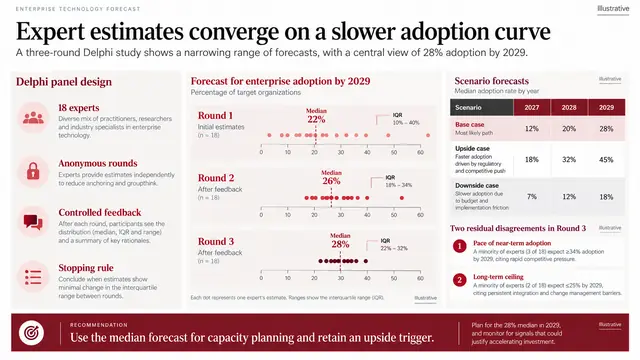</a><br><sub>Generated in Tosea</sub></p>

<details>
<summary><b>Prompt</b> (click to expand, then use the copy button)</summary>

```text
Build a Delphi forecasting slide from the attached round-level responses. State the expert panel size and composition, anonymity protocol, feedback process, and stopping rule. Plot every response for each round, then show the median, interquartile range, and change between rounds. Separate consensus from unresolved disagreement. Do not remove outliers without a documented rule. End with the planning assumption and the trigger that would justify revising it.
```

</details>

**[→ Open on Tosea](https://tosea.ai/prompts/presentations/decision-making-framework-prompts#tosea-097)** · part of [Decision-making framework prompts for PowerPoint](https://tosea.ai/prompts/presentations/decision-making-framework-prompts) · from the guide [How to Build a Bain-Style Consulting PowerPoint with 10 Decision-Making Frameworks](https://tosea.ai/blog/bain-style-powerpoint-decision-making-frameworks)

---

<a id="tosea-098"></a>
### 31. Kepner-Tregoe decision analysis slide

`TOSEA-098` · Single slide · Bain-style

Screens options on MUST criteria, scores WANTs with disclosed weights and adds a decision tree only when data allows.

<p align="center"><a href="images/tosea-098.webp">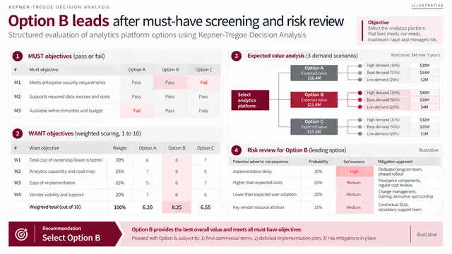</a><br><sub>Generated in Tosea</sub></p>

<details>
<summary><b>Prompt</b> (click to expand, then use the copy button)</summary>

```text
Create one Kepner-Tregoe Decision Analysis slide for the attached alternatives. State the decision objective. Separate MUST objectives from WANT objectives. Eliminate any option that fails a MUST. Weight the WANT objectives, score each feasible option on one disclosed scale, and show the weighted totals. Add a decision tree only where source data provides probabilities and outcomes, and report the break-even probability if the ranking changes between branches. Review adverse consequences for the leading option and list mitigations. Recalculate every total and flag missing evidence.
```

</details>

**[→ Open on Tosea](https://tosea.ai/prompts/presentations/decision-making-framework-prompts#tosea-098)** · part of [Decision-making framework prompts for PowerPoint](https://tosea.ai/prompts/presentations/decision-making-framework-prompts) · from the guide [How to Build a Bain-Style Consulting PowerPoint with 10 Decision-Making Frameworks](https://tosea.ai/blog/bain-style-powerpoint-decision-making-frameworks)

---

<a id="tosea-099"></a>
### 32. Financial health diagnosis slide

`TOSEA-099` · Single slide · Bain-style

Combines ratio KPI cards, a benchmark radar chart and a weighted Wall scorecard, with formulas in the footnote.

<p align="center"><a href="images/tosea-099.webp">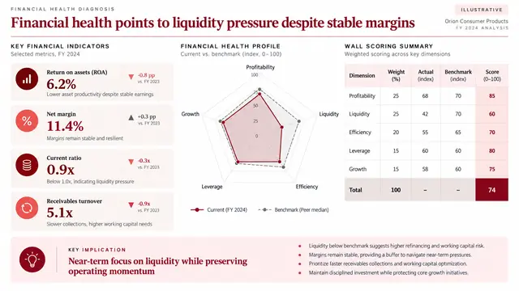</a><br><sub>Generated in Tosea</sub></p>

<details>
<summary><b>Prompt</b> (click to expand, then use the copy button)</summary>

```text
Create one executive financial health slide for a management review. Use the attached financial statements and peer benchmarks. Calculate profitability, liquidity, efficiency, leverage, and growth ratios. Build a weighted Wall scorecard with weights totaling 100 percent, a current-versus-benchmark radar chart, and four KPI cards. State the main implication in the title. Show formulas, period, units, benchmark source, the dimension scoring rule, and any score caps in a footnote. Do not invent missing values. Flag every assumption for review.
```

</details>

**[→ Open on Tosea](https://tosea.ai/prompts/presentations/bain-style-diagnostic-prompts#tosea-099)** · part of [Bain-style diagnostic prompts for PowerPoint](https://tosea.ai/prompts/presentations/bain-style-diagnostic-prompts) · from the guide [How to Build a Bain-Style Consulting PowerPoint: 18 Finance, Project and Supply Chain Frameworks](https://tosea.ai/blog/bain-style-consulting-powerpoint-18-frameworks)

---

<a id="tosea-100"></a>
### 33. Cost and capital allocation slide

`TOSEA-100` · Single slide · Bain-style

Puts activity-based costing, CVP break-even, NPV and EVA, and a zero-based budget shift on one decision slide.

<p align="center"><a href="images/tosea-100.webp">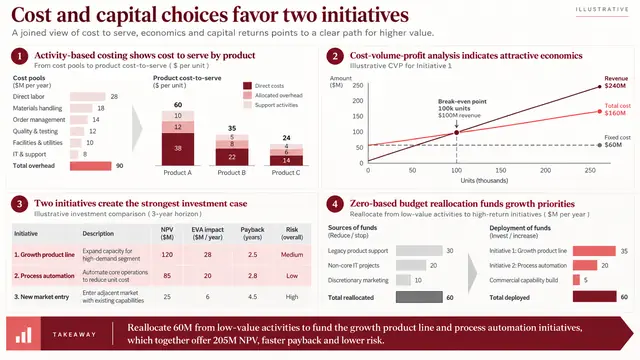</a><br><sub>Generated in Tosea</sub></p>

<details>
<summary><b>Prompt</b> (click to expand, then use the copy button)</summary>

```text
Build a four-panel investment decision slide from the attached cost model and project forecasts. Panel 1 allocates overhead through Activity-Based Costing. Panel 2 shows the Cost-Volume-Profit break-even point, the relevant range, and downside sensitivity. Panel 3 compares NPV, annual EVA impact, payback, and risk for each initiative using one discount rate and horizon. Panel 4 shows a zero-based budget reallocation with sources equal to uses. Use only supplied values, identify inconsistent assumptions, and write a conclusion-led title that recommends an action.
```

</details>

**[→ Open on Tosea](https://tosea.ai/prompts/presentations/bain-style-diagnostic-prompts#tosea-100)** · part of [Bain-style diagnostic prompts for PowerPoint](https://tosea.ai/prompts/presentations/bain-style-diagnostic-prompts) · from the guide [How to Build a Bain-Style Consulting PowerPoint: 18 Finance, Project and Supply Chain Frameworks](https://tosea.ai/blog/bain-style-consulting-powerpoint-18-frameworks)

---

<a id="tosea-101"></a>
### 34. Supply chain operating model slide

`TOSEA-101` · Single slide · Bain-style

Maps SCOR stages against KPI targets, flags bottlenecks, adds a VMI reorder loop and ties ECR and green actions to decisions.

<p align="center"><a href="images/tosea-101.webp">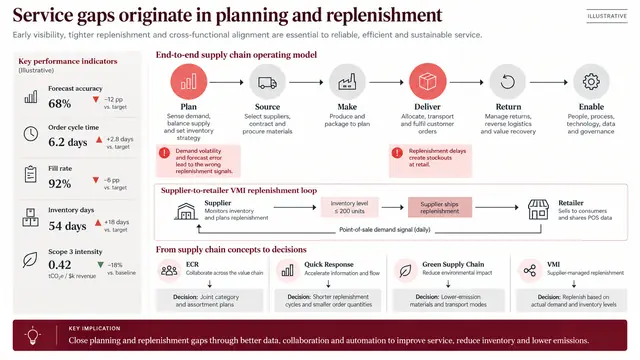</a><br><sub>Generated in Tosea</sub></p>

<details>
<summary><b>Prompt</b> (click to expand, then use the copy button)</summary>

```text
Create an end-to-end supply chain diagnosis using the attached service, inventory, lead-time, and emissions data. Map Plan, Source, Make, Deliver, Return, and Enable, and state the SCOR version used. Show every KPI against its target and highlight no more than three bottlenecks. Add a VMI replenishment loop with the reorder point calculated from demand, lead time, and safety stock. Connect ECR, Quick Response, and Green Supply Chain actions to measurable decisions, each with baseline, target, owner, and timing. Label missing evidence instead of estimating it.
```

</details>

**[→ Open on Tosea](https://tosea.ai/prompts/presentations/bain-style-diagnostic-prompts#tosea-101)** · part of [Bain-style diagnostic prompts for PowerPoint](https://tosea.ai/prompts/presentations/bain-style-diagnostic-prompts) · from the guide [How to Build a Bain-Style Consulting PowerPoint: 18 Finance, Project and Supply Chain Frameworks](https://tosea.ai/blog/bain-style-consulting-powerpoint-18-frameworks)

---

<a id="tosea-102"></a>
### 35. Project delivery control slide

`TOSEA-102` · Single slide · Bain-style

Combines a WBS, a RACI with one accountable owner per row, a PERT critical path and a logical framework.

<p align="center"><a href="images/tosea-102.webp">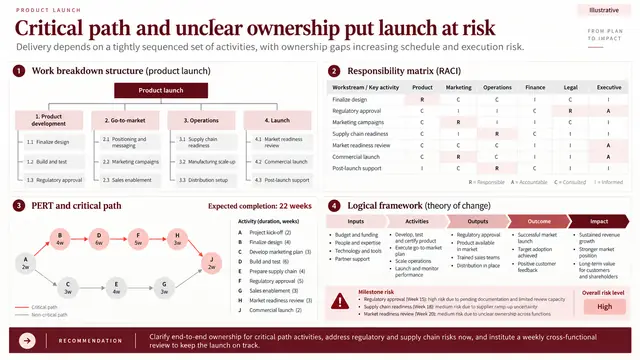</a><br><sub>Generated in Tosea</sub></p>

<details>
<summary><b>Prompt</b> (click to expand, then use the copy button)</summary>

```text
Turn the attached project plan into a delivery-control slide. Build a deliverable-based Work Breakdown Structure, a RACI matrix with exactly one accountable owner per activity, and a network plan with the critical path and float highlighted. Where three-point estimates exist, calculate the PERT expected duration and standard deviation, and show the date at 50 and 90 percent confidence. Add an inputs-to-impact logical framework and list the three milestones most at risk. Preserve all source dates and flag dependency conflicts and RACI rows without an owner.
```

</details>

**[→ Open on Tosea](https://tosea.ai/prompts/presentations/bain-style-diagnostic-prompts#tosea-102)** · part of [Bain-style diagnostic prompts for PowerPoint](https://tosea.ai/prompts/presentations/bain-style-diagnostic-prompts) · from the guide [How to Build a Bain-Style Consulting PowerPoint: 18 Finance, Project and Supply Chain Frameworks](https://tosea.ai/blog/bain-style-consulting-powerpoint-18-frameworks)

---

<a id="tosea-103"></a>
### 36. SPACE matrix aggressive posture slide

`TOSEA-103` · Single slide · Bain-style

Calculates FS, CA, ES and IS averages, plots the vector and recommends up to three sequenced growth moves.

<p align="center"><a href="images/tosea-103.webp">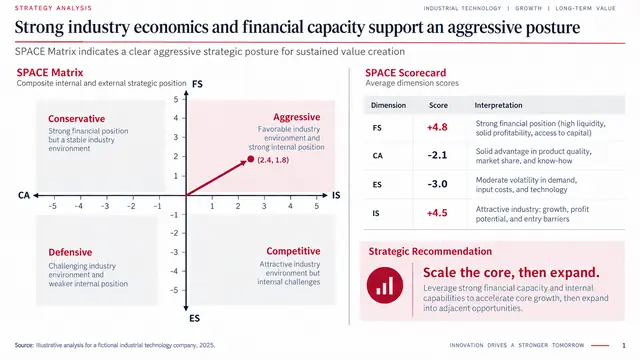</a><br><sub>Generated in Tosea</sub></p>

<details>
<summary><b>Prompt</b> (click to expand, then use the copy button)</summary>

```text
Create one 16:9 executive strategy slide using a SPACE Matrix. Audience: executive committee. Company: [company]. Decision: [decision]. Use only the verified data below: [FS, CA, ES, IS variables, scores, dates, and sources]. Calculate the four dimension averages, X coordinate, and Y coordinate. Plot a vector from the origin. Place the matrix on the left and a scorecard plus recommendation on the right. Write a conclusion-led title. Recommend no more than three sequenced growth moves. Add assumptions, decision gates, and source notes. Use a restrained red, charcoal, gray, and white consulting layout. Do not invent data.
```

</details>

**[→ Open on Tosea](https://tosea.ai/prompts/presentations/space-matrix-prompts#tosea-103)** · part of [SPACE matrix prompts for PowerPoint](https://tosea.ai/prompts/presentations/space-matrix-prompts) · from the guide [How to Build a Bain-Style SPACE Matrix PowerPoint with AI: Complete Guide](https://tosea.ai/blog/bain-style-space-matrix-powerpoint-ai-guide)

---

<a id="tosea-104"></a>
### 37. SPACE matrix conservative posture slide

`TOSEA-104` · Single slide · Bain-style

Explains the two variables behind a conservative vector and splits actions into protect, extend and preserve.

<p align="center"><a href="images/tosea-104.webp">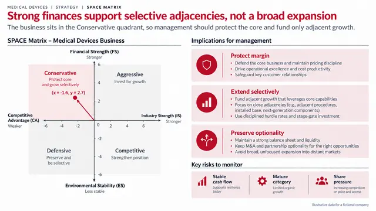</a><br><sub>Generated in Tosea</sub></p>

<details>
<summary><b>Prompt</b> (click to expand, then use the copy button)</summary>

```text
Build one 16:9 SPACE Matrix slide for a conservative strategic posture. Use these verified inputs: [paste data and sources]. Show the vector and explain the two variables that most influenced the result. Divide the right side into Protect margin, Extend selectively, and Preserve optionality. For each action, state the owner, investment limit, evidence gate, and review date. Use a conclusion-led title and restrained consulting typography. Label all forecast values and assumptions. Do not fabricate evidence.
```

</details>

**[→ Open on Tosea](https://tosea.ai/prompts/presentations/space-matrix-prompts#tosea-104)** · part of [SPACE matrix prompts for PowerPoint](https://tosea.ai/prompts/presentations/space-matrix-prompts) · from the guide [How to Build a Bain-Style SPACE Matrix PowerPoint with AI: Complete Guide](https://tosea.ai/blog/bain-style-space-matrix-powerpoint-ai-guide)

---

<a id="tosea-105"></a>
### 38. SPACE matrix competitive posture slide

`TOSEA-105` · Single slide · Bain-style

Focuses investment on one segment with three actions, quantified stage gates and a stop condition for each.

<p align="center"><a href="images/tosea-105.webp">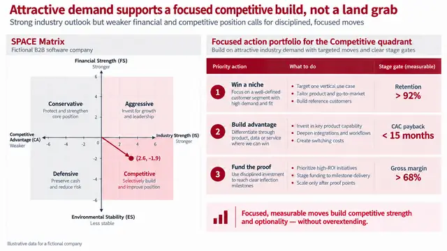</a><br><sub>Generated in Tosea</sub></p>

<details>
<summary><b>Prompt</b> (click to expand, then use the copy button)</summary>

```text
Create one 16:9 competitive-posture SPACE Matrix slide for [company]. Verified inputs: [data and sources]. Plot the calculated vector. Identify one customer segment or use case where the company can build advantage. Add three priority actions with quantified stage gates. Include a stop condition for each action. Write a title that states why focused investment is preferable to broad expansion. Use red only for the chosen path and key numbers. Keep the source note visible. Do not invent metrics.
```

</details>

**[→ Open on Tosea](https://tosea.ai/prompts/presentations/space-matrix-prompts#tosea-105)** · part of [SPACE matrix prompts for PowerPoint](https://tosea.ai/prompts/presentations/space-matrix-prompts) · from the guide [How to Build a Bain-Style SPACE Matrix PowerPoint with AI: Complete Guide](https://tosea.ai/blog/bain-style-space-matrix-powerpoint-ai-guide)

---

<a id="tosea-106"></a>
### 39. SPACE matrix defensive posture slide

`TOSEA-106` · Single slide · Bain-style

Builds a 90-day cash-first plan across liquidity, portfolio, cost base and exit triggers, with a cash bridge.

<p align="center"><a href="images/tosea-106.webp">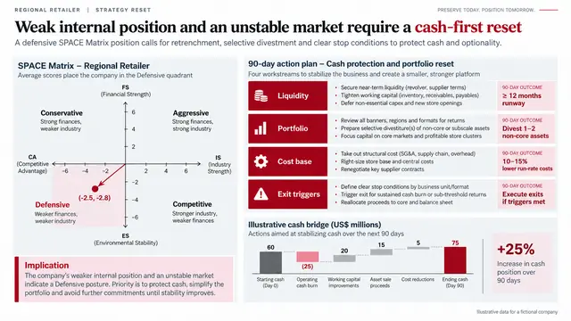</a><br><sub>Generated in Tosea</sub></p>

<details>
<summary><b>Prompt</b> (click to expand, then use the copy button)</summary>

```text
Create one 16:9 defensive SPACE Matrix slide. Company: [company]. Use only these verified inputs: [scores, cash, debt, working capital, portfolio performance, market evidence, sources]. Plot the vector and state why the business falls in the defensive quadrant. Build a 90-day plan covering liquidity, portfolio, cost base, and exit triggers. Add a cash bridge and identify which figures are actuals, forecasts, or assumptions. Use a restrained executive layout. Do not invent values or soften downside risks.
```

</details>

**[→ Open on Tosea](https://tosea.ai/prompts/presentations/space-matrix-prompts#tosea-106)** · part of [SPACE matrix prompts for PowerPoint](https://tosea.ai/prompts/presentations/space-matrix-prompts) · from the guide [How to Build a Bain-Style SPACE Matrix PowerPoint with AI: Complete Guide](https://tosea.ai/blog/bain-style-space-matrix-powerpoint-ai-guide)

---

<a id="tosea-131"></a>
### 40. GE-McKinsey matrix portfolio overview

`TOSEA-131` · Single slide · McKinsey-style

Plots business units on a nine-box grid with revenue-sized bubbles and a capital allocation panel.

<p align="center"><a href="images/tosea-131.webp">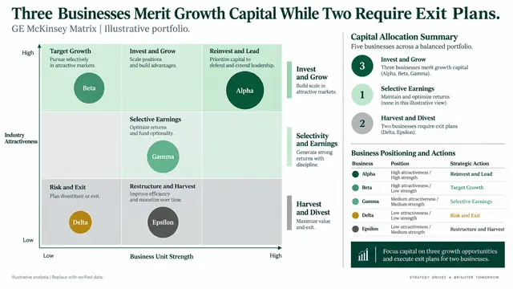</a><br><sub>Generated in Tosea</sub></p>

<details>
<summary><b>Prompt</b> (click to expand, then use the copy button)</summary>

```text
Create a 16:9 executive strategy slide titled Portfolio choices favor Digital Services and Specialty Solutions. Build a GE McKinsey nine-box matrix with industry attractiveness on the vertical axis and business unit strength on the horizontal axis. Plot five labeled bubbles sized by annual revenue. Use dark green for invest and grow, pale green for selective investment, and light gray for harvest or divest. Add a right-side panel with three portfolio recommendations, capital implications, and one key risk. Use a clean white background, precise alignment, restrained icons, small source notes, and editable chart elements. Do not add company logos.
```

</details>

**[→ Open on Tosea](https://tosea.ai/prompts/presentations/ge-mckinsey-matrix-prompts#tosea-131)** · part of [GE-McKinsey Matrix prompts for PowerPoint](https://tosea.ai/prompts/presentations/ge-mckinsey-matrix-prompts) · from the guide [How to Build a BCG-Style GE McKinsey Matrix PowerPoint with AI](https://tosea.ai/blog/ge-mckinsey-matrix-powerpoint-ai-guide)

---

<a id="tosea-132"></a>
### 41. GE-McKinsey matrix scoring model slide

`TOSEA-132` · Single slide · McKinsey-style

Shows weighted attractiveness and strength tables that each total 100 percent, with a sensitivity check on key assumptions.

<p align="center"><a href="images/tosea-132.webp">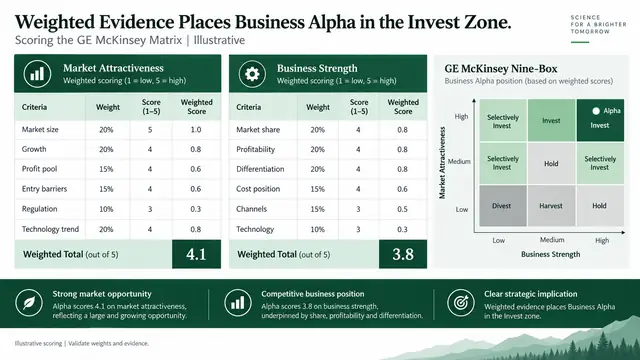</a><br><sub>Generated in Tosea</sub></p>

<details>
<summary><b>Prompt</b> (click to expand, then use the copy button)</summary>

```text
Design a 16:9 methodology slide titled Weighted evidence places Business A in the invest zone. Show two compact scoring tables: industry attractiveness and business unit strength. Include criterion, weight, score from 1 to 5, weighted result, source, and confidence. Weights must total 100 percent for each axis. Add the weighted score formula, a small sensitivity chart for the top three assumptions, and a conclusion box. Use a dark green, mint, charcoal, and white consulting palette with editable tables and no decorative photography.
```

</details>

**[→ Open on Tosea](https://tosea.ai/prompts/presentations/ge-mckinsey-matrix-prompts#tosea-132)** · part of [GE-McKinsey Matrix prompts for PowerPoint](https://tosea.ai/prompts/presentations/ge-mckinsey-matrix-prompts) · from the guide [How to Build a BCG-Style GE McKinsey Matrix PowerPoint with AI](https://tosea.ai/blog/ge-mckinsey-matrix-powerpoint-ai-guide)

---

<a id="tosea-133"></a>
### 42. GE-McKinsey invest and grow slide

`TOSEA-133` · Single slide · McKinsey-style

Turns an invest-and-grow position into a three-year roadmap with value drivers, milestone KPIs and risk controls.

<p align="center"><a href="images/tosea-133.webp">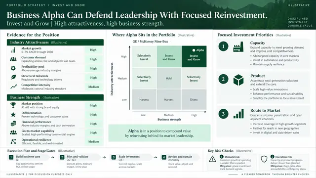</a><br><sub>Generated in Tosea</sub></p>

<details>
<summary><b>Prompt</b> (click to expand, then use the copy button)</summary>

```text
Create a green consulting-style recommendation slide for a business in the invest and grow zone. Use an action title stating that targeted investment can extend market leadership. Include a highlighted nine-box matrix, a three-year investment roadmap, three value drivers, required capabilities, milestone KPIs, and a risk-control panel. Show sample figures clearly as illustrative. Prioritize one message per visual, generous white space, editable shapes, and a concise source footer.
```

</details>

**[→ Open on Tosea](https://tosea.ai/prompts/presentations/ge-mckinsey-matrix-prompts#tosea-133)** · part of [GE-McKinsey Matrix prompts for PowerPoint](https://tosea.ai/prompts/presentations/ge-mckinsey-matrix-prompts) · from the guide [How to Build a BCG-Style GE McKinsey Matrix PowerPoint with AI](https://tosea.ai/blog/ge-mckinsey-matrix-powerpoint-ai-guide)

---

<a id="tosea-134"></a>
### 43. GE-McKinsey selectivity and earnings slide

`TOSEA-134` · Single slide · McKinsey-style

Sorts initiatives into fund, test, maintain and stop, with return thresholds, cash impact, owners and decision gates.

<p align="center"><a href="images/tosea-134.webp"></a><br><sub>Generated in Tosea</sub></p>

<details>
<summary><b>Prompt</b> (click to expand, then use the copy button)</summary>

```text
Build a 16:9 portfolio slide for a business in the selectivity and earnings zone. The action title should state that focused investment protects earnings while limiting exposure. Show the business position on a nine-box matrix, then divide initiatives into fund, test, maintain, and stop. Add return thresholds, cash impact, owner, timing, and decision gates. Use a white background, dark green headings, mint highlights, charcoal text, and an evidence-based consulting layout with fully editable elements.
```

</details>

**[→ Open on Tosea](https://tosea.ai/prompts/presentations/ge-mckinsey-matrix-prompts#tosea-134)** · part of [GE-McKinsey Matrix prompts for PowerPoint](https://tosea.ai/prompts/presentations/ge-mckinsey-matrix-prompts) · from the guide [How to Build a BCG-Style GE McKinsey Matrix PowerPoint with AI](https://tosea.ai/blog/ge-mckinsey-matrix-powerpoint-ai-guide)

---

<a id="tosea-135"></a>
### 44. GE-McKinsey harvest or divest options slide

`TOSEA-135` · Single slide · McKinsey-style

Compares harvest, restructure, sell and exit by cash released, time, cost and trigger, then adds a 100-day plan.

<p align="center"><a href="images/tosea-135.webp"></a><br><sub>Generated in Tosea</sub></p>

<details>
<summary><b>Prompt</b> (click to expand, then use the copy button)</summary>

```text
Create an executive options slide for a business in the harvest or divest zone. Include a highlighted nine-box position and compare four paths: harvest, restructure, sell, and exit. For each path show cash released, execution time, one-time cost, major risk, and trigger condition. Add a recommended path, a 100-day plan, and decision dependencies. Use subdued green and gray, simple tables, clear hierarchy, editable objects, and an explicit note that all numbers are illustrative.
```

</details>

**[→ Open on Tosea](https://tosea.ai/prompts/presentations/ge-mckinsey-matrix-prompts#tosea-135)** · part of [GE-McKinsey Matrix prompts for PowerPoint](https://tosea.ai/prompts/presentations/ge-mckinsey-matrix-prompts) · from the guide [How to Build a BCG-Style GE McKinsey Matrix PowerPoint with AI](https://tosea.ai/blog/ge-mckinsey-matrix-powerpoint-ai-guide)

---

<a id="tosea-136"></a>
### 45. BCG growth-share matrix slide

`TOSEA-136` · Single slide · BCG-style

Plots business units by market growth and relative share and gives each one capital action: invest, fund, test, reposition or exit.

<p align="center"><a href="images/tosea-136.webp"></a><br><sub>Generated in Tosea</sub></p>

<details>
<summary><b>Prompt</b> (click to expand, then use the copy button)</summary>

```text
Create one 16:9 executive portfolio strategy slide using a Growth-Share Matrix.
Audience: [executive committee]
Decision: [capital allocation decision]
Business units: [list]
Verified inputs: [market growth, company share, largest competitor share, revenue, sources]
Calculate relative market share consistently and size each bubble by [metric].
Label Stars, Cash Cows, Question Marks, and Pets.
Add one proposed action per business: invest, fund, test, reposition, or exit.
Write a conclusion-led title and include assumptions and source notes.
Use forest green, mint, charcoal, white, and pale gray.
Do not invent data or use BCG logos.
```

</details>

**[→ Open on Tosea](https://tosea.ai/prompts/presentations/bcg-growth-share-matrix-prompt#tosea-136)** · part of [BCG Growth-Share Matrix prompt for PowerPoint](https://tosea.ai/prompts/presentations/bcg-growth-share-matrix-prompt) · from the guide [Best BCG Strategy Consulting PowerPoint Templates: 5 Frameworks and AI Prompts](https://tosea.ai/blog/best-bcg-strategy-consulting-powerpoint-templates)

---

<a id="tosea-137"></a>
### 46. Experience curve slide

`TOSEA-137` · Single slide · BCG-style

Plots real unit cost against cumulative volume, estimates the cost change per doubling and keeps forecasts apart from actuals.

<p align="center"><a href="images/tosea-137.webp"></a><br><sub>Generated in Tosea</sub></p>

<details>
<summary><b>Prompt</b> (click to expand, then use the copy button)</summary>

```text
Create one 16:9 Experience Curve slide for [product or operation].
Decision: [pricing, capacity, sourcing, or investment decision]
Use only these verified data: [date, cumulative volume, unit cost, inflation adjustment, sources].
Plot real unit cost against cumulative volume and estimate the cost change per doubling.
Separate actual observations from forecasts.
Show the contribution of process learning, scale, sourcing, and design changes where supported.
State the commercial implication and one risk to the curve.
Use a restrained green consulting layout with an action title and source footer.
Do not fabricate missing observations.
```

</details>

**[→ Open on Tosea](https://tosea.ai/prompts/presentations/experience-curve-prompt#tosea-137)** · part of [Experience curve prompt for PowerPoint](https://tosea.ai/prompts/presentations/experience-curve-prompt) · from the guide [Best BCG Strategy Consulting PowerPoint Templates: 5 Frameworks and AI Prompts](https://tosea.ai/blog/best-bcg-strategy-consulting-powerpoint-templates)

---

<a id="tosea-138"></a>
### 47. Three Cs strategy slide

`TOSEA-138` · Single slide · BCG-style

Overlaps customer, company and competitor evidence to state one specific strategic position and one open question.

<p align="center"><a href="images/tosea-138.webp"></a><br><sub>Generated in Tosea</sub></p>

<details>
<summary><b>Prompt</b> (click to expand, then use the copy button)</summary>

```text
Create one 16:9 Three Cs strategy slide.
Audience: [decision makers]
Decision: [where to compete and how to win]
Customer evidence: [needs, behavior, willingness to pay, segment economics, sources]
Company evidence: [capabilities, assets, economics, constraints, sources]
Competitor evidence: [offers, prices, channels, strengths, likely response, sources]
Identify the evidence-backed overlap and write it as a specific strategic position.
Show one unresolved question if the evidence is incomplete.
Use an original forest-green consulting design, concise labels, and source notes.
```

</details>

**[→ Open on Tosea](https://tosea.ai/prompts/presentations/3c-analysis-prompts#tosea-138)** · part of [3C analysis prompts for PowerPoint](https://tosea.ai/prompts/presentations/3c-analysis-prompts) · from the guide [Best BCG Strategy Consulting PowerPoint Templates: 5 Frameworks and AI Prompts](https://tosea.ai/blog/best-bcg-strategy-consulting-powerpoint-templates)

---

<a id="tosea-139"></a>
### 48. Four Ds action matrix slide

`TOSEA-139` · Single slide · BCG-style

Places options on attractiveness versus right to win and assigns Defend, Disrupt, Divest or Develop Together to each.

<p align="center"><a href="images/tosea-139.webp"></a><br><sub>Generated in Tosea</sub></p>

<details>
<summary><b>Prompt</b> (click to expand, then use the copy button)</summary>

```text
Create one 16:9 Four Ds action matrix using Defend, Disrupt, Divest, and Develop Together.
This is a practical synthesis, not an official BCG model.
Options: [list]
Verified evidence: [market attractiveness, profit potential, capabilities, access, differentiation, sources]
Score each option with a disclosed scale and weighting.
Place the options on attractiveness versus right to win.
Recommend one action per option and state the trigger, owner, and next test.
Use an action title, forest green palette, pale green panels, and a compact methodology note.
Do not invent scores.
```

</details>

**[→ Open on Tosea](https://tosea.ai/prompts/presentations/four-ds-strategy-prompt#tosea-139)** · part of [Four Ds strategy matrix prompt for PowerPoint](https://tosea.ai/prompts/presentations/four-ds-strategy-prompt) · from the guide [Best BCG Strategy Consulting PowerPoint Templates: 5 Frameworks and AI Prompts](https://tosea.ai/blog/best-bcg-strategy-consulting-powerpoint-templates)

---

<a id="tosea-140"></a>
### 49. Evidence-led SWOT analysis slide

`TOSEA-140` · Single slide · BCG-style

Limits each SWOT quadrant to two decision-relevant facts and converts them into three sourced strategic moves.

<p align="center"><a href="images/tosea-140.webp"></a><br><sub>Generated in Tosea</sub></p>

<details>
<summary><b>Prompt</b> (click to expand, then use the copy button)</summary>

```text
Create one 16:9 evidence-led SWOT slide for [company and decision].
Use only the attached sources and these verified facts: [paste evidence].
Classify internal facts as Strengths or Weaknesses and external facts as Opportunities or Threats.
Limit each quadrant to the two most decision-relevant points.
Convert the findings into three strategic moves: use a strength, fix a weakness, and mitigate a threat.
Write a conclusion-led title that states the preferred move.
Add a source note for every material claim and flag evidence gaps.
Use a restrained green consulting layout without company logos.
```

</details>

**[→ Open on Tosea](https://tosea.ai/prompts/presentations/swot-analysis-prompt#tosea-140)** · part of [SWOT analysis prompt for PowerPoint](https://tosea.ai/prompts/presentations/swot-analysis-prompt) · from the guide [Best BCG Strategy Consulting PowerPoint Templates: 5 Frameworks and AI Prompts](https://tosea.ai/blog/best-bcg-strategy-consulting-powerpoint-templates)

---

<a id="tosea-141"></a>
### 50. Ansoff market penetration slide

`TOSEA-141` · Single slide · PwC-style

Builds a revenue driver tree and a bridge from baseline to target for growing existing products in existing markets.

<p align="center"><a href="images/tosea-141.webp"></a><br><sub>Generated in Tosea</sub></p>

<details>
<summary><b>Prompt</b> (click to expand, then use the copy button)</summary>

```text
Create one 16:9 executive strategy slide for market penetration. Audience: [leadership team]. Business: [company and product]. Decision required: [decision]. Use only the verified data below: [paste data and sources]. Build a driver tree covering acquisition, conversion, purchase frequency, retention, pricing, and cross-sell. Add a revenue bridge from the current baseline to the target. Write an action title that states the main implication. Use a restrained consulting layout with white space, charcoal text, muted burgundy accents, and one warm highlight color. Label estimates and assumptions clearly. Do not invent numbers. Add source notes and a recommendation box.
```

</details>

**[→ Open on Tosea](https://tosea.ai/prompts/presentations/ansoff-matrix-prompts#tosea-141)** · part of [Ansoff Matrix prompts for PowerPoint](https://tosea.ai/prompts/presentations/ansoff-matrix-prompts) · from the guide [How to Make a PwC-Style PowerPoint with AI: Ansoff Matrix Guide](https://tosea.ai/blog/pwc-style-powerpoint-ai-ansoff-matrix)

---

<a id="tosea-142"></a>
### 51. Ansoff market development slide

`TOSEA-142` · Single slide · PwC-style

Compares new markets on attractiveness and right to win, picks at most two priorities and adds a Partner, Pilot, Scale path.

<p align="center"><a href="images/tosea-142.webp"></a><br><sub>Generated in Tosea</sub></p>

<details>
<summary><b>Prompt</b> (click to expand, then use the copy button)</summary>

```text
Create one 16:9 market development slide for [company]. Compare these new markets or segments: [list]. Use only these verified inputs: [market size, growth, margin, competition, regulation, channel access, localization cost, sources]. Place a simple opportunity map on the left and a market attractiveness versus right-to-win matrix on the right. Highlight no more than two priority markets. Add a Partner, Pilot, Scale entry path and state the conditions required to move between stages. Use an action title with the recommendation, not a topic label. Mark any missing evidence as a gap. Do not fabricate data.
```

</details>

**[→ Open on Tosea](https://tosea.ai/prompts/presentations/ansoff-matrix-prompts#tosea-142)** · part of [Ansoff Matrix prompts for PowerPoint](https://tosea.ai/prompts/presentations/ansoff-matrix-prompts) · from the guide [How to Make a PwC-Style PowerPoint with AI: Ansoff Matrix Guide](https://tosea.ai/blog/pwc-style-powerpoint-ai-ansoff-matrix)

---

<a id="tosea-143"></a>
### 52. Ansoff product development slide

`TOSEA-143` · Single slide · PwC-style

Builds a customer-needs heat map and a Validate, Build, Launch roadmap with one measurable gate per stage.

<p align="center"><a href="images/tosea-143.webp"></a><br><sub>Generated in Tosea</sub></p>

<details>
<summary><b>Prompt</b> (click to expand, then use the copy button)</summary>

```text
Create one 16:9 product development slide for existing customers. Customer segments: [segments]. Candidate products or modules: [options]. Verified evidence: [research findings, usage, willingness to pay, delivery cost, sources]. Build a customer-needs heat map and identify the strongest evidence-backed opportunity. Add a three-stage roadmap covering Validate, Build, and Launch. Define one measurable gate for each stage. Use an action title that links customer need to the investment decision. Keep all wording concise, label illustrative values, and do not invent evidence.
```

</details>

**[→ Open on Tosea](https://tosea.ai/prompts/presentations/ansoff-matrix-prompts#tosea-143)** · part of [Ansoff Matrix prompts for PowerPoint](https://tosea.ai/prompts/presentations/ansoff-matrix-prompts) · from the guide [How to Make a PwC-Style PowerPoint with AI: Ansoff Matrix Guide](https://tosea.ai/blog/pwc-style-powerpoint-ai-ansoff-matrix)

---

<a id="tosea-144"></a>
### 53. Ansoff diversification decision slide

`TOSEA-144` · Single slide · PwC-style

Maps new product-market options by adjacency, synergy and execution risk, with three stage gates and explicit stop conditions.

<p align="center"><a href="images/tosea-144.webp"></a><br><sub>Generated in Tosea</sub></p>

<details>
<summary><b>Prompt</b> (click to expand, then use the copy button)</summary>

```text
Create one 16:9 diversification decision slide. Current transferable assets: [brand, data, channels, technology, operations, customer insight]. New product and market options: [options]. Verified evidence and sources: [paste]. Map each option by capability adjacency, synergy potential, execution risk, capital required, and time to proof. Recommend an option only if the evidence supports it. Add three stage gates: Test thesis, Prove demand, Commit capital. State the stop conditions. Use an implication-led title, a restrained consulting palette, and clear source notes. Do not invent numbers or certainty.
```

</details>

**[→ Open on Tosea](https://tosea.ai/prompts/presentations/ansoff-matrix-prompts#tosea-144)** · part of [Ansoff Matrix prompts for PowerPoint](https://tosea.ai/prompts/presentations/ansoff-matrix-prompts) · from the guide [How to Make a PwC-Style PowerPoint with AI: Ansoff Matrix Guide](https://tosea.ai/blog/pwc-style-powerpoint-ai-ansoff-matrix)

---

<a id="tosea-146"></a>
### 54. Human Capital Index slide

`TOSEA-146` · Single slide · PwC-style

Links five people-practice drivers to a Human Capital Index and an indexed shareholder-return chart, labeling correlation carefully.

<p align="center"><a href="images/tosea-146.webp"></a><br><sub>Generated in Tosea</sub></p>

<details>
<summary><b>Prompt</b> (click to expand, then use the copy button)</summary>

```text
Create a 16:9 consulting slide with an answer-first headline. Show five human-capital practice drivers flowing into a Human Capital Index, then connect the index to an indexed shareholder-return chart. Use only supplied data, label correlation carefully, and add three management implications.
```

</details>

**[→ Open on Tosea](https://tosea.ai/prompts/presentations/human-capital-index-prompt#tosea-146)** · part of [Human Capital Index prompt for PowerPoint](https://tosea.ai/prompts/presentations/human-capital-index-prompt) · from the guide [How to Make a PwC-Style PowerPoint with AI: 8 Organization and Innovation Models](https://tosea.ai/blog/pwc-style-powerpoint-ai-organization-innovation-models)

---

<a id="tosea-147"></a>
### 55. Five factors of change diagnostic slide

`TOSEA-147` · Single slide · PwC-style

Rates environment, leadership, strategy and operations, HR and coordination, and highlights the two highest-risk factors.

<p align="center"><a href="images/tosea-147.webp"></a><br><sub>Generated in Tosea</sub></p>

<details>
<summary><b>Prompt</b> (click to expand, then use the copy button)</summary>

```text
Build a 16:9 change diagnostic slide using five connected circles: environment, leadership, strategy and operations, human resources, and coordination. Highlight the two highest-risk factors in burgundy. Add evidence under each factor and a right-hand panel with owners and next actions.
```

</details>

**[→ Open on Tosea](https://tosea.ai/prompts/presentations/five-factors-of-change-prompt#tosea-147)** · part of [Five factors of change prompt for PowerPoint](https://tosea.ai/prompts/presentations/five-factors-of-change-prompt) · from the guide [How to Make a PwC-Style PowerPoint with AI: 8 Organization and Innovation Models](https://tosea.ai/blog/pwc-style-powerpoint-ai-organization-innovation-models)

---

<a id="tosea-148"></a>
### 56. Brand positioning map slide

`TOSEA-148` · Single slide · PwC-style

Plots six brands on premium-value and specialist-generalist axes, sized by market share, and names one credible white space.

<p align="center"><a href="images/tosea-148.webp"></a><br><sub>Generated in Tosea</sub></p>

<details>
<summary><b>Prompt</b> (click to expand, then use the copy button)</summary>

```text
Create a 16:9 brand positioning map from the supplied customer data. Plot six brands on Premium versus Value and Specialist versus Generalist axes. Size bubbles by market share, highlight our brand, identify one credible white space, and state three strategic implications without inventing data.
```

</details>

**[→ Open on Tosea](https://tosea.ai/prompts/presentations/brand-positioning-map-prompt#tosea-148)** · part of [Brand positioning map prompt for PowerPoint](https://tosea.ai/prompts/presentations/brand-positioning-map-prompt) · from the guide [How to Make a PwC-Style PowerPoint with AI: 8 Organization and Innovation Models](https://tosea.ai/blog/pwc-style-powerpoint-ai-organization-innovation-models)

---

<a id="tosea-149"></a>
### 57. Grand Strategy Matrix slide

`TOSEA-149` · Single slide · PwC-style

Places the business by market growth and competitive position and gives one direction, three actions, two risks and a decision.

<p align="center"><a href="images/tosea-149.webp"></a><br><sub>Generated in Tosea</sub></p>

<details>
<summary><b>Prompt</b> (click to expand, then use the copy button)</summary>

```text
Design a 16:9 Grand Strategy Matrix. Use market growth on the vertical axis and competitive position on the horizontal axis. Place the business using supplied evidence, label four strategic zones, show one recommended direction, and list three actions, two risks, and one decision required.
```

</details>

**[→ Open on Tosea](https://tosea.ai/prompts/presentations/grand-strategy-matrix-prompt#tosea-149)** · part of [Grand Strategy Matrix prompt for PowerPoint](https://tosea.ai/prompts/presentations/grand-strategy-matrix-prompt) · from the guide [How to Make a PwC-Style PowerPoint with AI: 8 Organization and Innovation Models](https://tosea.ai/blog/pwc-style-powerpoint-ai-organization-innovation-models)

---

<a id="tosea-150"></a>
### 58. Ansoff environmental turbulence slide

`TOSEA-150` · Single slide · PwC-style

Shows five turbulence levels as a staircase, marks the current level and lists three signals that would trigger reassessment.

<p align="center"><a href="images/tosea-150.webp"></a><br><sub>Generated in Tosea</sub></p>

<details>
<summary><b>Prompt</b> (click to expand, then use the copy button)</summary>

```text
Create a five-level environmental turbulence staircase for a 16:9 strategy slide. Assess novelty, speed of change, and predictability at each level. Mark the current level, match it with the appropriate strategic response, and include three observable signals that would trigger a reassessment.
```

</details>

**[→ Open on Tosea](https://tosea.ai/prompts/presentations/ansoff-turbulence-model-prompt#tosea-150)** · part of [Ansoff environmental turbulence prompt for PowerPoint](https://tosea.ai/prompts/presentations/ansoff-turbulence-model-prompt) · from the guide [How to Make a PwC-Style PowerPoint with AI: 8 Organization and Innovation Models](https://tosea.ai/blog/pwc-style-powerpoint-ai-organization-innovation-models)

---

<a id="tosea-151"></a>
### 59. Parenting advantage slide

`TOSEA-151` · Single slide · PwC-style

Plots four business units on a parent-fit matrix and says where the corporate center should intervene, enable, monitor or step back.

<p align="center"><a href="images/tosea-151.webp"></a><br><sub>Generated in Tosea</sub></p>

<details>
<summary><b>Prompt</b> (click to expand, then use the copy button)</summary>

```text
Build a 16:9 Parenting Advantage slide. Show the corporate parent connected to four business units and plot each unit on a parent-fit matrix. Label heartland, ballast, value trap, and alien territory. Recommend where the center should intervene, enable, monitor, or step back.
```

</details>

**[→ Open on Tosea](https://tosea.ai/prompts/presentations/parenting-advantage-prompt#tosea-151)** · part of [Parenting advantage prompt for PowerPoint](https://tosea.ai/prompts/presentations/parenting-advantage-prompt) · from the guide [How to Make a PwC-Style PowerPoint with AI: 8 Organization and Innovation Models](https://tosea.ai/blog/pwc-style-powerpoint-ai-organization-innovation-models)

---

<a id="tosea-152"></a>
### 60. Management elements alignment slide

`TOSEA-152` · Single slide · PwC-style

Rates alignment across strategy, processes, organization, technology and measurement, then sequences a diagnose, align, execute plan.

<p align="center"><a href="images/tosea-152.webp"></a><br><sub>Generated in Tosea</sub></p>

<details>
<summary><b>Prompt</b> (click to expand, then use the copy button)</summary>

```text
Create a 16:9 management-elements diagnostic with five connected nodes: strategy, processes, organization, technology, and performance measurement. Use evidence to rate alignment, highlight the weakest links, explain the operational consequence, and propose a sequenced diagnose, align, execute plan.
```

</details>

**[→ Open on Tosea](https://tosea.ai/prompts/presentations/management-elements-analysis-prompt#tosea-152)** · part of [Management elements analysis prompt for PowerPoint](https://tosea.ai/prompts/presentations/management-elements-analysis-prompt) · from the guide [How to Make a PwC-Style PowerPoint with AI: 8 Organization and Innovation Models](https://tosea.ai/blog/pwc-style-powerpoint-ai-organization-innovation-models)

---

<a id="tosea-153"></a>
### 61. Lotus innovation ecosystem slide

`TOSEA-153` · Single slide · PwC-style

Draws eight ecosystem petals across micro, meso and macro layers, flags missing links and ties the network to outcomes.

<p align="center"><a href="images/tosea-153.webp"></a><br><sub>Generated in Tosea</sub></p>

<details>
<summary><b>Prompt</b> (click to expand, then use the copy button)</summary>

```text
Design a 16:9 Lotus Innovation slide with micro, meso, and macro layers. Use eight overlapping petals for knowledge, talent, technology, partners, customers, capital, policy, and markets. Highlight missing relationships, name ecosystem owners, and connect the network to measurable innovation outcomes.
```

</details>

**[→ Open on Tosea](https://tosea.ai/prompts/presentations/lotus-blossom-innovation-prompt#tosea-153)** · part of [Lotus blossom innovation prompt for PowerPoint](https://tosea.ai/prompts/presentations/lotus-blossom-innovation-prompt) · from the guide [How to Make a PwC-Style PowerPoint with AI: 8 Organization and Innovation Models](https://tosea.ai/blog/pwc-style-powerpoint-ai-organization-innovation-models)

---

<a id="tosea-154"></a>
### 62. PwC-style enterprise management model deck

`TOSEA-154` · Full deck · PwC-style

Builds a decision-led strategy deck after choosing one enterprise model, such as STRATPORT or V Matrix, and stating its limits.

<details>
<summary><b>Prompt</b> (click to expand, then use the copy button)</summary>

```text
Create a professional consulting presentation from the attached source material.

Audience: executive committee and business-unit leaders
Purpose: support a resource-allocation and transformation decision
Format: 16:9 editable PowerPoint
Style: restrained PwC-inspired consulting aesthetic without copying proprietary templates, logos, or brand assets

Identify the decision, evidence, financial impact, operating risk, and recommended action. Build an outline before rendering.

Use conclusion-led titles, a white canvas, charcoal text, muted red accents, and light gray structures. Preserve source numbers, dates, units, assumptions, and citations. Do not invent missing values.

Select the best model from ROS/RMS, STRATPORT, V Matrix, value-chain information management, value linkage analysis, and Nine Forces. Explain why the model fits the question, and note its provenance and limitations where relevant. For every slide, provide the headline, evidence, visual, implication, and source.

End with decisions required, actions, owners, timing, dependencies, and risks.
```

</details>

**[→ Open on Tosea](https://tosea.ai/prompts/presentations/consulting#tosea-154)** · from the guide [How to Make a PwC-Style PowerPoint with AI: 6 Enterprise Management Models](https://tosea.ai/blog/pwc-style-powerpoint-ai-management-models)

---

<a id="tosea-156"></a>
### 63. PwC-style executive strategy deck with 90-day plan

`TOSEA-156` · Full deck · PwC-style

Builds a 10-slide strategy deck that ends in a preferred option and first 90-day actions, with an outline for review first.

<details>
<summary><b>Prompt</b> (click to expand, then use the copy button)</summary>

```text
Create a 10-slide executive strategy presentation from the attached source material.

Audience: senior management and functional leaders
Decision: determine the preferred strategic option and the first 90-day actions
Tone: rigorous, cautious, evidence-led, and concise

Storyline:
1. Executive answer
2. Market evidence
3. Customer implications
4. Competitive position
5. Company capabilities
6. Financial and operational risks
7. Strategic options
8. Evaluation criteria and recommendation
9. Implementation roadmap
10. Decisions required

Design rules:
- Use a clean white canvas with charcoal text, muted red accents, cool gray structures,
  and limited pale gold
- Write an action-title headline that states the conclusion on every content slide
- Use tables, matrices, and source-linked charts where they improve comprehension
- Keep dates, units, assumptions, and citations visible
- Use conditional language for uncertain outcomes
- Preserve exact figures from the source and do not invent missing values
- Separate facts, estimates, and recommendations
- End each analytical page with one business implication

Before rendering, provide the outline, slide headlines, source mapping, selected visuals,
and speaker notes for review.
```

</details>

**[→ Open on Tosea](https://tosea.ai/prompts/presentations/consulting#tosea-156)** · from the guide [How to Make a PwC-Style PowerPoint with AI: A Practical Consulting Deck Guide](https://tosea.ai/blog/pwc-style-powerpoint-ai-consulting-guide)

---

<a id="tosea-157"></a>
### 64. McKinsey-style 3C strategy deck

`TOSEA-157` · Full deck · McKinsey-style

Builds a nine-slide 3C growth strategy deck with action titles and an appendix, after a reviewable outline step.

<details>
<summary><b>Prompt</b> (click to expand, then use the copy button)</summary>

```text
Create a professional 16:9 strategy presentation based only on the attached source materials.

Audience: senior executives deciding where to compete and how to win
Objective: recommend a growth strategy using Customer, Competitor, and Company analysis
Length: 9 content slides plus an appendix

Storyline requirements:
- Lead with the recommendation and the decision it enables
- Use the 3C framework to organize evidence
- Make the storyline mutually exclusive and collectively exhaustive where practical
- Give every slide an action title that states the conclusion
- Use one primary message per slide
- Separate source facts, analysis, assumptions, and recommendations
- Preserve material numbers, units, dates, table labels, and source context
- Do not invent market data, customer evidence, or competitor claims

Visual requirements:
- Use a restrained consulting-style page system with consistent margins and typography
- Prefer charts, comparison tables, matrices, and simple process diagrams over decorative icons
- Highlight only the data needed to prove each action title
- Add a source line to every evidence-based slide
- Use accessible contrast and keep body text readable

Required slides:
1. Executive recommendation
2. Decision context and scope
3. Customer segmentation and priority segment
4. Customer needs and economics
5. Competitor landscape
6. Strategic whitespace
7. Company capabilities and constraints
8. Recommendation, value, and assumptions
9. Implementation roadmap and risks

Before rendering, produce a reviewable outline containing slide titles, key claims,
supporting evidence, selected visuals, source references, and speaker notes.
Flag every unsupported claim for human review.
```

</details>

**[→ Open on Tosea](https://tosea.ai/prompts/presentations/consulting#tosea-157)** · from the guide [How to Make a McKinsey-Style PowerPoint with AI: The 3C Strategy Deck Guide](https://tosea.ai/blog/mckinsey-style-powerpoint-3c-analysis-guide)

---

<a id="tosea-163"></a>
### 65. Consulting-style executive deck from a source file

`TOSEA-163` · Full deck · McKinsey-style

Turns attached material into a conclusion-first 16:9 deck with action titles, source notes and an outline approval step.

<details>
<summary><b>Prompt</b> (click to expand, then use the copy button)</summary>

```text
Create an executive presentation from the attached source material.

Audience: senior decision-makers
Objective: support a clear decision or recommendation
Structure: conclusion-first storyline with one main message per slide
Titles: write action titles that state the takeaway
Evidence: preserve important numbers, tables, charts, figures, and source context
Visual style: restrained consulting presentation with clear hierarchy, consistent grid, generous white space, and minimal decoration
Layouts: choose comparison, process, timeline, matrix, hierarchy, or chart layouts according to the information relationship
Output: editable 16:9 PowerPoint deck with source notes and a concise executive summary

Before rendering, show the slide-by-slide outline and proposed layout for approval.
```

</details>

**[→ Open on Tosea](https://tosea.ai/prompts/presentations/consulting#tosea-163)** · from the guide [How to Build a McKinsey-Style PowerPoint with AI: 8 Simple Rules for Consulting-Grade Slides](https://tosea.ai/blog/how-to-build-mckinsey-style-powerpoint-ai)

---

<a id="business"></a>
## Business

QBRs, board decisions, dashboards and reviews.

<a id="tosea-019"></a>
### 01. Executive presentation from a report (10 slides)

`TOSEA-019` · Full deck

Turns a report into a 10-slide executive deck with takeaway titles, a source note for every material number and an editable PPTX.

<details>
<summary><b>Prompt</b> (click to expand, then use the copy button)</summary>

```text
Create a 10-slide executive presentation from the attached report.
Audience: business unit leaders with five minutes to review before a meeting.
Goal: explain the decision, the evidence, the financial effect, and the next action.
Use takeaway titles, one main message per slide, and a restrained consulting style.
Reuse source charts where accurate. Rebuild simple charts as editable objects.
Add source notes for every material number.
Export an editable PPTX.
Render every slide and check overflow, alignment, contrast, and font substitution before delivery.
```

</details>

**[→ Open on Tosea](https://tosea.ai/prompts/presentations/business#tosea-019)** · from the guide [10 Best Claude Code Skills for PowerPoint and Slide Creation in 2026](https://tosea.ai/blog/best-claude-code-skills-powerpoint-2026)

---

<a id="tosea-024"></a>
### 02. Data center siting options executive slide

`TOSEA-024` · Single slide

Compares local power expansion with computation-transfer siting on one slide, with a cost callout and stated exclusions.

<details>
<summary><b>Prompt</b> (click to expand, then use the copy button)</summary>

```text
Using the uploaded Qu et al. manuscript, create one 16:9 executive slide comparing local energy expansion with computation-transfer-based siting of new data centers. Show two alternatives with their main dependencies. Add one callout: approximately 44-47% lower modeled construction costs under the reported comparison. State that servers, network hardware, and AI accelerators are excluded. Use a dark green, ivory, and amber palette. Cite the abstract, Section 3.4, and Figure 2 caption. Do not depict physical relocation of existing facilities or guarantee project savings.
```

</details>

**[→ Open on Tosea](https://tosea.ai/prompts/presentations/business#tosea-024)** · from the guide [AI Data Center Siting: What 'Moving Bits Instead of Watts' Found and How to Present It](https://tosea.ai/blog/ai-data-center-siting-moving-data-not-power)

---

<a id="tosea-025"></a>
### 03. Data center site-screening table slide

`TOSEA-025` · Single slide

Builds a five-row screening table for energy, water, connectivity, land and financing, labeled as proposed checks.

<p align="center"><a href="images/tosea-025.webp"></a><br><sub>Example slide</sub></p>

<details>
<summary><b>Prompt</b> (click to expand, then use the copy button)</summary>

```text
Create one 16:9 site-screening slide grounded in Section 2 of the uploaded paper. Build a five-row table: energy, water, digital connectivity, land, and financing. For each row, specify an evidence input and a feasibility question. Mark every item as a proposed screening check, not an observed site rating. Add a separate unresolved-issues strip for energy security, data security, and environmental compensation in cross-border deployment. Use no invented location scores or investment recommendations. Cite Section 2 and the limitations in Section 4.
```

</details>

**[→ Open on Tosea](https://tosea.ai/prompts/presentations/business#tosea-025)** · from the guide [AI Data Center Siting: What 'Moving Bits Instead of Watts' Found and How to Present It](https://tosea.ai/blog/ai-data-center-siting-moving-data-not-power)

---

<a id="tosea-026"></a>
### 04. Flexible vs latency-sensitive workloads slide

`TOSEA-026` · Single slide

Separates movable workloads from latency-sensitive services with a shared eligibility gate and a modeled 100 ms threshold.

<p align="center"><a href="images/tosea-026.webp"></a><br><sub>Example slide</sub></p>

<details>
<summary><b>Prompt</b> (click to expand, then use the copy button)</summary>

```text
Create one 16:9 cloud-architecture discussion slide distinguishing potentially flexible workloads from latency-sensitive services. Use two columns and a shared eligibility gate covering latency, bandwidth, approved destinations, and resilience. Identify 100 ms as the paper's modeled service threshold, not a universal SLA. Add a callout that synchronized distributed training needs separate engineering validation. Label workload examples and gates as proposed guidance. Cite the flexibility constraints in Section 2.3.2 and Section 2.3.4. Invent no workload shares, throughput gains, or migration success rates.
```

</details>

**[→ Open on Tosea](https://tosea.ai/prompts/presentations/business#tosea-026)** · from the guide [AI Data Center Siting: What 'Moving Bits Instead of Watts' Found and How to Present It](https://tosea.ai/blog/ai-data-center-siting-moving-data-not-power)

---

<a id="tosea-027"></a>
### 05. Data center carbon savings slide with transmission

`TOSEA-027` · Single slide

Charts modeled emissions on a zero-based axis and keeps data transmission emissions inside the net reduction.

<p align="center"><a href="images/tosea-027.webp"></a><br><sub>Example slide</sub></p>

<details>
<summary><b>Prompt</b> (click to expand, then use the copy button)</summary>

```text
Create one 16:9 sustainability slide from Section 3.4 and Figure 7. Plot annual modeled emissions with a zero-based axis in Mt CO2/year. Local energy expansion is 184.9. Computation-transfer siting consists of 101.7 for receiving-site operations plus 13.1 for data transmission, totaling 114.8. Annotate the net reduction as 70.1, approximately 37.9%. Add a note that some receiving corridors increase emissions. Use green for operations and amber for transmission. Do not omit network emissions or present a whole-industry historical reduction.
```

</details>

**[→ Open on Tosea](https://tosea.ai/prompts/presentations/business#tosea-027)** · from the guide [AI Data Center Siting: What 'Moving Bits Instead of Watts' Found and How to Present It](https://tosea.ai/blog/ai-data-center-siting-moving-data-not-power)

---

<a id="tosea-032"></a>
### 06. Annual operating review dashboard from Excel

`TOSEA-032` · Single slide

Turns an Excel workbook into a full-year review slide with KPI cards against plan, a budget waterfall and a segment heatmap.

<p align="center"><a href="images/tosea-032.webp"></a><br><sub>Example slide</sub></p>

<details>
<summary><b>Prompt</b> (click to expand, then use the copy button)</summary>

```text
Create a 16:9 annual operating review from the uploaded Excel workbook.
Audience: CEO, CFO, and business unit leaders.
Decision: explain full-year performance and identify next-year actions.
Show revenue, EBITDA margin, free cash flow, and working capital against plan and prior year. Add a monthly revenue and margin trend, a budget-to-actual waterfall, and a segment performance heatmap. Put the conclusion in the title. Reconcile monthly values to annual totals. Preserve units, periods, definitions, and sources. Flag missing or conflicting data instead of estimating it.
```

</details>

**[→ Open on Tosea](https://tosea.ai/prompts/presentations/annual-business-review-prompts#tosea-032)** · part of [Annual business review prompts for PowerPoint](https://tosea.ai/prompts/presentations/annual-business-review-prompts) · from the guide [How to Create an Annual Business Review PowerPoint with AI from Excel, Reports, and KPIs](https://tosea.ai/blog/ai-annual-business-review-powerpoint)

---

<a id="tosea-033"></a>
### 07. Profit-to-cash bridge slide from an annual report

`TOSEA-033` · Single slide

Pairs a three-year financial table with an operating income to free cash flow waterfall, citing audited source pages.

<p align="center"><a href="images/tosea-033.webp"></a><br><sub>Example slide</sub></p>

<details>
<summary><b>Prompt</b> (click to expand, then use the copy button)</summary>

```text
Create one executive analysis slide from the uploaded annual financial report.
Use the audited statements and notes as the source of record. Show a three-year table for revenue, gross profit, operating income, and free cash flow. Add a waterfall from operating income to free cash flow, separating receivables, inventory, capital expenditure, tax, and other items. Explain material changes using the management discussion, but do not invent causes. Label currency, period, accounting basis, and source pages. Flag non-GAAP measures and preserve the reconciliation.
```

</details>

**[→ Open on Tosea](https://tosea.ai/prompts/presentations/annual-business-review-prompts#tosea-033)** · part of [Annual business review prompts for PowerPoint](https://tosea.ai/prompts/presentations/annual-business-review-prompts) · from the guide [How to Create an Annual Business Review PowerPoint with AI from Excel, Reports, and KPIs](https://tosea.ai/blog/ai-annual-business-review-powerpoint)

---

<a id="tosea-034"></a>
### 08. Department KPI scorecard slide

`TOSEA-034` · Single slide

Compares one primary KPI per function on target-versus-actual bullet charts, with owner, status and one priority action.

<p align="center"><a href="images/tosea-034.webp"></a><br><sub>Example slide</sub></p>

<details>
<summary><b>Prompt</b> (click to expand, then use the copy button)</summary>

```text
Create a 16:9 department KPI scorecard from the uploaded files.
Audience: executive committee and department heads.
Compare Finance, Sales, Operations, and People using one primary KPI per function. For each KPI, show actual, target, variance, status, owner, and reporting period. Use target-versus-actual bullet charts and consistent status rules. Put the largest management gap in the title. End with one priority action, one accountable owner, and the next review date. Do not compare KPIs that use different definitions or periods.
```

</details>

**[→ Open on Tosea](https://tosea.ai/prompts/presentations/annual-business-review-prompts#tosea-034)** · part of [Annual business review prompts for PowerPoint](https://tosea.ai/prompts/presentations/annual-business-review-prompts) · from the guide [How to Create an Annual Business Review PowerPoint with AI from Excel, Reports, and KPIs](https://tosea.ai/blog/ai-annual-business-review-powerpoint)

---

<a id="tosea-036"></a>
### 09. Quarterly business review (QBR) deck

`TOSEA-036` · Full deck

Builds a 10-slide QBR from quarterly results and budget that ends with two actions to protect next-quarter margin.

<p align="center"><a href="images/tosea-036.webp"></a><br><sub>Example slide</sub></p>

<details>
<summary><b>Prompt</b> (click to expand, then use the copy button)</summary>

```text
Create a 10-slide quarterly business review for the executive committee.
Decision: agree on two actions to protect next-quarter margin.
Use only the attached Q3 results, budget, and operating notes.
Cover performance versus plan, revenue drivers, margin bridge, cash flow, customers, operating risks, and actions.
For each slide provide an action title, evidence, visual, and source.
Do not invent figures. Mark gaps as data required.
```

</details>

**[→ Open on Tosea](https://tosea.ai/prompts/presentations/qbr-presentation-prompt#tosea-036)** · part of [QBR presentation prompt for PowerPoint](https://tosea.ai/prompts/presentations/qbr-presentation-prompt) · from the guide [10 Best Business Presentation Prompts for ChatGPT and Claude in 2026](https://tosea.ai/blog/best-business-presentation-prompts-chatgpt-claude-2026)

---

<a id="tosea-037"></a>
### 10. Market entry strategy deck

`TOSEA-037` · Full deck

Builds a 12-slide market entry recommendation with a weighted market model, capability matrix and 18-month roadmap.

<p align="center"><a href="images/tosea-037.webp"></a><br><sub>Example slide</sub></p>

<details>
<summary><b>Prompt</b> (click to expand, then use the copy button)</summary>

```text
Build a 12-slide market entry recommendation for [company] entering [region].
Audience: CEO and investment committee.
Decision: select the first market and approve an 18-month plan.
Compare [market A], [market B], and [market C] on size, growth, competition, regulation, route to market, and capability fit.
Use a weighted model, capability matrix, economics, risks, and roadmap.
Cite external claims. Separate facts, assumptions, and recommendations.
```

</details>

**[→ Open on Tosea](https://tosea.ai/prompts/presentations/market-entry-strategy-prompt#tosea-037)** · part of [Market entry strategy prompt for PowerPoint](https://tosea.ai/prompts/presentations/market-entry-strategy-prompt) · from the guide [10 Best Business Presentation Prompts for ChatGPT and Claude in 2026](https://tosea.ai/blog/best-business-presentation-prompts-chatgpt-claude-2026)

---

<a id="tosea-038"></a>
### 11. Competitive analysis deck

`TOSEA-038` · Full deck

Builds an 8-slide competitor comparison from win-loss notes and interviews, ending with a positioning map and three implications.

<p align="center"><a href="images/tosea-038.webp"></a><br><sub>Example slide</sub></p>

<details>
<summary><b>Prompt</b> (click to expand, then use the copy button)</summary>

```text
Create an 8-slide competitive analysis for [product] versus [competitor A] and [competitor B].
Audience: product and commercial leadership.
Decision: choose two gaps to close and one advantage to defend.
Use the attached product documents, win-loss notes, and customer interviews.
Compare segments, use cases, implementation, integrations, security, pricing logic, and service.
End with a positioning map and three implications.
Label unsupported claims as unverified.
```

</details>

**[→ Open on Tosea](https://tosea.ai/prompts/presentations/competitive-analysis-prompt#tosea-038)** · part of [Competitive analysis prompt for PowerPoint](https://tosea.ai/prompts/presentations/competitive-analysis-prompt) · from the guide [10 Best Business Presentation Prompts for ChatGPT and Claude in 2026](https://tosea.ai/blog/best-business-presentation-prompts-chatgpt-claude-2026)

---

<a id="tosea-039"></a>
### 12. Financial performance diagnosis deck

`TOSEA-039` · Full deck

Turns management accounts into a 9-slide diagnosis of cash conversion, with budget-to-actual bridges and an action table.

<p align="center"><a href="images/tosea-039.webp"></a><br><sub>Example slide</sub></p>

<details>
<summary><b>Prompt</b> (click to expand, then use the copy button)</summary>

```text
Turn the attached management accounts into a 9-slide financial diagnosis.
Audience: CFO and business unit leaders.
Decision: identify the cash conversion problem and approve corrective actions.
Cover revenue, margin, expenses, EBITDA, cash flow, receivables, inventory, payables, and forecast risk.
Use trends, budget-to-actual bridges, and an action table.
Preserve units, periods, currency, signs, and definitions. Reconcile totals and distinguish percent change from percentage-point change.
```

</details>

**[→ Open on Tosea](https://tosea.ai/prompts/presentations/financial-performance-review-prompt#tosea-039)** · part of [Financial performance review prompt for PowerPoint](https://tosea.ai/prompts/presentations/financial-performance-review-prompt) · from the guide [10 Best Business Presentation Prompts for ChatGPT and Claude in 2026](https://tosea.ai/blog/best-business-presentation-prompts-chatgpt-claude-2026)

---

<a id="tosea-040"></a>
### 13. Operations improvement review deck

`TOSEA-040` · Full deck

Builds a 10-slide operations review that picks the first constraint to fix, using a downtime Pareto and a 90-day plan.

<p align="center"><a href="images/tosea-040.webp"></a><br><sub>Example slide</sub></p>

<details>
<summary><b>Prompt</b> (click to expand, then use the copy button)</summary>

```text
Create a 10-slide operations review from production, quality, downtime, and delivery files.
Audience: COO, plant manager, and supply chain leads.
Decision: select the first constraint to fix and assign a 90-day recovery plan.
Show throughput, OEE, delivery, scrap, downtime causes, capacity, and supplier issues.
Use a Pareto chart, trend, root-cause view, and action tracker.
Do not claim causality without evidence. Flag inconsistent definitions.
```

</details>

**[→ Open on Tosea](https://tosea.ai/prompts/presentations/operations-improvement-prompt#tosea-040)** · part of [Operations improvement prompt for PowerPoint](https://tosea.ai/prompts/presentations/operations-improvement-prompt) · from the guide [10 Best Business Presentation Prompts for ChatGPT and Claude in 2026](https://tosea.ai/blog/best-business-presentation-prompts-chatgpt-claude-2026)

---

<a id="tosea-041"></a>
### 14. Customer segmentation deck from CRM data

`TOSEA-041` · Full deck

Segments customers by growth, margin, retention and cost to serve across 9 slides, with a bubble chart and migration rules.

<p align="center"><a href="images/tosea-041.webp"></a><br><sub>Example slide</sub></p>

<details>
<summary><b>Prompt</b> (click to expand, then use the copy button)</summary>

```text
Develop a 9-slide customer segmentation using the attached CRM and profitability data.
Audience: revenue and marketing leadership.
Decision: select priority segments and treatments.
Segment customers by revenue, growth, margin, retention, adoption, and cost to serve.
Show segment size, economics, needs, risks, and commercial action.
Include a bubble chart and migration rules.
State the period and exclusions. Do not use attributes absent from the source.
```

</details>

**[→ Open on Tosea](https://tosea.ai/prompts/presentations/customer-segmentation-prompt#tosea-041)** · part of [Customer segmentation prompt for PowerPoint](https://tosea.ai/prompts/presentations/customer-segmentation-prompt) · from the guide [10 Best Business Presentation Prompts for ChatGPT and Claude in 2026](https://tosea.ai/blog/best-business-presentation-prompts-chatgpt-claude-2026)

---

<a id="tosea-042"></a>
### 15. Four-quarter product roadmap with decision gates

`TOSEA-042` · Full deck

Lays out an 11-slide roadmap under three themes, separating commitments from options and flagging resource conflicts.

<p align="center"><a href="images/tosea-042.webp"></a><br><sub>Example slide</sub></p>

<details>
<summary><b>Prompt</b> (click to expand, then use the copy button)</summary>

```text
Create an 11-slide four-quarter roadmap for [product].
Audience: executives, product, engineering, and go-to-market leaders.
Decision: approve sequencing and resources.
Organize work under three strategic themes. For each initiative show customer problem, value, dependency, capacity assumption, delivery window, metric, and decision gate.
Separate commitments from options. Identify conflicts.
Do not invent delivery dates or estimates. Use confirmation placeholders.
```

</details>

**[→ Open on Tosea](https://tosea.ai/prompts/presentations/product-roadmap-prompt#tosea-042)** · part of [Product roadmap prompt for PowerPoint](https://tosea.ai/prompts/presentations/product-roadmap-prompt) · from the guide [10 Best Business Presentation Prompts for ChatGPT and Claude in 2026](https://tosea.ai/blog/best-business-presentation-prompts-chatgpt-claude-2026)

---

<a id="tosea-043"></a>
### 16. Enterprise risk assessment deck

`TOSEA-043` · Full deck

Builds an 8-slide risk review with a 5x5 heatmap, inherent and residual scores, owners and a 90-day mitigation plan.

<p align="center"><a href="images/tosea-043.webp"></a><br><sub>Example slide</sub></p>

<details>
<summary><b>Prompt</b> (click to expand, then use the copy button)</summary>

```text
Create an 8-slide enterprise risk assessment from the risk register, audit findings, and operating plan.
Audience: executive risk committee.
Decision: confirm top risks and fund mitigation.
Define likelihood and impact scales. Show inherent risk, controls, residual risk, owner, mitigation, date, and status.
Use a 5x5 heatmap, priority table, and 90-day plan.
Do not reduce a score for actions not yet implemented. Flag weak evidence and missing owners.
```

</details>

**[→ Open on Tosea](https://tosea.ai/prompts/presentations/risk-assessment-prompt#tosea-043)** · part of [Enterprise risk assessment prompt for PowerPoint](https://tosea.ai/prompts/presentations/risk-assessment-prompt) · from the guide [10 Best Business Presentation Prompts for ChatGPT and Claude in 2026](https://tosea.ai/blog/best-business-presentation-prompts-chatgpt-claude-2026)

---

<a id="tosea-044"></a>
### 17. Project postmortem deck

`TOSEA-044` · Full deck

Builds a blameless 7-slide postmortem that compares plan with actual and separates root causes from symptoms.

<p align="center"><a href="images/tosea-044.webp"></a><br><sub>Example slide</sub></p>

<details>
<summary><b>Prompt</b> (click to expand, then use the copy button)</summary>

```text
Create a 7-slide postmortem for [project] using the plan, status reports, issue log, and feedback.
Audience: steering committee and delivery team.
Decision: agree on changes before the next phase.
Compare planned and actual scope, schedule, cost, quality, and benefits.
Separate root causes from symptoms and controllable factors from external events.
Include a timeline, cause tree, lessons, and actions with owners and dates.
Use neutral language and do not assign blame.
```

</details>

**[→ Open on Tosea](https://tosea.ai/prompts/presentations/project-postmortem-prompt#tosea-044)** · part of [Project postmortem prompt for PowerPoint](https://tosea.ai/prompts/presentations/project-postmortem-prompt) · from the guide [10 Best Business Presentation Prompts for ChatGPT and Claude in 2026](https://tosea.ai/blog/best-business-presentation-prompts-chatgpt-claude-2026)

---

<a id="tosea-045"></a>
### 18. Board investment decision deck

`TOSEA-045` · Full deck

Compares three options across 10 board slides with NPV scenarios, a weighted matrix, a dissenting case and approval conditions.

<p align="center"><a href="images/tosea-045.webp"></a><br><sub>Example slide</sub></p>

<details>
<summary><b>Prompt</b> (click to expand, then use the copy button)</summary>

```text
Create a 10-slide board deck comparing [option A], [option B], and [option C].
Decision: approve one option, reject all, or request evidence.
Compare strategic fit, customer value, NPV, payback, capital, execution risk, dependencies, and capacity.
Show base, upside, and downside cases from the attached model.
Provide a weighted matrix, recommendation, dissenting case, and approval conditions.
Do not change financial assumptions. Identify where judgment affects the result.
```

</details>

**[→ Open on Tosea](https://tosea.ai/prompts/presentations/board-investment-decision-prompt#tosea-045)** · part of [Board investment decision prompt for PowerPoint](https://tosea.ai/prompts/presentations/board-investment-decision-prompt) · from the guide [10 Best Business Presentation Prompts for ChatGPT and Claude in 2026](https://tosea.ai/blog/best-business-presentation-prompts-chatgpt-claude-2026)

---

<a id="tosea-046"></a>
### 19. Job interview portfolio presentation

`TOSEA-046` · Full deck

Builds an eight-slide interview portfolio that maps your real evidence to the role's top five requirements through two case studies.

<details>
<summary><b>Prompt</b> (click to expand, then use the copy button)</summary>

```text
Create an eight-slide job portfolio presentation for the target role in my uploaded job description. Use only evidence from my approved files. Start with my professional value proposition, then map my skills to the role's top five requirements and present two case studies using problem, constraints, my responsibility, method, result, and lesson. Separate my contribution from team outcomes and cite the source of every metric in a footnote. Preserve relevant charts and work samples, flag missing evidence, remove client names and confidential details, and use concise action titles. Do not invent metrics, clients, tools, or experience. Produce an editable PowerPoint suitable for a 10-minute interview discussion.
```

</details>

**[→ Open on Tosea](https://tosea.ai/prompts/presentations/business#tosea-046)** · from the guide [How to Make a Job Portfolio Presentation with AI: Interview-Ready Slides from Your Real Work](https://tosea.ai/blog/job-portfolio-presentation-ai-guide)

---

<a id="tosea-047"></a>
### 20. CFO financial dashboard for cash conversion

`TOSEA-047` · Single slide

Builds a one-slide CFO dashboard tracking revenue, margin, cash and working capital, with waterfall steps that reconcile.

<p align="center"><a href="images/tosea-047.webp"></a><br><sub>Generated in Tosea</sub></p>

<details>
<summary><b>Prompt</b> (click to expand, then use the copy button)</summary>

```text
Create one 16:9 financial dashboard from the uploaded files.

Audience: CFO and executive committee
Decision: protect cash conversion while meeting the profit plan

Show revenue, EBITDA margin, free cash flow, and net working capital cards, each with its comparison basis. Add a monthly revenue and margin trend, a budget-to-actual revenue waterfall, and an expense mix versus plan.

Write an action title. Make the monthly values reconcile to the annual totals and the waterfall steps reconcile from budget to actual. Calculate the full-year margin as a revenue-weighted average. Preserve values, units, periods, currency, definitions, and sources. Use editable navy and blue charts with teal and amber accents. Flag missing data instead of estimating it.
```

</details>

**[→ Open on Tosea](https://tosea.ai/prompts/presentations/business-dashboard-prompts#tosea-047)** · part of [Business dashboard prompts for PowerPoint](https://tosea.ai/prompts/presentations/business-dashboard-prompts) · from the guide [How to Build a Business Dashboard PowerPoint with AI: Finance, Operations, and Sales Examples](https://tosea.ai/blog/business-dashboard-powerpoint-ai-guide)

---

<a id="tosea-048"></a>
### 21. Operations dashboard for delivery bottlenecks

`TOSEA-048` · Single slide

Builds a one-slide plant dashboard linking throughput, downtime by line and supplier quality to on-time delivery.

<p align="center"><a href="images/tosea-048.webp"></a><br><sub>Generated in Tosea</sub></p>

<details>
<summary><b>Prompt</b> (click to expand, then use the copy button)</summary>

```text
Create one 16:9 operations dashboard from production, inventory, and supplier data.

Audience: COO, plant leaders, and supply chain management
Decision: identify the constraint reducing on-time delivery and assign recovery

Show output, OEE, inventory turns, and on-time delivery cards. Add a weekly throughput trend with downtime, a downtime ranking by line for the same period, and a supplier delivery-quality matrix.

Use a conclusion title and show KPI variance. Make the downtime-by-line totals reconcile with the weekly downtime series and state the period on every chart. Keep definitions consistent, label sources, and end with actions, owners, and review dates. Do not invent causes.
```

</details>

**[→ Open on Tosea](https://tosea.ai/prompts/presentations/business-dashboard-prompts#tosea-048)** · part of [Business dashboard prompts for PowerPoint](https://tosea.ai/prompts/presentations/business-dashboard-prompts) · from the guide [How to Build a Business Dashboard PowerPoint with AI: Finance, Operations, and Sales Examples](https://tosea.ai/blog/business-dashboard-powerpoint-ai-guide)

---

<a id="tosea-049"></a>
### 22. Sales and marketing dashboard slide

`TOSEA-049` · Single slide

Builds a one-slide revenue dashboard with a stage-by-stage funnel, segment bubble chart and channel CAC ranking.

<p align="center"><a href="images/tosea-049.webp"></a><br><sub>Generated in Tosea</sub></p>

<details>
<summary><b>Prompt</b> (click to expand, then use the copy button)</summary>

```text
Create one 16:9 sales and marketing dashboard from CRM and campaign files.

Audience: chief revenue officer, sales leaders, and marketing leaders
Decision: improve conversion and reallocate acquisition spending

Show revenue, pipeline coverage, win rate, and acquisition cost cards. Add revenue versus target, a funnel with counts and stage conversion rates, a segment bubble chart (growth vs operating margin, bubble = revenue), and a channel CAC ranking.

Write an action title. State the denominator for every rate. Preserve stage definitions, cohort dates, attribution, currency, and sources. End with conversion, channel, and segment actions that follow from the charts. Flag missing denominators.
```

</details>

**[→ Open on Tosea](https://tosea.ai/prompts/presentations/business-dashboard-prompts#tosea-049)** · part of [Business dashboard prompts for PowerPoint](https://tosea.ai/prompts/presentations/business-dashboard-prompts) · from the guide [How to Build a Business Dashboard PowerPoint with AI: Finance, Operations, and Sales Examples](https://tosea.ai/blog/business-dashboard-powerpoint-ai-guide)

---

<a id="tosea-050"></a>
### 23. AI risk disclosure board briefing slide

`TOSEA-050` · Single slide

Contrasts AI risk mentions with substantive disclosure on one slide, showing a percentage-point gap and its denominator.

<p align="center"><a href="images/tosea-050.webp"></a><br><sub>Example slide</sub></p>

<details>
<summary><b>Prompt</b> (click to expand, then use the copy button)</summary>

```text
Read the uploaded AI Risk Observatory v2 paper. Create one 16:9 board briefing slide in navy, teal, and white. Compare 41.2% of all 2025 reports mentioning AI risk with 4.3% containing substantive AI risk disclosure. Show a 36.9 percentage-point gap, not a percent change. Add the denominator: 1,561 reports. Explain that 67 of 643 risk-mentioning reports were substantive, equal to 10.4%. Define substantive as a specific risk mechanism plus a tangible company response. Cite Table 4 and Section 4.6. Label the management follow-up as a proposed action, not a paper finding.
```

</details>

**[→ Open on Tosea](https://tosea.ai/prompts/presentations/business#tosea-050)** · from the guide [AI Risk Disclosure: What UK Annual Reports Reveal and How to Present the Findings](https://tosea.ai/blog/ai-risk-disclosure-annual-reports-presentation)

---

<a id="tosea-051"></a>
### 24. AI risk disclosure by market segment slide

`TOSEA-051` · Single slide

Plots disclosure rates for two market segments on a shared zero-based scale, with sample sizes and an exclusions caveat.

<p align="center"><a href="images/tosea-051.webp"></a><br><sub>Example slide</sub></p>

<details>
<summary><b>Prompt</b> (click to expand, then use the copy button)</summary>

```text
Create a two-bar comparison slide from Table 3 of the uploaded v2 paper. Plot 2025 AI risk disclosure: Main Market 57.8%, n=703 reports; AIM 6.4%, n=171 reports. Use a zero baseline and a shared percent scale. Add a visible caveat that 687 reports were excluded from this printed segment comparison, including 676 without a provider-assigned segment and 11 Aquis reports. Mention that refined segment mapping changes the Main Market rate. Do not treat nested FTSE groups as independent categories or infer that lower disclosure means lower risk.
```

</details>

**[→ Open on Tosea](https://tosea.ai/prompts/presentations/business#tosea-051)** · from the guide [AI Risk Disclosure: What UK Annual Reports Reveal and How to Present the Findings](https://tosea.ai/blog/ai-risk-disclosure-annual-reports-presentation)

---

<a id="tosea-052"></a>
### 25. AI vendor due diligence questions slide

`TOSEA-052` · Single slide

Turns vendor mentions into four linked cards of procurement questions, labeled as a proposed diligence framework.

<p align="center"><a href="images/tosea-052.webp"></a><br><sub>Example slide</sub></p>

<details>
<summary><b>Prompt</b> (click to expand, then use the copy button)</summary>

```text
Build a procurement workshop slide inspired by the uploaded paper. Use four linked cards: provider and model, business workflow, dependency, and fallback. Under each card, list two questions that procurement should verify internally. Label the whole diagram as a proposed diligence framework. Include the research observation that Microsoft leads named vendor mentions, without converting mentions into market share, spending share, or service reliability. Leave internal vendor names and exposure values unfilled unless verified source data is supplied. Cite Section 4.3.
```

</details>

**[→ Open on Tosea](https://tosea.ai/prompts/presentations/business#tosea-052)** · from the guide [AI Risk Disclosure: What UK Annual Reports Reveal and How to Present the Findings](https://tosea.ai/blog/ai-risk-disclosure-annual-reports-presentation)

---

<a id="tosea-053"></a>
### 26. Risk disclosure specificity rubric slide

`TOSEA-053` · Single slide

Explains a three-level boilerplate-to-substantive rubric with labeled illustrative examples and a review checklist.

<p align="center"><a href="images/tosea-053.webp"></a><br><sub>Example slide</sub></p>

<details>
<summary><b>Prompt</b> (click to expand, then use the copy button)</summary>

```text
Create a 16:9 reporting workshop slide explaining the paper's risk substantiveness rubric. Use three levels: boilerplate, moderate, substantive. For substantive disclosure, require both an AI risk mechanism and a tangible company response. Use paraphrased hypothetical examples, clearly labeled illustrative, and do not attribute them to any company. Add a proposed checklist: affected workflow, accountable owner, response, evidence, and review date. Explain that this is a communication aid, not a compliance certification or a validated measure of actual resilience. Cite Section 3.3 and Appendix G.
```

</details>

**[→ Open on Tosea](https://tosea.ai/prompts/presentations/business#tosea-053)** · from the guide [AI Risk Disclosure: What UK Annual Reports Reveal and How to Present the Findings](https://tosea.ai/blog/ai-risk-disclosure-annual-reports-presentation)

---

<a id="tosea-107"></a>
### 27. Data-led executive deck with chart selection rules

`TOSEA-107` · Full deck

Turns a report and spreadsheet into an executive deck, choosing bar, line, scatter, heatmap or waterfall by the question asked.

<details>
<summary><b>Prompt</b> (click to expand, then use the copy button)</summary>

```text
Create an executive presentation from the uploaded report and spreadsheet.

Audience: senior leadership
Decision: determine where to invest, fix performance, or investigate further
Time period: [insert period]
Required comparisons: actual versus plan, current period versus prior period, and segment performance

Use the uploaded data as the source of truth. Do not invent missing values.
For every chart, preserve units, time periods, category labels, source notes, and sample sizes.
Choose the chart according to the analytical question:
- bars for category comparison
- lines for change over time
- scatter plots for relationships between two numeric variables
- heatmaps for patterns across a matrix
- waterfall for bridging one total to another

Use the presentation theme by default. Reserve one accent color for the most important series.
Write an action title that states the finding on each slide.
Flag missing data, inconsistent definitions, and any value that cannot be verified.
```

</details>

**[→ Open on Tosea](https://tosea.ai/prompts/presentations/business#tosea-107)** · from the guide [AI Think-Cell Alternative: Complete Guide to Editable PowerPoint Charts](https://tosea.ai/blog/ai-think-cell-data-studio-editable-powerpoint-charts)

---

<a id="tosea-158"></a>
### 28. Internship conversion presentation (consulting, finance)

`TOSEA-158` · Full deck

Builds a nine-slide answer-first return-offer review with a STAR case, measurable contribution and a 90-day plan.

<details>
<summary><b>Prompt</b> (click to expand, then use the copy button)</summary>

```text
Create a nine-slide consulting and finance internship conversion presentation for a manager and partner review panel. Use an answer-first storyline. Show my professional profile, work overview, one detailed STAR case, measurable contribution, one mistake and method upgrade, broader role insight, and a 90-day development plan. Use restrained consulting-style design, action titles, editable text, evidence-first charts, and clear source labels. Do not invent results. Flag missing evidence for my review before rendering.
```

</details>

**[→ Open on Tosea](https://tosea.ai/prompts/presentations/business#tosea-158)** · from the guide [How to Build a Consulting and Finance Internship Conversion Presentation](https://tosea.ai/blog/consulting-finance-internship-conversion-presentation)

---

<a id="tosea-238"></a>
### 29. Technical whitepaper to non-technical deck

`TOSEA-238` · Full deck

Turns an engineering whitepaper into a 10-slide value proposition deck for a marketing team, with minimal jargon.

<details>
<summary><b>Prompt</b> (click to expand, then use the copy button)</summary>

```text
Analyze the technical specifications in this engineering whitepaper. Create a 10-slide presentation for a non-technical marketing team. Focus on the 'Value Propositions' section and use a clean, consulting-style layout with minimal jargon.
```

</details>

**[→ Open on Tosea](https://tosea.ai/prompts/presentations/business#tosea-238)** · from the guide [Best AI Prompts for Professional Document-to-PPT Transformation](https://tosea.ai/blog/best-ai-prompts-document-to-ppt)

---

<a id="tosea-240"></a>
### 30. Compliance audit findings by severity

`TOSEA-240` · Full deck

Groups audit non-conformities by severity in a table layout, citing the source clause or section for every finding.

<details>
<summary><b>Prompt</b> (click to expand, then use the copy button)</summary>

```text
Based on this compliance audit, create a summary of non-conformities organized by severity. For every finding, include a reference to the specific clause or section number from the source document. Use a table layout where possible.
```

</details>

**[→ Open on Tosea](https://tosea.ai/prompts/presentations/business#tosea-240)** · from the guide [Best AI Prompts for Professional Document-to-PPT Transformation](https://tosea.ai/blog/best-ai-prompts-document-to-ppt)

---

<a id="tosea-244"></a>
### 31. Best, base and worst case scenario slides

`TOSEA-244` · Full deck

Builds one slide each for best, base and worst case outcomes from a forecast's data tables, plus a comparison summary.

<details>
<summary><b>Prompt</b> (click to expand, then use the copy button)</summary>

```text
From this market forecast document, generate three distinct 'What-If' scenarios. Create a separate slide for the 'Best Case,' 'Base Case,' and 'Worst Case' outcomes based on the provided data tables. Include a comparison summary slide at the end.
```

</details>

**[→ Open on Tosea](https://tosea.ai/prompts/presentations/business#tosea-244)** · from the guide [Best AI Prompts for Professional Document-to-PPT Transformation](https://tosea.ai/blog/best-ai-prompts-document-to-ppt)

---

<a id="tosea-245"></a>
### 32. Quarterly board briefing from an operations report

`TOSEA-245` · Full deck

Turns a quarterly operations report into a 10-slide board briefing that leads with the three most critical metrics.

<details>
<summary><b>Prompt</b> (click to expand, then use the copy button)</summary>

```text
From this quarterly operations report, create a 10-slide board briefing. Lead with a one-slide executive summary of the 3 most critical metrics. Follow with one slide per business unit, showing performance against targets. Close with a forward-looking slide on next quarter priorities.
```

</details>

**[→ Open on Tosea](https://tosea.ai/prompts/presentations/business#tosea-245)** · from the guide [Best AI Prompts for Professional Document-to-PPT Transformation](https://tosea.ai/blog/best-ai-prompts-document-to-ppt)

---

<a id="tosea-246"></a>
### 33. Employee handbook to onboarding training deck

`TOSEA-246` · Full deck

Converts a handbook into a 25-slide onboarding deck with one section per policy area and a quiz slide after each.

<details>
<summary><b>Prompt</b> (click to expand, then use the copy button)</summary>

```text
Convert this employee handbook into a 25-slide onboarding training deck. Break each policy area into a separate section. Use simplified language appropriate for new hires. Include a quiz question slide at the end of each section to reinforce key points.
```

</details>

**[→ Open on Tosea](https://tosea.ai/prompts/presentations/business#tosea-246)** · from the guide [Best AI Prompts for Professional Document-to-PPT Transformation](https://tosea.ai/blog/best-ai-prompts-document-to-ppt)

---

<a id="tosea-249"></a>
### 34. Placeholder for missing data (add-on line)

`TOSEA-249` · Add-on rule

Adds a rule to use only the source document and leave a placeholder wherever a figure is missing.

<details>
<summary><b>Prompt</b> (click to expand, then use the copy button)</summary>

```text
Only use information provided in the uploaded document. If data is missing, leave a placeholder rather than generating a figure.
```

</details>

**[→ Open on Tosea](https://tosea.ai/prompts/presentations/business#tosea-249)** · from the guide [Best AI Prompts for Professional Document-to-PPT Transformation](https://tosea.ai/blog/best-ai-prompts-document-to-ppt)

---

<a id="tosea-250"></a>
### 35. Show conflicting figures from two reports

`TOSEA-250` · Add-on rule

Tells the model to show both values and both sources when two reports disagree on the same metric.

<details>
<summary><b>Prompt</b> (click to expand, then use the copy button)</summary>

```text
Where the two reports present different figures for the same metric, show both values with their sources.
```

</details>

**[→ Open on Tosea](https://tosea.ai/prompts/presentations/business#tosea-250)** · from the guide [Best AI Prompts for Professional Document-to-PPT Transformation](https://tosea.ai/blog/best-ai-prompts-document-to-ppt)

---

<a id="tosea-255"></a>
### 36. Generative AI in supply chain strategy outline

`TOSEA-255` · Outline

Outlines a 12-slide C-suite briefing on generative AI in logistics around ROI, risk and a 24-month roadmap.

<details>
<summary><b>Prompt</b> (click to expand, then use the copy button)</summary>

```text
Create a 12-slide strategic outline for a C-suite presentation on adopting Generative AI in supply chain logistics. The audience is non-technical executives. Focus on three pillars: ROI projections, risk mitigation, and a 24-month implementation roadmap. Use a Problem-Solution-Benefit structure.
```

</details>

**[→ Open on Tosea](https://tosea.ai/prompts/presentations/business#tosea-255)** · from the guide [Mastering Professional Slide Generation with Multi-Agent Intelligence](https://tosea.ai/blog/professional-slide-generation-multi-agent-ai)

---

<a id="tosea-257"></a>
### 37. Speaker notes with transitions

`TOSEA-257` · Speaker notes

Writes 3-4 sentence speaker notes for a range of slides, each ending with a transition and avoiding the bullet text.

<details>
<summary><b>Prompt</b> (click to expand, then use the copy button)</summary>

```text
Write speaker notes for slides 3 through 6. Each note should be 3-4 sentences, include a transition phrase to the next slide, and use a conversational but authoritative tone. Do not repeat the slide bullet points verbatim.
```

</details>

**[→ Open on Tosea](https://tosea.ai/prompts/presentations/business#tosea-257)** · from the guide [Mastering Professional Slide Generation with Multi-Agent Intelligence](https://tosea.ai/blog/professional-slide-generation-multi-agent-ai)

---

<a id="tosea-267"></a>
### 38. Board of directors presentation style

`TOSEA-267` · Full deck

Sets a 15-slide board deck style: one takeaway per title, four bullets at most, navy and white with gold accents.

<details>
<summary><b>Prompt</b> (click to expand, then use the copy button)</summary>

```text
Create a 15-slide executive presentation on [topic] for a board of directors audience. Use a clean, minimal design with generous white space. Each slide should have one key takeaway in the title, supporting data in the body, and no more than four bullet points per slide. Use a navy and white color scheme with gold accents for emphasis.
```

</details>

**[→ Open on Tosea](https://tosea.ai/prompts/presentations/business#tosea-267)** · from the guide [60+ Best AI Prompts for PowerPoint Presentations (2026)](https://tosea.ai/blog/best-ai-prompts-powerpoint-presentations-2026)

---

<a id="tosea-271"></a>
### 39. New employee training presentation

`TOSEA-271` · Full deck

Sets up a 25-slide training deck with numbered steps, definition callouts and a knowledge check every five slides.

<details>
<summary><b>Prompt</b> (click to expand, then use the copy button)</summary>

```text
Create a 25-slide training presentation on [skill/topic] for new employees. Use a friendly, approachable design with a light background, clear numbered steps, and callout boxes for key definitions. Include knowledge check slide placeholders after every five content slides.
```

</details>

**[→ Open on Tosea](https://tosea.ai/prompts/presentations/business#tosea-271)** · from the guide [60+ Best AI Prompts for PowerPoint Presentations (2026)](https://tosea.ai/blog/best-ai-prompts-powerpoint-presentations-2026)

---

<a id="tosea-278"></a>
### 40. Project status dashboard slide (four workstreams)

`TOSEA-278` · Single slide

Shows four workstreams with progress bars, RAG budget status and next-milestone callouts on one grid slide.

<details>
<summary><b>Prompt</b> (click to expand, then use the copy button)</summary>

```text
Create a project management report slide showing four project workstreams. For each workstream, show percent complete as a horizontal progress bar, budget status as a RAG (red/amber/green) indicator, and next milestone as a text callout. Use a clean grid layout with clear visual separation between workstreams.
```

</details>

**[→ Open on Tosea](https://tosea.ai/prompts/presentations/business#tosea-278)** · from the guide [60+ Best AI Prompts for PowerPoint Presentations (2026)](https://tosea.ai/blog/best-ai-prompts-powerpoint-presentations-2026)

---

<a id="tosea-282"></a>
### 41. Project status report to executive deck

`TOSEA-282` · Full deck

Converts a status report into 10 set slides: RAG summary, milestones, burn chart, workstreams, risks and decisions.

<details>
<summary><b>Prompt</b> (click to expand, then use the copy button)</summary>

```text
Convert the following project status report into a 10-slide executive presentation. Slide 1: executive summary with overall RAG status. Slide 2: milestone progress with planned vs actual dates. Slide 3: budget performance with burn chart. Slides 4-6: one slide per major workstream with status and key risks. Slide 7: risk register summary. Slide 8: decisions required from leadership. Slide 9: next period priorities. Slide 10: appendix placeholder.
```

</details>

**[→ Open on Tosea](https://tosea.ai/prompts/presentations/business#tosea-282)** · from the guide [60+ Best AI Prompts for PowerPoint Presentations (2026)](https://tosea.ai/blog/best-ai-prompts-powerpoint-presentations-2026)

---

<a id="tosea-283"></a>
### 42. Weekly team sync deck from a status report

`TOSEA-283` · Full deck

Turns a weekly status report into five slides: wins, blockers, priorities by owner, metrics and open questions.

<details>
<summary><b>Prompt</b> (click to expand, then use the copy button)</summary>

```text
Transform this weekly project status report template into a five-slide team sync format. Slide 1: this week's accomplishments as bullet points. Slide 2: blockers and dependencies. Slide 3: next week's priorities by owner. Slide 4: metrics dashboard. Slide 5: open questions.
```

</details>

**[→ Open on Tosea](https://tosea.ai/prompts/presentations/business#tosea-283)** · from the guide [60+ Best AI Prompts for PowerPoint Presentations (2026)](https://tosea.ai/blog/best-ai-prompts-powerpoint-presentations-2026)

---

<a id="tosea-288"></a>
### 43. Executive summary slide (situation, recommendation, action)

`TOSEA-288` · Single slide

Answers three questions on one slide: the current situation, the recommendation and the action required.

<details>
<summary><b>Prompt</b> (click to expand, then use the copy button)</summary>

```text
Create a single executive summary slide that answers three questions: What is the current situation? What is the recommendation? What action is required? Use three columns or three distinct sections, each headed by the question, with two to three bullet points of supporting information below each header.
```

</details>

**[→ Open on Tosea](https://tosea.ai/prompts/presentations/business#tosea-288)** · from the guide [60+ Best AI Prompts for PowerPoint Presentations (2026)](https://tosea.ai/blog/best-ai-prompts-powerpoint-presentations-2026)

---

<a id="tosea-289"></a>
### 44. Agenda slide with time per section

`TOSEA-289` · Single slide

Lists four numbered agenda items with one-line descriptions, time estimates and icons for a 45-minute talk.

<details>
<summary><b>Prompt</b> (click to expand, then use the copy button)</summary>

```text
Generate an agenda slide for a 45-minute presentation covering [topic 1], [topic 2], [topic 3], and [topic 4]. Show each agenda item as a numbered section with a brief one-line description. Indicate estimated time for each section. Use icons to differentiate sections visually.
```

</details>

**[→ Open on Tosea](https://tosea.ai/prompts/presentations/business#tosea-289)** · from the guide [60+ Best AI Prompts for PowerPoint Presentations (2026)](https://tosea.ai/blog/best-ai-prompts-powerpoint-presentations-2026)

---

<a id="tosea-290"></a>
### 45. Closing slide with call to action

`TOSEA-290` · Single slide

Ends a deck with three numbered takeaways, one clear next step and a call-to-action element in the brand color.

<details>
<summary><b>Prompt</b> (click to expand, then use the copy button)</summary>

```text
Design a closing slide that summarizes three key takeaways as numbered points, states the recommended next step clearly, and includes a call-to-action button or visual element. Use the brand primary color for emphasis on the CTA element.
```

</details>

**[→ Open on Tosea](https://tosea.ai/prompts/presentations/business#tosea-290)** · from the guide [60+ Best AI Prompts for PowerPoint Presentations (2026)](https://tosea.ai/blog/best-ai-prompts-powerpoint-presentations-2026)

---

<a id="tosea-292"></a>
### 46. SaaS product roadmap presentation

`TOSEA-292` · Full deck

Covers current metrics, 12-month themes, a quarterly timeline, the top three initiatives, dependencies and success metrics.

<details>
<summary><b>Prompt</b> (click to expand, then use the copy button)</summary>

```text
Generate a product roadmap presentation for a SaaS platform for [audience type]. Include: Current state overview with key metrics, Strategic priorities for the next 12 months organized by theme, Quarterly roadmap as a visual timeline, Feature detail slides for the top three initiatives, Dependency and risk summary, and Success metrics for each strategic priority.
```

</details>

**[→ Open on Tosea](https://tosea.ai/prompts/presentations/business#tosea-292)** · from the guide [60+ Best AI Prompts for PowerPoint Presentations (2026)](https://tosea.ai/blog/best-ai-prompts-powerpoint-presentations-2026)

---

<a id="tosea-294"></a>
### 47. Construction project client update deck

`TOSEA-294` · Full deck

Builds a client update with safety metrics, work completed, a two-week lookahead, RFI status, budget curve and open actions.

<details>
<summary><b>Prompt</b> (click to expand, then use the copy button)</summary>

```text
Create a construction project daily report presentation for a client update. Include: Safety performance metrics, Work completed this week with photos placeholder, Lookahead schedule for next two weeks, RFI and submittal status summary, Budget performance curve, Weather and site condition notes, and Open action items by responsible party.
```

</details>

**[→ Open on Tosea](https://tosea.ai/prompts/presentations/business#tosea-294)** · from the guide [60+ Best AI Prompts for PowerPoint Presentations (2026)](https://tosea.ai/blog/best-ai-prompts-powerpoint-presentations-2026)

---

<a id="finance"></a>
## Finance

Pitch decks, investor updates and financial reviews.

<a id="tosea-035"></a>
### 01. IPO investor deck from an S-1 filing

`TOSEA-035` · Full deck

Turns a preliminary S-1 into an investor deck ordered by investor decisions, with period-safe financial charts and filing sources.

<details>
<summary><b>Prompt</b> (click to expand, then use the copy button)</summary>

```text
Create an investor presentation from the uploaded preliminary S-1.

Audience:
Institutional investors, equity research analysts and corporate strategy teams.

Objective:
Explain the company's business model, product architecture, customer adoption,
revenue growth, operating leverage, cost structure, capital requirements,
risk factors, governance and unresolved offering terms.

Structure the presentation around investor decisions rather than the order
of the filing. Use conclusion-led slide titles. Separate reported facts,
calculated metrics and interpretation.

For every financial slide:
- Preserve the reporting period and units
- Do not combine annual and half-year figures in one continuous trend
- Label calculated ratios clearly
- Add the filing section as a source
- Do not estimate redacted or blank figures

Use a restrained institutional design with editable charts and tables.
End with the questions investors should resolve before valuation.
```

</details>

**[→ Open on Tosea](https://tosea.ai/prompts/presentations/finance#tosea-035)** · from the guide [Anthropic S-1 PowerPoint: How to Turn the IPO Filing into an 18-Slide Investor Deck](https://tosea.ai/blog/anthropic-s1-powerpoint-investor-deck)

---

<a id="tosea-121"></a>
### 02. Wall method executive financial scorecard

`TOSEA-121` · Single slide

Shows a financial health score out of 100 with category contributions of 50, 30 and 20 under a decision title.

<p align="center"><a href="images/tosea-121.webp"></a><br><sub>Generated in Tosea</sub></p>

<details>
<summary><b>Prompt</b> (click to expand, then use the copy button)</summary>

```text
Create a 16:9 executive Wall method scorecard in forest green, mint, white, and charcoal. Lead with a decision title. Show the total out of 100 and category contributions of 50, 30, and 20. Add benchmark source, reporting period, and Illustrative Data. Use no logos.
```

</details>

**[→ Open on Tosea](https://tosea.ai/prompts/presentations/wall-method-scorecard-prompts#tosea-121)** · part of [Wall method scorecard prompts for PowerPoint](https://tosea.ai/prompts/presentations/wall-method-scorecard-prompts) · from the guide [How to Create a BCG-Style Wall Method PowerPoint with AI](https://tosea.ai/blog/wall-method-powerpoint-ai-guide)

---

<a id="tosea-122"></a>
### 03. Wall method weight architecture slide

`TOSEA-122` · Single slide

Splits 100 points across profitability, solvency and efficiency, and growth metrics in three cards, with weights marked illustrative.

<p align="center"><a href="images/tosea-122.webp"></a><br><sub>Generated in Tosea</sub></p>

<details>
<summary><b>Prompt</b> (click to expand, then use the copy button)</summary>

```text
Design a 16:9 methodology slide. Divide 100 points across profitability 50, solvency and efficiency 30, and growth 20. List metrics and weights in three aligned cards. Mark the weights as illustrative. Use restrained green bands, whitespace, and editable labels.
```

</details>

**[→ Open on Tosea](https://tosea.ai/prompts/presentations/wall-method-scorecard-prompts#tosea-122)** · part of [Wall method scorecard prompts for PowerPoint](https://tosea.ai/prompts/presentations/wall-method-scorecard-prompts) · from the guide [How to Create a BCG-Style Wall Method PowerPoint with AI](https://tosea.ai/blog/wall-method-powerpoint-ai-guide)

---

<a id="tosea-123"></a>
### 04. Actual vs benchmark ratio dumbbell chart

`TOSEA-123` · Single slide

Plots six financial ratios against benchmarks, colors favorable results green and gaps amber, and adds two short implications.

<p align="center"><a href="images/tosea-123.webp"></a><br><sub>Generated in Tosea</sub></p>

<details>
<summary><b>Prompt</b> (click to expand, then use the copy button)</summary>

```text
Build a 16:9 dumbbell chart for six ratios. Show actual and benchmark values with units. Use dark green for favorable results and amber for gaps. Add two short implications plus benchmark source and period. Use no brand marks.
```

</details>

**[→ Open on Tosea](https://tosea.ai/prompts/presentations/wall-method-scorecard-prompts#tosea-123)** · part of [Wall method scorecard prompts for PowerPoint](https://tosea.ai/prompts/presentations/wall-method-scorecard-prompts) · from the guide [How to Create a BCG-Style Wall Method PowerPoint with AI](https://tosea.ai/blog/wall-method-powerpoint-ai-guide)

---

<a id="tosea-124"></a>
### 05. Audit-ready Wall method scoring table

`TOSEA-124` · Single slide

Lays out actual, benchmark, direction, weight, raw and capped scores with the formula, so reviewers can recheck every row.

<p align="center"><a href="images/tosea-124.webp"></a><br><sub>Generated in Tosea</sub></p>

<details>
<summary><b>Prompt</b> (click to expand, then use the copy button)</summary>

```text
Create a 16:9 audit-friendly calculation table with metric, actual, benchmark, direction, weight, raw score, and capped score. Add the formula and flag reverse-direction metrics. Use pale rows, a dark green header, one amber caveat, and complete sources.
```

</details>

**[→ Open on Tosea](https://tosea.ai/prompts/presentations/wall-method-scorecard-prompts#tosea-124)** · part of [Wall method scorecard prompts for PowerPoint](https://tosea.ai/prompts/presentations/wall-method-scorecard-prompts) · from the guide [How to Create a BCG-Style Wall Method PowerPoint with AI](https://tosea.ai/blog/wall-method-powerpoint-ai-guide)

---

<a id="tosea-125"></a>
### 06. Wall method sensitivity and caps slide

`TOSEA-125` · Single slide

Compares raw and capped totals across base, stress and alternative peer cases, then closes with two governance actions.

<p align="center"><a href="images/tosea-125.webp"></a><br><sub>Generated in Tosea</sub></p>

<details>
<summary><b>Prompt</b> (click to expand, then use the copy button)</summary>

```text
Create a 16:9 sensitivity slide comparing raw and capped totals. Show reverse-direction logic, outlier dominance, and mismatched benchmarks. Chart base, stress, and alternative peer cases. Use green, amber, and muted red. End with two governance actions.
```

</details>

**[→ Open on Tosea](https://tosea.ai/prompts/presentations/wall-method-scorecard-prompts#tosea-125)** · part of [Wall method scorecard prompts for PowerPoint](https://tosea.ai/prompts/presentations/wall-method-scorecard-prompts) · from the guide [How to Create a BCG-Style Wall Method PowerPoint with AI](https://tosea.ai/blog/wall-method-powerpoint-ai-guide)

---

<a id="tosea-219"></a>
### 07. Financial presentation builder for any audience

`TOSEA-219` · Full deck

Builds a slide-by-slide financial deck with conclusion titles, three-bullet limits, chart picks, speaker notes and verification flags.

<details>
<summary><b>Prompt</b> (click to expand, then use the copy button)</summary>

```text
Act as a financial presentation strategist and slide creator.
Create a complete slide-by-slide financial presentation on:
[insert financial topic — e.g., Q3 earnings results, Series B pitch, annual budget review]
Audience: [insert audience — e.g., board of directors, buy-side analysts, potential investors, CFO]
Goal: [inform / persuade / request approval / update / raise capital]
Length: [insert number of slides]
Tone: [executive / technical / persuasive / conservative]
For each slide, include:
A conclusion-style slide title that states the key message — not just a label
Main takeaway in one sentence
3 bullet points maximum
Recommended financial visual (chart type, table format, or diagram)
Speaker notes with transition to the next slide
Flag any statistic or figure that requires external verification with the label: NEEDS VERIFICATION
Structure the deck with:
Executive summary
Current financial position or business context
The central problem or opportunity
Financial impact and analysis
Supporting evidence and data
Recommendation or ask
Risk factors
Next steps and required decisions
Make this deck decision-ready. Every slide should push toward the final ask.
```

</details>

**[→ Open on Tosea](https://tosea.ai/prompts/presentations/finance#tosea-219)** · from the guide [7 Best ChatGPT Prompts for Financial Presentations: Investor, Board & Equity Research](https://tosea.ai/blog/best-chatgpt-prompts-financial-presentations-2026)

---

<a id="tosea-220"></a>
### 08. Investor storytelling deck for fundraising

`TOSEA-220` · Full deck

Structures a fundraising deck as hook, conflict, stakes, journey, insight, transformation and ask, flagging every market-size claim.

<details>
<summary><b>Prompt</b> (click to expand, then use the copy button)</summary>

```text
Create a fundraising or investor presentation on:
[insert topic — e.g., Series A pitch, secondary offering, strategic partnership proposal]
Use this narrative structure:
Hook:
the single insight that changes how the audience sees this opportunity
Conflict:
what is broken, missing, or inefficient in the current market
Stakes:
the financial and strategic cost of the status quo
Journey:
the path from current state to market capture
Insight:
the proprietary advantage or insight that makes this possible
Transformation:
what the market looks like after this solution succeeds
Call to Action:
the specific ask and what it enables
For each slide, include:
Slide title as a memorable headline, not a label
Core financial idea or market claim
Narrative beat — where this slide sits in the story arc
Recommended visual metaphor or financial chart
Speaker notes with one line to deliver with emphasis
Flag any market-size claim or growth projection with: NEEDS VERIFICATION
Avoid generic startup language. Make this feel like a credible investment thesis, not a product demo.
```

</details>

**[→ Open on Tosea](https://tosea.ai/prompts/presentations/finance#tosea-220)** · from the guide [7 Best ChatGPT Prompts for Financial Presentations: Investor, Board & Equity Research](https://tosea.ai/blog/best-chatgpt-prompts-financial-presentations-2026)

---

<a id="tosea-221"></a>
### 09. Financial briefing for non-finance executives

`TOSEA-221` · Full deck

Explains each financial concept in plain English with a business analogy and defines terms like EBITDA or IRR on the same slide.

<details>
<summary><b>Prompt</b> (click to expand, then use the copy button)</summary>

```text
Build an executive-level financial presentation on:
[insert financial topic — e.g., risk exposure, budget variance, regulatory impact, capital allocation]
The audience has limited financial background. Explain every concept clearly enough that a senior executive without an accounting background would follow every slide.
For each financial concept, provide:
A plain-English explanation of what it means
A real-world business analogy
The specific business decision it informs
A visual that clarifies rather than decorates
Speaker notes that anticipate non-technical questions
Rules:
No unexplained jargon. If you use EBITDA, LTV, CAC, IRR, or similar terms, define them immediately on the same slide.
No assumptions about prior financial knowledge.
Flag any benchmark figure with: NEEDS VERIFICATION
The goal is decision-readiness, not financial education.
```

</details>

**[→ Open on Tosea](https://tosea.ai/prompts/presentations/finance#tosea-221)** · from the guide [7 Best ChatGPT Prompts for Financial Presentations: Investor, Board & Equity Research](https://tosea.ai/blog/best-chatgpt-prompts-financial-presentations-2026)

---

<a id="tosea-222"></a>
### 10. Research-backed financial analysis deck

`TOSEA-222` · Full deck

Builds an analysis deck with methodology, sensitivity analysis and a source appendix, and marks any missing figure instead of inventing it.

<details>
<summary><b>Prompt</b> (click to expand, then use the copy button)</summary>

```text
Create a research-backed financial presentation on:
[insert topic — e.g., market entry analysis, competitive landscape, credit risk assessment]
Audience: [insert audience]
Goal: [insert decision or action required]
For each slide, include:
A conclusion-style slide title
Key analytical takeaway
Supporting financial evidence required — chart type, data source category, or analysis type
Suggested data visualization — waterfall chart, sensitivity table, scatter plot, regression line, or other
Speaker notes with citation guidance
For any specific figure, statistic, or market data: mark as NEEDS VERIFICATION
Structure the deck with:
Market or business context with key macro factors
The analytical question this deck answers
Methodology — how the analysis was conducted
Key findings with supporting data
Scenario analysis or sensitivity analysis
Risks and limitations
Conclusion and recommendation
Source appendix
Rules:
Never invent numbers. If a figure is missing, write: NEEDS VERIFICATION — [describe what data is needed]
Every quantitative claim needs a source category (e.g., company filings, market data provider, management estimate)
```

</details>

**[→ Open on Tosea](https://tosea.ai/prompts/presentations/finance#tosea-222)** · from the guide [7 Best ChatGPT Prompts for Financial Presentations: Investor, Board & Equity Research](https://tosea.ai/blog/best-chatgpt-prompts-financial-presentations-2026)

---

<a id="tosea-223"></a>
### 11. Eight-slide board financial briefing

`TOSEA-223` · Full deck

Fixes an eight-slide board briefing from executive summary to decisions required, with no more than six figures on the metrics slide.

<details>
<summary><b>Prompt</b> (click to expand, then use the copy button)</summary>

```text
Create an executive-level financial briefing on:
[insert topic]
Audience: [CEO / CFO / board / investment committee / audit committee]
Structure exactly as follows:
Slide 1:
Executive summary — the situation, the recommendation, and the decision required — in three bullets maximum
Slide 2:
Current financial position — the most relevant metrics, no more than six figures on this slide
Slide 3:
The central problem or opportunity — stated as a financial impact, not a description
Slide 4:
Analysis — supporting data for the recommendation, structured as a comparison, scenario, or trend
Slide 5:
Strategic options — two or three alternatives with financial and strategic tradeoffs
Slide 6:
Recommendation — one clear direction with the financial case
Slide 7:
Risks — the three most significant risks and the mitigation approach for each
Slide 8:
Next steps and decisions required from this meeting
For each slide:
Title states the conclusion, not the topic
Maximum three bullets
Recommended visual or data format
Speaker notes with the decision or action this slide leads to
Flag any figure with: NEEDS VERIFICATION
No filler. No generic business language. Every word earns its place.
```

</details>

**[→ Open on Tosea](https://tosea.ai/prompts/presentations/finance#tosea-223)** · from the guide [7 Best ChatGPT Prompts for Financial Presentations: Investor, Board & Equity Research](https://tosea.ai/blog/best-chatgpt-prompts-financial-presentations-2026)

---

<a id="tosea-224"></a>
### 12. Financial slide and chart makeover

`TOSEA-224` · Restyle

Reviews existing financial slides and recommends the right chart, text cuts, layout and a sharper conclusion headline for each.

<details>
<summary><b>Prompt</b> (click to expand, then use the copy button)</summary>

```text
Act as a senior financial presentation designer.
Review and improve this slide-deck content for visual clarity and analytical impact:
[paste your slide content here]
For each slide, recommend:
The most appropriate chart or visualization type for the financial data (waterfall, bridge, line chart, scatter plot, heat map, comparison table, or other)
What text to cut — every slide should show, not tell
What should be converted from bullets to a visual
Specific layout recommendation (two-column, full-bleed chart, timeline, matrix, or other)
A stronger conclusion-style headline that states the financial insight
A cleaner, shorter version of the slide copy
Design rules:
One financial insight per slide
Lead with the conclusion, support with data
Financial tables must show all necessary rows — do not abbreviate data that decisions depend on
Highlight the key metric or result in the primary brand color
All axes labeled, all data sourced
Charts should look publication-ready, not presentation-template default
Make this deck look like it came from a top-tier investment bank or consulting firm, not a template library.
```

</details>

**[→ Open on Tosea](https://tosea.ai/prompts/presentations/finance#tosea-224)** · from the guide [7 Best ChatGPT Prompts for Financial Presentations: Investor, Board & Equity Research](https://tosea.ai/blog/best-chatgpt-prompts-financial-presentations-2026)

---

<a id="tosea-225"></a>
### 13. Financial presentation Q&A and delivery prep

`TOSEA-225` · Speaker notes

Writes opening lines, talking points and transitions for each slide, plus the 10 hardest audience questions with direct answers.

<details>
<summary><b>Prompt</b> (click to expand, then use the copy button)</summary>

```text
Act as a financial speechwriter and investor presentation coach.
Using this deck:
[paste your slide outline or key slide titles]
For each slide, create:
Opening line — the first sentence of your delivery for this slide
Main talking points — what to say, not what is on the slide
Financial story or example to make the number real
What to emphasize — the one figure or claim that must land
Transition to the next slide — what connects this slide to what follows
The hardest financial question this slide will provoke
A strong, specific answer to that question
After the slide notes, provide:
The 10 most challenging questions this audience will ask after the full presentation
A direct, confident answer to each question
Rules:
Do not make the delivery sound like reading bullets aloud
Use natural, confident financial language
Anticipate skepticism about projections, assumptions, and risks
This is where the presentation becomes defensible — the numbers are only part of the case.
```

</details>

**[→ Open on Tosea](https://tosea.ai/prompts/presentations/finance#tosea-225)** · from the guide [7 Best ChatGPT Prompts for Financial Presentations: Investor, Board & Equity Research](https://tosea.ai/blog/best-chatgpt-prompts-financial-presentations-2026)

---

<a id="tosea-237"></a>
### 14. Annual report risk and opportunity summary

`TOSEA-237` · Full deck

Pulls the top five financial risks and three growth opportunities from a long annual report and cites the PDF page on every slide.

<details>
<summary><b>Prompt</b> (click to expand, then use the copy button)</summary>

```text
Using the uploaded 200-page annual report, extract the top 5 financial risks and 3 growth opportunities. Structure the slides for an audience of institutional investors, focusing on the 'Risk Mitigation' section. Ensure every slide references the specific page number from the PDF.
```

</details>

**[→ Open on Tosea](https://tosea.ai/prompts/presentations/finance#tosea-237)** · from the guide [Best AI Prompts for Professional Document-to-PPT Transformation](https://tosea.ai/blog/best-ai-prompts-document-to-ppt)

---

<a id="tosea-239"></a>
### 15. IPO pitch deck from a draft prospectus

`TOSEA-239` · Full deck

Condenses a prospectus's business model and competitive landscape into 15 minimalist slides that favor visual metaphors over bullets.

<details>
<summary><b>Prompt</b> (click to expand, then use the copy button)</summary>

```text
Summarize the 'Business Model' and 'Competitive Landscape' sections of this draft prospectus. Use minimalist design principles and prioritize high-impact visual metaphors over bullet points. Limit to 15 slides.
```

</details>

**[→ Open on Tosea](https://tosea.ai/prompts/presentations/finance#tosea-239)** · from the guide [Best AI Prompts for Professional Document-to-PPT Transformation](https://tosea.ai/blog/best-ai-prompts-document-to-ppt)

---

<a id="tosea-281"></a>
### 16. Three-scenario revenue forecast chart

`TOSEA-281` · Single slide

Draws base, optimistic and conservative revenue lines over three years and shades the range between the upper and lower cases.

<details>
<summary><b>Prompt</b> (click to expand, then use the copy button)</summary>

```text
Create a financial forecast slide showing projected revenue for the next three years. Display the base case as a solid line, optimistic case as a dotted line above, and conservative case as a dotted line below. Shade the area between the optimistic and conservative lines to represent the confidence range.
```

</details>

**[→ Open on Tosea](https://tosea.ai/prompts/presentations/finance#tosea-281)** · from the guide [60+ Best AI Prompts for PowerPoint Presentations (2026)](https://tosea.ai/blog/best-ai-prompts-powerpoint-presentations-2026)

---

<a id="tosea-285"></a>
### 17. Investor pitch deck from a business plan

`TOSEA-285` · Full deck

Turns a business plan into a standard 12-slide pitch deck from problem to use of funds, each slide titled with one message.

<details>
<summary><b>Prompt</b> (click to expand, then use the copy button)</summary>

```text
Transform this business plan into a 12-slide investor pitch deck following the standard pitch deck template structure: Problem, Solution, Market Size, Product, Business Model, Traction, Competitive Landscape, Team, Financial Projections, Funding Ask, Use of Funds, and Appendix. Each slide should have a single clear message as the title and supporting evidence as the body content.
```

</details>

**[→ Open on Tosea](https://tosea.ai/prompts/presentations/finance#tosea-285)** · from the guide [60+ Best AI Prompts for PowerPoint Presentations (2026)](https://tosea.ai/blog/best-ai-prompts-powerpoint-presentations-2026)

---

<a id="tosea-291"></a>
### 18. Investment thesis presentation

`TOSEA-291` · Full deck

Builds a thesis deck with a TAM/SAM breakdown, three evidence-backed arguments, risks, model assumptions and bull, base and bear returns.

<details>
<summary><b>Prompt</b> (click to expand, then use the copy button)</summary>

```text
Create an investment thesis presentation for [company/fund]. Structure: Market opportunity with TAM/SAM breakdown, Thesis statement as a single sentence, Three supporting investment arguments each with data evidence, Risk factors with mitigation strategy for each, Financial model summary with key assumptions, Portfolio fit analysis, and Return scenario analysis showing base, bull, and bear cases.
```

</details>

**[→ Open on Tosea](https://tosea.ai/prompts/presentations/finance#tosea-291)** · from the guide [60+ Best AI Prompts for PowerPoint Presentations (2026)](https://tosea.ai/blog/best-ai-prompts-powerpoint-presentations-2026)

---

<a id="research"></a>
## Research

Conference talks, defenses, journal clubs and lectures.

<a id="tosea-001"></a>
### 01. Reviewer-style research paper explanation

`TOSEA-001` · Outline

Outlines 10 slides on a paper's problem, prior work, intuition and method, tagging each claim by evidence type with page citations.

<details>
<summary><b>Prompt</b> (click to expand, then use the copy button)</summary>

```text
Act as a rigorous peer reviewer. Analyze the attached paper for a research presentation.

Explain four sections: research problem, prior work, core intuition, and method. For the method, trace one concrete example from input through processing to output. Define every symbol in every equation and explain its mathematical intuition.

Label each statement as one of four evidence classes: stated by the paper, supported by cited literature, evidence-based inference, or unresolved uncertainty. Cite the page, section, figure, or table for every important claim. Do not invent missing experimental details.

Output a 10-slide outline with an action title, evidence, proposed visual, source reference, and speaker note for each slide.
```

</details>

**[→ Open on Tosea](https://tosea.ai/prompts/presentations/research#tosea-001)** · from the guide [10 Best AI Prompts for Research Presentations in 2026 (With Examples)](https://tosea.ai/blog/best-ai-prompts-research-presentations-2026)

---

<a id="tosea-002"></a>
### 02. 15-minute conference talk from a research paper

`TOSEA-002` · Full deck

Builds 10 to 12 timed conference slides with conclusion titles, three points each, sourced visuals and speaker notes.

<details>
<summary><b>Prompt</b> (click to expand, then use the copy button)</summary>

```text
Create a research conference presentation from the attached paper for a 15-minute talk and 5-minute Q&A. Audience: researchers in the field who do not know this project.

Allocate time by section. Open with the practical or scientific problem, establish the gap, explain one core idea, show only the methods needed to trust the results, present two to three decisive findings, then close with limitations and the main takeaway.

Return 10 to 12 slides. For each slide provide one conclusion-style title, no more than three supporting points, one recommended visual, its source, and speaker notes. Do not change reported values or imply causality beyond the study design.
```

</details>

**[→ Open on Tosea](https://tosea.ai/prompts/presentations/research#tosea-002)** · from the guide [10 Best AI Prompts for Research Presentations in 2026 (With Examples)](https://tosea.ai/blog/best-ai-prompts-research-presentations-2026)

---

<a id="tosea-003"></a>
### 03. PhD thesis defense storyline

`TOSEA-003` · Outline

Maps a 30-minute defense by chapter with timing, transitions, backup slides and five likely committee questions.

<details>
<summary><b>Prompt</b> (click to expand, then use the copy button)</summary>

```text
Build a thesis defense storyline for a 30-minute presentation using the dissertation and committee requirements.

Identify the central research question, why it matters, the thesis-level contribution, and how each study chapter supports that contribution. Separate shared methods from chapter-specific methods. Show how evidence accumulates across chapters and where findings remain uncertain.

Produce a slide map with section timing, transition sentences, candidate visuals, backup slides, and five likely committee questions. Preserve terminology and citations from the dissertation. Flag claims that are broader than the evidence.
```

</details>

**[→ Open on Tosea](https://tosea.ai/prompts/presentations/research#tosea-003)** · from the guide [10 Best AI Prompts for Research Presentations in 2026 (With Examples)](https://tosea.ai/blog/best-ai-prompts-research-presentations-2026)

---

<a id="tosea-004"></a>
### 04. Journal club critical appraisal deck

`TOSEA-004` · Full deck

Builds 9 appraisal slides plus discussion: design diagram, results visual from reported data and a strengths-and-limits table.

<details>
<summary><b>Prompt</b> (click to expand, then use the copy button)</summary>

```text
Prepare a journal club presentation for graduate researchers using the attached article and reporting guideline relevant to its study design.

Cover the research question, design, population, exposure or intervention, comparator, outcomes, statistical approach, main effect estimates, uncertainty, bias, generalizability, and reproducibility. Distinguish statistical significance from practical importance.

Create 9 slides plus a discussion slide. Include a study-design diagram, one reconstructed results visual using only reported data, a strengths-and-limitations table, and three discussion questions. Cite exact locations in the paper. Mark unreported items as not reported.
```

</details>

**[→ Open on Tosea](https://tosea.ai/prompts/presentations/research#tosea-004)** · from the guide [10 Best AI Prompts for Research Presentations in 2026 (With Examples)](https://tosea.ai/blog/best-ai-prompts-research-presentations-2026)

---

<a id="tosea-005"></a>
### 05. Research method and pipeline slides

`TOSEA-005` · Full deck

Turns a methods section into four slides with one running example and every equation symbol, unit and dimension defined.

<details>
<summary><b>Prompt</b> (click to expand, then use the copy button)</summary>

```text
Convert the method section into a technically accurate presentation sequence.

Identify inputs, preprocessing, model or experimental stages, decision points, outputs, assumptions, and failure modes. Use one realistic running example throughout. For every equation, define all symbols, subscripts, superscripts, operators, units, and dimensions.

Return four slides: end-to-end pipeline, one worked example, computational or experimental detail, and validation. Recommend a flowchart, annotated schematic, equation-to-geometry view, or timeline where appropriate. Never add a processing step that is absent from the source.
```

</details>

**[→ Open on Tosea](https://tosea.ai/prompts/presentations/research#tosea-005)** · from the guide [10 Best AI Prompts for Research Presentations in 2026 (With Examples)](https://tosea.ai/blog/best-ai-prompts-research-presentations-2026)

---

<a id="tosea-006"></a>
### 06. Results slides with uncertainty

`TOSEA-006` · Full deck

Builds up to five results slides, each with one claim, one chart, one interpretation and one stated limitation.

<details>
<summary><b>Prompt</b> (click to expand, then use the copy button)</summary>

```text
Design the results section from the attached tables, figures, and analysis outputs.

First identify the minimum evidence needed to support each claim. Preserve sample size, denominator, units, baseline, effect estimate, uncertainty interval, model adjustment, and comparison period. Recommend the correct chart for each claim and explain why.

Create no more than five results slides. Each slide must contain one claim, one visual, one interpretation, and one limitation. Recalculate displayed differences where possible and report any inconsistency. Do not infer significance, causality, or subgroup effects that the source does not establish.
```

</details>

**[→ Open on Tosea](https://tosea.ai/prompts/presentations/research#tosea-006)** · from the guide [10 Best AI Prompts for Research Presentations in 2026 (With Examples)](https://tosea.ai/blog/best-ai-prompts-research-presentations-2026)

---

<a id="tosea-007"></a>
### 07. Literature review and research gap slides

`TOSEA-007` · Full deck

Groups supplied papers by method or question, compares where they conflict and ends on the gap your study fills.

<details>
<summary><b>Prompt</b> (click to expand, then use the copy button)</summary>

```text
Synthesize the attached literature into a research-gap presentation. Use only the supplied papers and bibliography metadata.

Group prior work by mechanism, method, population, or unresolved question rather than listing papers chronologically. Compare what each cluster establishes, where results conflict, and which limitation motivates the present study.

Return six slides: field map, major approaches, strongest established evidence, disagreement, unresolved gap, and how the new study addresses it. Include a comparison matrix with citations. Do not claim novelty until the supplied literature supports it.
```

</details>

**[→ Open on Tosea](https://tosea.ai/prompts/presentations/research#tosea-007)** · from the guide [10 Best AI Prompts for Research Presentations in 2026 (With Examples)](https://tosea.ai/blog/best-ai-prompts-research-presentations-2026)

---

<a id="tosea-008"></a>
### 08. Cross-disciplinary research briefing

`TOSEA-008` · Full deck

Builds an 8-slide briefing for adjacent-field specialists, defining shorthand while keeping every quantitative qualifier.

<details>
<summary><b>Prompt</b> (click to expand, then use the copy button)</summary>

```text
Translate the attached research for an audience of specialists from adjacent fields.

Identify which concepts the audience already knows, which terms need definition, and which technical details are essential for evaluating the contribution. Keep scientific precision while replacing field-specific shorthand with short explanations.

Create an 8-slide briefing with a shared problem, conceptual model, method, decisive evidence, limitations, and collaboration opportunities. Add a glossary only for terms used more than once. Preserve all quantitative qualifiers and uncertainty.
```

</details>

**[→ Open on Tosea](https://tosea.ai/prompts/presentations/research#tosea-008)** · from the guide [10 Best AI Prompts for Research Presentations in 2026 (With Examples)](https://tosea.ai/blog/best-ai-prompts-research-presentations-2026)

---

<a id="tosea-009"></a>
### 09. One-slide graphical abstract

`TOSEA-009` · Single slide

Compresses a study into question, method and result regions readable in 20 seconds, with exact copy and alt text.

<details>
<summary><b>Prompt</b> (click to expand, then use the copy button)</summary>

```text
Turn the attached study into one graphical abstract slide for a research seminar.

Use three regions: question and population, method and evidence, result and implication. Select one primary outcome and one necessary uncertainty measure. Propose a left-to-right visual path with labels that can be understood in 20 seconds.

Provide exact slide copy, layout instructions, figure sources, and alt text. Exclude secondary findings, decorative icons, unsupported mechanisms, and conclusions beyond the study population.
```

</details>

**[→ Open on Tosea](https://tosea.ai/prompts/presentations/research#tosea-009)** · from the guide [10 Best AI Prompts for Research Presentations in 2026 (With Examples)](https://tosea.ai/blog/best-ai-prompts-research-presentations-2026)

---

<a id="tosea-010"></a>
### 10. Reviewer Q&A prep and backup slides

`TOSEA-010` · Speaker notes

Ranks likely reviewer questions by likelihood and consequence and drafts sourced answers for the top ten.

<details>
<summary><b>Prompt</b> (click to expand, then use the copy button)</summary>

```text
Act as a skeptical domain reviewer. Audit the proposed research presentation and prepare the Q&A appendix.

Generate questions about design validity, assumptions, confounding, measurement, missing data, power, model specification, robustness, external validity, ethics, and reproducibility. Rank each question by likelihood and consequence.

For the top ten questions, draft a concise evidence-based answer and identify the exact source. Propose backup slides only when a figure, table, sensitivity analysis, or definition materially improves the answer. Mark questions that the available evidence cannot resolve.
```

</details>

**[→ Open on Tosea](https://tosea.ai/prompts/presentations/research#tosea-010)** · from the guide [10 Best AI Prompts for Research Presentations in 2026 (With Examples)](https://tosea.ai/blog/best-ai-prompts-research-presentations-2026)

---

<a id="tosea-011"></a>
### 11. Model evaluation overview for a forecasting paper

`TOSEA-011` · Single slide

Frames an AI ocean forecast benchmark through three evaluation lenses instead of one accuracy ranking.

<p align="center"><a href="images/tosea-011.webp"></a><br><sub>Example slide</sub></p>

<details>
<summary><b>Prompt</b> (click to expand, then use the copy button)</summary>

```text
Create one 16:9 benchmark overview using Sections 2 and 3. Show Wenhai, Skyocean, and ST-base, 120 daily initializations, January to April 2026, northwestern Pacific, and lead days 1 to 7. Use three columns: pointwise accuracy, physical consistency, and distributional consistency. State that inputs and configurations differ. Do not compute an aggregate ranking or invent scores.
```

</details>

**[→ Open on Tosea](https://tosea.ai/prompts/presentations/research#tosea-011)** · from the guide [AI Ocean Forecasting: Why a Low RMSE Can Mislead and How to Present the Evidence](https://tosea.ai/blog/ai-ocean-forecasting-evaluation-presentation)

---

<a id="tosea-012"></a>
### 12. Physical consistency check slide for forecast models

`TOSEA-012` · Single slide

Plots balance residuals next to accuracy claims to show that low error does not prove physically coherent currents.

<p align="center"><a href="images/tosea-012.webp"></a><br><sub>Example slide</sub></p>

<details>
<summary><b>Prompt</b> (click to expand, then use the copy button)</summary>

```text
Create a one-slide physics check from Section 4.2. Plot approximate geostrophic balance residuals for Wenhai near 0.100 at days 1 and 7 and Skyocean 0.176 and 0.138. Start at zero and label units m/s. Note that these are selected endpoints and that ST-base ranged from about 0.107 to 0.118. Explain why low sea level anomaly error does not establish height-current coherence. Cite Figure 2b.
```

</details>

**[→ Open on Tosea](https://tosea.ai/prompts/presentations/research#tosea-012)** · from the guide [AI Ocean Forecasting: Why a Low RMSE Can Mislead and How to Present the Evidence](https://tosea.ai/blog/ai-ocean-forecasting-evaluation-presentation)

---

<a id="tosea-013"></a>
### 13. Tail error comparison slide for forecast models

`TOSEA-013` · Single slide

Compares error in the lower tail, all samples and upper tail, marking missing values as not supplied.

<p align="center"><a href="images/tosea-013.webp"></a><br><sub>Example slide</sub></p>

<details>
<summary><b>Prompt</b> (click to expand, then use the copy button)</summary>

```text
Design a tail-error slide from Sections 3.3.1 and 4.3.1. Compare lower tail below the dynamic 10th percentile, all valid samples, and upper tail above the dynamic 90th percentile. Define tails using reference values. Include fields for variable, lead day, reference, sample count, and RMSE. Mark missing values as not supplied. Cite Figure 3 and avoid invented warning thresholds.
```

</details>

**[→ Open on Tosea](https://tosea.ai/prompts/presentations/research#tosea-013)** · from the guide [AI Ocean Forecasting: Why a Low RMSE Can Mislead and How to Present the Evidence](https://tosea.ai/blog/ai-ocean-forecasting-evaluation-presentation)

---

<a id="tosea-014"></a>
### 14. Spatial error diagnosis slide: shifted vs smoothed

`TOSEA-014` · Single slide

Uses RMSE, neighborhood CRPS and spectral variance to separate displaced features from smoothed ones.

<p align="center"><a href="images/tosea-014.webp"></a><br><sub>Example slide</sub></p>

<details>
<summary><b>Prompt</b> (click to expand, then use the copy button)</summary>

```text
Create one 16:9 diagnostic slide for sea level anomaly against SWOT L3 at Scale C, below 70 km. Summarize the relative patterns for ST-base and Skyocean in RMSE, neighborhood CRPS, and spectral variance from Section 4.3.3. Label displacement and smoothing as suggested explanations. Add a reminder that reference resolution and sampling matter. Cite Figures 4 to 6; do not digitize or invent chart values.
```

</details>

**[→ Open on Tosea](https://tosea.ai/prompts/presentations/research#tosea-014)** · from the guide [AI Ocean Forecasting: Why a Low RMSE Can Mislead and How to Present the Evidence](https://tosea.ai/blog/ai-ocean-forecasting-evaluation-presentation)

---

<a id="tosea-015"></a>
### 15. Workflow position slide for a clinical AI pilot

`TOSEA-015` · Single slide

Draws a seven-stage diagnostic chain, highlights the pilot scope and adds review owner, output and fallback fields.

<p align="center"><a href="images/tosea-015.webp"></a><br><sub>Example slide</sub></p>

<details>
<summary><b>Prompt</b> (click to expand, then use the copy button)</summary>

```text
Create one 16:9 slide for a diagnostic service steering committee. Draw the seven-stage chain from Figure 1 of the uploaded preprint. Highlight report generation and the handoff to communication as an illustrative pilot scope. Add fields for review owner, output destination, and fallback. Use only approved local inputs or mark them to confirm. Cite the preprint and do not claim measured time savings or improved diagnosis.
```

</details>

**[→ Open on Tosea](https://tosea.ai/prompts/presentations/research#tosea-015)** · from the guide [Diagnostic AI Adoption: What 96 Stakeholder Barriers Show and How to Present Them](https://tosea.ai/blog/diagnostic-ai-adoption-barriers-presentation)

---

<a id="tosea-016"></a>
### 16. User vs developer barriers slide for health AI

`TOSEA-016` · Single slide

Sets AI user and developer barrier themes side by side, with one proposed follow-up question per group.

<p align="center"><a href="images/tosea-016.webp"></a><br><sub>Example slide</sub></p>

<details>
<summary><b>Prompt</b> (click to expand, then use the copy button)</summary>

```text
Design a two-column stakeholder slide for a joint clinical and development workshop. Use Section III-E and Figure 5 to summarize the qualitative contrast under Desire to Use only. Show five raters per group. Use barrier names instead of cluster numbers, omit unverified scores, and add one follow-up question per group. Label workshop questions as proposed, not findings.
```

</details>

**[→ Open on Tosea](https://tosea.ai/prompts/presentations/research#tosea-016)** · from the guide [Diagnostic AI Adoption: What 96 Stakeholder Barriers Show and How to Present Them](https://tosea.ai/blog/diagnostic-ai-adoption-barriers-presentation)

---

<a id="tosea-017"></a>
### 17. Go-Zone matrix explainer slide

`TOSEA-017` · Single slide

Builds a 2x2 grid of user and developer ratings split at group means, noting that agreement does not prove feasibility.

<p align="center"><a href="images/tosea-017.webp"></a><br><sub>Example slide</sub></p>

<details>
<summary><b>Prompt</b> (click to expand, then use the copy button)</summary>

```text
Create a 2-by-2 Go-Zone explainer. Label the horizontal axis AI user rating and the vertical axis AI developer rating for the same selected dimension. Divide each axis at its group mean. Highlight the quadrant above both means. Use no points or fabricated values. Add one line explaining why agreement does not establish feasibility. Cite Figure 6.
```

</details>

**[→ Open on Tosea](https://tosea.ai/prompts/presentations/research#tosea-017)** · from the guide [Diagnostic AI Adoption: What 96 Stakeholder Barriers Show and How to Present Them](https://tosea.ai/blog/diagnostic-ai-adoption-barriers-presentation)

---

<a id="tosea-018"></a>
### 18. Pilot review table for diagnostic AI adoption

`TOSEA-018` · Single slide

Turns barrier research into a pilot table for integration, human review, traceability and fallback, with owners.

<p align="center"><a href="images/tosea-018.webp"></a><br><sub>Example slide</sub></p>

<details>
<summary><b>Prompt</b> (click to expand, then use the copy button)</summary>

```text
Create a one-slide pilot review table for an illustrative report-generation workflow. Include integration, human review, traceability, and fallback. For each row show proposed owner role and evidence to request. Leave status unverified unless the supplied records support it. Separate source themes from proposed actions. Do not invent patient information, institutional approvals, validation thresholds, or clinical benefits.
```

</details>

**[→ Open on Tosea](https://tosea.ai/prompts/presentations/research#tosea-018)** · from the guide [Diagnostic AI Adoption: What 96 Stakeholder Barriers Show and How to Present Them](https://tosea.ai/blog/diagnostic-ai-adoption-barriers-presentation)

---

<a id="tosea-028"></a>
### 19. Hiring committee briefing on research signals

`TOSEA-028` · Single slide

Separates publication output from assessed understanding in a labeled conceptual model for a hiring committee.

<details>
<summary><b>Prompt</b> (click to expand, then use the copy button)</summary>

```text
Using the uploaded Pal and Park paper, create one 16:9 committee briefing slide distinguishing publication output from an assessment of understanding. Show two observable signals feeding a conditional judgment, with study choice and true understanding explicitly marked as unobserved. Add a note that AI-assisted learning is excluded by the model. Use burgundy, ivory, and navy. Cite Sections 2-3. Do not claim that prolific applicants lack expertise or assign real candidates to theoretical types. Label the diagram as a conceptual model.
```

</details>

**[→ Open on Tosea](https://tosea.ai/prompts/presentations/research#tosea-028)** · from the guide [AI and Academic Hiring: What a Game-Theory Model Shows and How to Present It](https://tosea.ai/blog/ai-academic-hiring-papers-understanding)

---

<a id="tosea-029"></a>
### 20. Model output comparison slide for a theory paper

`TOSEA-029` · Single slide

Compares hire rates and understanding across two equilibria, labeled as illustrative model output with assumptions shown.

<p align="center"><a href="images/tosea-029.webp"></a><br><sub>Example slide</sub></p>

<details>
<summary><b>Prompt</b> (click to expand, then use the copy button)</summary>

```text
Create one 16:9 methods slide using Table 3. Label every value illustrative model output. Use assumed shares H=0.3, M=0.5, L=0.2 and tau=0.9. In two zero-based 0-100% panels, compare E2 versus E3: hire rates 35% versus 82% (computed from the Table 3 formulas), and understanding among hires approximately 85.7% versus 97.6%. Explain that applicant behavior differs across equilibria and rankings depend on pool composition. Do not describe the difference as an experimentally measured policy effect. Include the assumptions visibly and cite Table 3, page 13.
```

</details>

**[→ Open on Tosea](https://tosea.ai/prompts/presentations/research#tosea-029)** · from the guide [AI and Academic Hiring: What a Game-Theory Model Shows and How to Present It](https://tosea.ai/blog/ai-academic-hiring-papers-understanding)

---

<a id="tosea-030"></a>
### 21. Research interview rubric slide

`TOSEA-030` · Single slide

Proposes a three-stage interview (explain, change an assumption, verify) with blank criteria marked unvalidated.

<p align="center"><a href="images/tosea-030.webp"></a><br><sub>Example slide</sub></p>

<details>
<summary><b>Prompt</b> (click to expand, then use the copy button)</summary>

```text
Create one 16:9 slide proposing an understanding-focused research interview. Use three stages: explain a selected result, analyze a changed assumption, and describe a verification or failure-checking step. Add review criteria for reasoning, limitations, and evidence, leaving scores blank. State that this rubric is proposed and unvalidated. Include the paper's point that assessment matters only when hiring decisions use its result. Cite Discussion items iv-v. Avoid candidate rankings, psychological labels, and any assertion that AI use proves a lack of understanding.
```

</details>

**[→ Open on Tosea](https://tosea.ai/prompts/presentations/research#tosea-030)** · from the guide [AI and Academic Hiring: What a Game-Theory Model Shows and How to Present It](https://tosea.ai/blog/ai-academic-hiring-papers-understanding)

---

<a id="tosea-031"></a>
### 22. Faculty job talk slide that shows research depth

`TOSEA-031` · Single slide

Structures a candidate talk slide around contribution, assumption, verification and limitation from your own notes.

<p align="center"><a href="images/tosea-031.webp"></a><br><sub>Example slide</sub></p>

<details>
<summary><b>Prompt</b> (click to expand, then use the copy button)</summary>

```text
Create one 16:9 candidate research-talk slide from my approved project notes. Structure it around contribution, key assumption, verification, and limitation. Include one changed-condition question that I must answer from my own work. Distinguish my contribution from the team's and report tool assistance only from supplied facts. Label missing evidence as not supplied. Cite the uploaded hiring paper only as conceptual motivation, not proof that this slide improves hiring chances. Use four evidence cards and a concise conclusion. Invent no publications, outcomes, or personal experience.
```

</details>

**[→ Open on Tosea](https://tosea.ai/prompts/presentations/research#tosea-031)** · from the guide [AI and Academic Hiring: What a Game-Theory Model Shows and How to Present It](https://tosea.ai/blog/ai-academic-hiring-papers-understanding)

---

<a id="tosea-058"></a>
### 23. Faculty briefing slide on a teaching study

`TOSEA-058` · Single slide

Explains an education study's effect estimate, its baseline and three stated limits without overselling the result.

<p align="center"><a href="images/tosea-058.webp"></a><br><sub>Example slide</sub></p>

<details>
<summary><b>Prompt</b> (click to expand, then use the copy button)</summary>

```text
Read the uploaded CAiSEY paper. Create one 16:9 faculty briefing slide in navy, blue, and white. Headline: A second qualifying use supports later participation. Show +0.227 voluntary contributions per later session as the incremental second-use IV estimate and explain that 0.227 / 0.73 is approximately 31%. State that 0.73 is the sample mean, not a control-group mean. Add three limits: no detectable same-session benefit, no demonstrated exam-score gain, and a purpose-built MBA setting. Cite Results, page 7, and Supplementary Table S4, Model 7. Do not invent a before-and-after comparison.
```

</details>

**[→ Open on Tosea](https://tosea.ai/prompts/presentations/research#tosea-058)** · from the guide [AI Classroom Engagement: What Voice Practice Changes and How to Present the Evidence](https://tosea.ai/blog/ai-classroom-engagement-voice-practice-research)

---

<a id="tosea-059"></a>
### 24. Course design workshop slide from a study

`TOSEA-059` · Single slide

Maps a four-stage AI voice practice sequence and labels any local rollout as an adaptation of the study.

<p align="center"><a href="images/tosea-059.webp"></a><br><sub>Example slide</sub></p>

<details>
<summary><b>Prompt</b> (click to expand, then use the copy button)</summary>

```text
Using only the uploaded study, make a 16:9 course design slide with four stages: read the case, defend a position aloud, respond to the opposing AI argument, and reflect on feedback. Use concise labels and directional connectors. Below the process, explain that the study assigned two preparation opportunities and evaluated later voluntary participation. Label any suggested local rollout as an adaptation. Put the ten-minute qualifying-use definition in a footnote, and note that sensitivity analyses also tested shorter thresholds. Do not claim ten minutes is an optimal dose.
```

</details>

**[→ Open on Tosea](https://tosea.ai/prompts/presentations/research#tosea-059)** · from the guide [AI Classroom Engagement: What Voice Practice Changes and How to Present the Evidence](https://tosea.ai/blog/ai-classroom-engagement-voice-practice-research)

---

<a id="tosea-060"></a>
### 25. Student workshop slide: findings vs non-findings

`TOSEA-060` · Single slide

Pairs a rehearsal checklist with a clear split between outcomes the study found and outcomes it did not show.

<p align="center"><a href="images/tosea-060.webp"></a><br><sub>Example slide</sub></p>

<details>
<summary><b>Prompt</b> (click to expand, then use the copy button)</summary>

```text
Create a student-facing workshop slide based on the CAiSEY paper. Use two panels. The first gives a proposed rehearsal checklist: read the source, state a position, answer a counterargument, and identify one unresolved question. The second distinguishes study findings: later voluntary participation, comfort speaking up, and perceived learning, from outcomes not shown to improve: focus, motivation, and exam scores. State that exam scores were not established as improved, rather than labeling them a null result. Mark the checklist as practical guidance inspired by the study. Include a source footer.
```

</details>

**[→ Open on Tosea](https://tosea.ai/prompts/presentations/research#tosea-060)** · from the guide [AI Classroom Engagement: What Voice Practice Changes and How to Present the Evidence](https://tosea.ai/blog/ai-classroom-engagement-voice-practice-research)

---

<a id="tosea-061"></a>
### 26. Teaching pilot evaluation scorecard

`TOSEA-061` · Single slide

Sets participation, experience and learning measures for a classroom AI pilot, left empty of invented results.

<p align="center"><a href="images/tosea-061.webp"></a><br><sub>Example slide</sub></p>

<details>
<summary><b>Prompt</b> (click to expand, then use the copy button)</summary>

```text
Build a 16:9 evaluation scorecard for a proposed voice-AI preparation pilot. Use three rows: voluntary participation, student experience, and learning assessment. For participation, count contributions separately from cold calls. For experience, collect comfort, perceived learning, focus, and motivation separately. For learning assessment, propose an independently scored task and clearly label it as a new local measure. Add columns for collection method and interpretation. Distinguish randomized assignment from actual use, show attendance and missing-data checks, and do not fill the scorecard with invented results.
```

</details>

**[→ Open on Tosea](https://tosea.ai/prompts/presentations/research#tosea-061)** · from the guide [AI Classroom Engagement: What Voice Practice Changes and How to Present the Evidence](https://tosea.ai/blog/ai-classroom-engagement-voice-practice-research)

---

<a id="tosea-080"></a>
### 27. Policy briefing slide on population ageing data

`TOSEA-080` · Single slide

Compares 2010 and 2024 shares of workers aged 55+ in three sectors with paired bars and a conditional takeaway.

<p align="center"><a href="images/tosea-080.webp"></a><br><sub>Example slide</sub></p>

<details>
<summary><b>Prompt</b> (click to expand, then use the copy button)</summary>

```text
Using the uploaded BIS Bulletin 135, create a policy briefing slide comparing workers aged 55+ in 2010 and 2024: agriculture 24% and 33%, real estate 27% and 34%, health and social work 18% and 25%. Use paired horizontal bars, label percentages and years, and cite printed page 2. State that these are employment-weighted global averages. Add a conditional policy takeaway without inventing country rankings or causal effects.
```

</details>

**[→ Open on Tosea](https://tosea.ai/prompts/presentations/research#tosea-080)** · from the guide [AI and Population Ageing: How to Present the BIS Findings in 4 Slides](https://tosea.ai/blog/ai-and-population-ageing-presentation-guide)

---

<a id="tosea-081"></a>
### 28. Workforce planning slide for an ageing workforce

`TOSEA-081` · Single slide

Lays out diagnose, assess and test stages for task pilots and lists required inputs where company data is missing.

<p align="center"><a href="images/tosea-081.webp"></a><br><sub>Example slide</sub></p>

<details>
<summary><b>Prompt</b> (click to expand, then use the copy button)</summary>

```text
Create a workforce planning slide using the uploaded bulletin and any internal workforce files supplied. Show three stages: diagnose age and vacancy exposure, assess tasks for assistance, and test interventions. Use the health and social work finding as context. Propose retention, training, and task-level pilots while separating suggestions from measured results. If company data is missing, list required inputs. Include review time, error rates, service quality, and vacancy duration as proposed metrics.
```

</details>

**[→ Open on Tosea](https://tosea.ai/prompts/presentations/research#tosea-081)** · from the guide [AI and Population Ageing: How to Present the BIS Findings in 4 Slides](https://tosea.ai/blog/ai-and-population-ageing-presentation-guide)

---

<a id="tosea-082"></a>
### 29. Market opportunity slide: exposure vs demand

`TOSEA-082` · Single slide

Splits sectors by AI and robot exposure and adds a demand validation panel, labeling commercial ideas as hypotheses.

<p align="center"><a href="images/tosea-082.webp"></a><br><sub>Example slide</sub></p>

<details>
<summary><b>Prompt</b> (click to expand, then use the copy button)</summary>

```text
Build a market opportunity slide grounded in BIS Bulletin 135. Separate sectors with higher composite AI-robot exposure from those with lower exposure, using the paper's classifications. Add a validation panel for customer demand, workflow volume, deployment cost, and adoption barriers. Explain that exposure does not establish market size or revenue potential. Label all commercial recommendations as hypotheses and include no unsupported TAM, ROI, or growth forecast.
```

</details>

**[→ Open on Tosea](https://tosea.ai/prompts/presentations/research#tosea-082)** · from the guide [AI and Population Ageing: How to Present the BIS Findings in 4 Slides](https://tosea.ai/blog/ai-and-population-ageing-presentation-guide)

---

<a id="tosea-083"></a>
### 30. Research method slide for an index-based study

`TOSEA-083` · Single slide

Explains how an employment-weighted overlap index is built and what it does not measure, before any conclusion.

<p align="center"><a href="images/tosea-083.webp"></a><br><sub>Example slide</sub></p>

<details>
<summary><b>Prompt</b> (click to expand, then use the copy button)</summary>

```text
Create a research-method slide from the uploaded bulletin. Explain standardized AI and robot exposure, their equally weighted composite, industry shares of workers aged 55+, and employment weights. Describe the overlap index as employment-weighted covariance. State that higher overlap indicates better alignment, not a replaceable-job percentage. Cite printed pages 3–4 and identify the online annex as necessary for replication. Separate methodological limitations from proposed sensitivity tests.
```

</details>

**[→ Open on Tosea](https://tosea.ai/prompts/presentations/research#tosea-083)** · from the guide [AI and Population Ageing: How to Present the BIS Findings in 4 Slides](https://tosea.ai/blog/ai-and-population-ageing-presentation-guide)

---

<a id="tosea-088"></a>
### 31. Journal club slide summarizing a discovery pipeline

`TOSEA-088` · Single slide

Shows the funnel from 1.94 billion clusters to 3 retained associations, with compute effort kept in separate units.

<p align="center"><a href="images/tosea-088.webp"></a><br><sub>Example slide</sub></p>

<details>
<summary><b>Prompt</b> (click to expand, then use the copy button)</summary>

```text
Using the uploaded Yoon et al. report, create a journal-club slide explaining the discovery campaign. Show 1.94 billion protein clusters searched, 198,290 RT clusters after filtering, 17 candidate partner families, and 3 retained new associations. Add 119 tasks, 949 sessions, 77 agent-hours, and 21.5 elapsed hours. Keep these units distinct. Cite Figure 1 and page 3. Explain the repeat-array observation without claiming biochemical validation.
```

</details>

**[→ Open on Tosea](https://tosea.ai/prompts/presentations/journal-club-presentation-prompts#tosea-088)** · part of [Journal club presentation prompts for PowerPoint](https://tosea.ai/prompts/presentations/journal-club-presentation-prompts) · from the guide [Array-Associated Reverse Transcriptases: Complete Guide to Claude's Discovery and Slides](https://tosea.ai/blog/array-associated-reverse-transcriptases-presentation-guide)

---

<a id="tosea-089"></a>
### 32. Teaching schematic slide for a gene locus

`TOSEA-089` · Single slide

Draws a not-to-scale locus with repeat array, RT gene and partner gene, without depicting unproven mechanism.

<p align="center"><a href="images/tosea-089.webp"></a><br><sub>Example slide</sub></p>

<details>
<summary><b>Prompt</b> (click to expand, then use the copy button)</summary>

```text
Create an educational slide illustrating ART genomic architecture from the uploaded paper. Show an upstream non-coding repeat array, the reverse transcriptase gene, and a downstream partner gene. Distinguish repeats from spacers and label the schematic not to scale. Include 28 detectable arrays among 95 RT clusters, 3-21 repeat copies, and 120-220 nucleotide spacers. Cite Figure 2 and page 6. Do not depict DNA editing or confirmed molecular interactions.
```

</details>

**[→ Open on Tosea](https://tosea.ai/prompts/presentations/journal-club-presentation-prompts#tosea-089)** · part of [Journal club presentation prompts for PowerPoint](https://tosea.ai/prompts/presentations/journal-club-presentation-prompts) · from the guide [Array-Associated Reverse Transcriptases: Complete Guide to Claude's Discovery and Slides](https://tosea.ai/blog/array-associated-reverse-transcriptases-presentation-guide)

---

<a id="tosea-090"></a>
### 33. Lab meeting results slide: evidence vs claims

`TOSEA-090` · Single slide

Reports RNA evidence from two experimental contexts and states plainly what the data does not prove.

<p align="center"><a href="images/tosea-090.webp"></a><br><sub>Example slide</sub></p>

<details>
<summary><b>Prompt</b> (click to expand, then use the copy button)</summary>

```text
Build a results slide from Figure 3 and the accompanying text. Highlight that SA1 array-derived RNAs account for up to 8% of phage RNAs at 15 minutes after infection. Separately summarize discrete short RNAs observed after expression of SA1 ART constructs in E. coli. Identify the experimental contexts and cite pages 6-8. State that RNA expression does not demonstrate RT activity or editing. Preserve original labels if using source panels.
```

</details>

**[→ Open on Tosea](https://tosea.ai/prompts/presentations/journal-club-presentation-prompts#tosea-090)** · part of [Journal club presentation prompts for PowerPoint](https://tosea.ai/prompts/presentations/journal-club-presentation-prompts) · from the guide [Array-Associated Reverse Transcriptases: Complete Guide to Claude's Discovery and Slides](https://tosea.ai/blog/array-associated-reverse-transcriptases-presentation-guide)

---

<a id="tosea-091"></a>
### 34. Observed, proposed and unresolved evidence slide

`TOSEA-091` · Single slide

Sorts findings into three evidence-status columns and ends with an R&D decision rather than a platform claim.

<p align="center"><a href="images/tosea-091.webp"></a><br><sub>Example slide</sub></p>

<details>
<summary><b>Prompt</b> (click to expand, then use the copy button)</summary>

```text
Create an R&D review slide with three columns: observed, proposed, and unresolved. Place the distinct ART family, associated arrays, partner families, and RNA expression under observed. Place retron-like complexes, the predicted RT-partner interface, and multiple RNA templates or baits under proposed. Place RT activity, substrate identity, confirmed interaction, biological role, and editing utility under unresolved. Cite the Discussion on page 13. End with a research decision without asserting a working gene-editing platform.
```

</details>

**[→ Open on Tosea](https://tosea.ai/prompts/presentations/journal-club-presentation-prompts#tosea-091)** · part of [Journal club presentation prompts for PowerPoint](https://tosea.ai/prompts/presentations/journal-club-presentation-prompts) · from the guide [Array-Associated Reverse Transcriptases: Complete Guide to Claude's Discovery and Slides](https://tosea.ai/blog/array-associated-reverse-transcriptases-presentation-guide)

---

<a id="tosea-108"></a>
### 35. Industry snapshot dashboard slide

`TOSEA-108` · Single slide

Four metric cards with reporting periods and three conclusions that summarize a regional biopharma sector report.

<p align="center"><a href="images/tosea-108.webp"></a><br><sub>Generated in Tosea</sub></p>

<details>
<summary><b>Prompt</b> (click to expand, then use the copy button)</summary>

```text
Create one executive dashboard slide titled Massachusetts Biopharma: A Resilient but Uneven Recovery. Use four metric cards: 3.45 billion dollars in H1 2026 venture capital, 113,503 biopharma jobs in 2025, approximately 2,400 active clinical trials, and 36.2 percent year-over-year growth in China's drug pipeline. Add three conclusions: capital and exits are recovering, employment and federal research remain under pressure, and Massachusetts retains scientific depth while China closes the scale gap. Place reporting periods beneath each metric. Use a clean life-sciences palette with navy, teal, white, and light blue.
```

</details>

**[→ Open on Tosea](https://tosea.ai/prompts/presentations/research#tosea-108)** · from the guide [2026 Massachusetts Biopharma Snapshot: Complete Guide and AI Presentation Prompts](https://tosea.ai/blog/massachusetts-biopharma-industry-snapshot-2026)

---

<a id="tosea-109"></a>
### 36. Venture funding analysis slide for a sector report

`TOSEA-109` · Single slide

Shows a funding rebound next to top-10 deal concentration and the Series A versus seed gap, all source-linked.

<p align="center"><a href="images/tosea-109.webp"></a><br><sub>Generated in Tosea</sub></p>

<details>
<summary><b>Prompt</b> (click to expand, then use the copy button)</summary>

```text
Design one investor presentation slide titled Venture Capital Rebounded, but Concentration Increased. Show 3.45 billion dollars raised in H1 2026, up 25 percent year over year and equal to 25 percent of US funding. Add a horizontal bar showing that the top 10 deals received 46.5 percent of Massachusetts capital. Compare the 79.6 million dollar average Series A with the 4.65 million dollar average seed round, down from 7.65 million. End with the implication that the market reopened while earliest-stage companies still face a thinner funding environment. Keep all numbers source-linked and editable.
```

</details>

**[→ Open on Tosea](https://tosea.ai/prompts/presentations/research#tosea-109)** · from the guide [2026 Massachusetts Biopharma Snapshot: Complete Guide and AI Presentation Prompts](https://tosea.ai/blog/massachusetts-biopharma-industry-snapshot-2026)

---

<a id="tosea-110"></a>
### 37. Employment vs wages slide for a sector report

`TOSEA-110` · Single slide

Contrasts falling jobs with rising total wages and adds a discussion question instead of a forced explanation.

<p align="center"><a href="images/tosea-110.webp"></a><br><sub>Generated in Tosea</sub></p>

<details>
<summary><b>Prompt</b> (click to expand, then use the copy button)</summary>

```text
Build one analytical slide titled Biopharma Employment Fell as Total Wages Rose. Compare 113,503 jobs, down 3.1 percent, with 26.45 billion dollars in total wages, up 2.2 percent. Note that this was the first annual employment decline in the more than two decades MassBio has tracked the data, that losses were concentrated in R&D, and that biomanufacturing added jobs. Add a discussion question asking whether the pattern reflects broad contraction, greater specialization, or a lagging effect of the financing slowdown. Do not calculate average compensation unless the methodology is explained.
```

</details>

**[→ Open on Tosea](https://tosea.ai/prompts/presentations/research#tosea-110)** · from the guide [2026 Massachusetts Biopharma Snapshot: Complete Guide and AI Presentation Prompts](https://tosea.ai/blog/massachusetts-biopharma-industry-snapshot-2026)

---

<a id="tosea-111"></a>
### 38. Clinical trial benchmark slide by region

`TOSEA-111` · Single slide

Compares early-stage trial counts across regions with a footnote that overlapping geographies cannot be summed.

<p align="center"><a href="images/tosea-111.webp"></a><br><sub>Generated in Tosea</sub></p>

<details>
<summary><b>Prompt</b> (click to expand, then use the copy button)</summary>

```text
Create one clinical-development slide titled Massachusetts Remains an Early-Stage Clinical Engine. Show 2,405 ongoing Phase I to Phase III trials, 836 early-stage trials, a 35 percent early-stage share, and a 54 percent oncology share. Compare early-stage counts for Massachusetts at 836, California at 1,581, the United States at 5,661, and China at 5,715. Add a footnote that Massachusetts is included within US totals and that trial geographies can overlap. Use proportional bars without implying that the categories can be summed.
```

</details>

**[→ Open on Tosea](https://tosea.ai/prompts/presentations/research#tosea-111)** · from the guide [2026 Massachusetts Biopharma Snapshot: Complete Guide and AI Presentation Prompts](https://tosea.ai/blog/massachusetts-biopharma-industry-snapshot-2026)

---

<a id="tosea-112"></a>
### 39. Cross-region drug pipeline comparison table

`TOSEA-112` · Single slide

Benchmarks China, the US and Massachusetts on pipeline size, growth, advanced modalities and early-stage trials.

<p align="center"><a href="images/tosea-112.webp"></a><br><sub>Generated in Tosea</sub></p>

<details>
<summary><b>Prompt</b> (click to expand, then use the copy button)</summary>

```text
Create one strategy slide titled China Is Closing the Biopharma Innovation Gap. Build a table comparing China, the United States, and Massachusetts across total drug pipeline, year-over-year pipeline growth, advanced-modality programs, and early-stage trials. Use these values: 7,105, 12,769, and 2,175 for total pipeline; 36.2 percent, 0.6 percent, and 9.2 percent for growth; 1,322, 2,717, and 561 for advanced modalities; and 5,715, 5,661, and 836 for early-stage trials. State that Massachusetts is a subset of the US figures. Avoid geopolitical language that is not supported by the source.
```

</details>

**[→ Open on Tosea](https://tosea.ai/prompts/presentations/research#tosea-112)** · from the guide [2026 Massachusetts Biopharma Snapshot: Complete Guide and AI Presentation Prompts](https://tosea.ai/blog/massachusetts-biopharma-industry-snapshot-2026)

---

<a id="tosea-116"></a>
### 40. AI workflow slide for legal contract review

`TOSEA-116` · Single slide

Maps source material, AI analysis and decision output for contract research, ending with required human approval.

<p align="center"><a href="images/tosea-116.webp"></a><br><sub>Generated in Tosea</sub></p>

<details>
<summary><b>Prompt</b> (click to expand, then use the copy button)</summary>

```text
Create one executive presentation slide titled AI compresses contract research from hours to minutes. Show a left-to-right workflow with three stages: source material, AI analysis, and decision output. Under source material include contract clauses, jurisdiction, and cited precedents. Under AI analysis include extraction, comparison, and source-linked citations. Under decision output include risk summary, review checklist, and final human approval. Use a clean legal-technology style with navy, white, and blue. Do not imply that AI provides legal advice. Add a footer stating that all findings require qualified human review.
```

</details>

**[→ Open on Tosea](https://tosea.ai/prompts/presentations/research#tosea-116)** · from the guide [How to Build an AI Productivity Presentation: Why Fast Adoption Produces Slow Gains](https://tosea.ai/blog/ai-productivity-presentation-guide)

---

<a id="tosea-117"></a>
### 41. AI adoption vs productivity evidence slide

`TOSEA-117` · Single slide

Places a 44 percent adoption figure beside three productivity growth bars, each labeled with its measurement basis.

<p align="center"><a href="images/tosea-117.webp"></a><br><sub>Generated in Tosea</sub></p>

<details>
<summary><b>Prompt</b> (click to expand, then use the copy button)</summary>

```text
Design one board-ready slide titled Fast adoption has not produced a visible productivity boom. Place a large 44 percent AI workplace adoption statistic on the left. On the right, create a three-bar comparison showing 1.5 percent for the 1980s average, 2.2 percent for US labor productivity in Q2 2026 measured year over year, and 2.7 percent for the late 1990s. Label the measurement basis under each bar. State that the values are reported in Reuters Breakingviews and should be checked against current BLS data. End with the takeaway that task-level speed is real, while aggregate productivity depends on workflow redesign. Use an analytical finance style and avoid decorative charts.
```

</details>

**[→ Open on Tosea](https://tosea.ai/prompts/presentations/research#tosea-117)** · from the guide [How to Build an AI Productivity Presentation: Why Fast Adoption Produces Slow Gains](https://tosea.ai/blog/ai-productivity-presentation-guide)

---

<a id="tosea-118"></a>
### 42. Global value chain map slide

`TOSEA-118` · Single slide

Traces AI chip design, manufacturing and deployment across three regions and asks which economy captures the value.

<p align="center"><a href="images/tosea-118.webp"></a><br><sub>Generated in Tosea</sub></p>

<details>
<summary><b>Prompt</b> (click to expand, then use the copy button)</summary>

```text
Create one presentation slide titled Why AI value can disappear across global value chains. Visualize a three-stage flow: AI chip design in the United States, manufacturing in Taiwan, and sale or deployment in Europe. Connect the stages with a curved route. Add a central question asking which economy captures the value created by AI infrastructure. Use restrained colors, large geographic labels, and a source note. Do not invent trade values or market shares. Distinguish confirmed locations from analytical interpretation.
```

</details>

**[→ Open on Tosea](https://tosea.ai/prompts/presentations/research#tosea-118)** · from the guide [How to Build an AI Productivity Presentation: Why Fast Adoption Produces Slow Gains](https://tosea.ai/blog/ai-productivity-presentation-guide)

---

<a id="tosea-119"></a>
### 43. Workflow redesign roadmap slide with metrics

`TOSEA-119` · Single slide

Four sequential stage cards with two actions each and a measurement row for cycle time, rework and error rate.

<p align="center"><a href="images/tosea-119.webp"></a><br><sub>Generated in Tosea</sub></p>

<details>
<summary><b>Prompt</b> (click to expand, then use the copy button)</summary>

```text
Build one strategy slide titled The productivity payoff depends on organizational redesign. Show four sequential stages: train people, redesign the process, build controls, and scale the gain. Under each stage include two concrete actions. Add a measurement row containing baseline cycle time, AI-assisted cycle time, human review time, rework rate, accepted output, and error rate. Use a modern consulting layout with four equal cards. Make the final stage green to indicate realized value. Keep all text editable and include no unsupported ROI claim.
```

</details>

**[→ Open on Tosea](https://tosea.ai/prompts/presentations/research#tosea-119)** · from the guide [How to Build an AI Productivity Presentation: Why Fast Adoption Produces Slow Gains](https://tosea.ai/blog/ai-productivity-presentation-guide)

---

<a id="tosea-120"></a>
### 44. Investment benefits timeline slide

`TOSEA-120` · Single slide

Splits AI benefits into now, next and later milestones and warns against using infrastructure revenue as a productivity proxy.

<p align="center"><a href="images/tosea-120.webp"></a><br><sub>Generated in Tosea</sub></p>

<details>
<summary><b>Prompt</b> (click to expand, then use the copy button)</summary>

```text
Create one executive timeline slide titled AI investment benefits arrive on different timelines. Use three milestones: Now for chips, cloud, and data centers; Next for workflow implementation and adoption costs; Later for economy-wide productivity. Add the takeaway that infrastructure revenue should not be used as a proxy for realized customer productivity. Use a dark technology theme with green, blue, and amber milestones. Avoid forecasting a date unless a source provides one.
```

</details>

**[→ Open on Tosea](https://tosea.ai/prompts/presentations/research#tosea-120)** · from the guide [How to Build an AI Productivity Presentation: Why Fast Adoption Produces Slow Gains](https://tosea.ai/blog/ai-productivity-presentation-guide)

---

<a id="tosea-126"></a>
### 45. Life cycle assessment executive overview slide

`TOSEA-126` · Single slide

Links the product journey to the four ISO LCA phases under a verified action title, with implications and a limit.

<p align="center"><a href="images/tosea-126.webp"></a><br><sub>Generated in Tosea</sub></p>

<details>
<summary><b>Prompt</b> (click to expand, then use the copy button)</summary>

```text
Create one 16:9 Life Cycle Assessment PowerPoint slide for an executive review.
Decision: identify where management should focus reduction investment.
Show the product life cycle from raw materials through manufacturing, distribution, use, collection, recycling, and end of life.
Connect the journey to the four LCA phases: goal and scope, inventory, impact assessment, and interpretation.
Use this verified finding as the action title: [insert finding].
Add three implications and one limitation.
Use an original forest-green consulting layout with a source footer.
Mark unverified values as illustrative and do not invent missing data.
```

</details>

**[→ Open on Tosea](https://tosea.ai/prompts/presentations/life-cycle-assessment-prompts#tosea-126)** · part of [Life cycle assessment prompts for PowerPoint](https://tosea.ai/prompts/presentations/life-cycle-assessment-prompts) · from the guide [How to Create a BCG-Style Life Cycle Assessment PowerPoint with AI](https://tosea.ai/blog/life-cycle-assessment-powerpoint-ai-guide)

---

<a id="tosea-127"></a>
### 46. LCA goal and scope slide

`TOSEA-127` · Single slide

Draws the system boundary as a process diagram and lists functional unit, allocation, cut-offs and exclusions.

<p align="center"><a href="images/tosea-127.webp"></a><br><sub>Generated in Tosea</sub></p>

<details>
<summary><b>Prompt</b> (click to expand, then use the copy button)</summary>

```text
Create one 16:9 goal and scope slide for an LCA comparison.
Decision context: [insert decision].
Functional unit: [insert quantified function].
System boundary: [insert included stages and processes].
Also show intended use, audience, geography, time period, allocation method, data quality requirements, cut-off rules, and justified exclusions.
Draw the system boundary as a process diagram and place the scope choices in a compact table.
Use a restrained green and white consulting design with editable elements and a source note.
Do not imply that excluded processes have zero impact.
```

</details>

**[→ Open on Tosea](https://tosea.ai/prompts/presentations/life-cycle-assessment-prompts#tosea-127)** · part of [Life cycle assessment prompts for PowerPoint](https://tosea.ai/prompts/presentations/life-cycle-assessment-prompts) · from the guide [How to Create a BCG-Style Life Cycle Assessment PowerPoint with AI](https://tosea.ai/blog/life-cycle-assessment-powerpoint-ai-guide)

---

<a id="tosea-128"></a>
### 47. Life cycle inventory slide with data quality map

`TOSEA-128` · Single slide

Pairs a process map with a heatmap of primary, secondary, estimated and missing data, titled by the biggest data issue.

<p align="center"><a href="images/tosea-128.webp"></a><br><sub>Generated in Tosea</sub></p>

<details>
<summary><b>Prompt</b> (click to expand, then use the copy button)</summary>

```text
Create one 16:9 life cycle inventory slide.
Functional unit: [insert unit].
Stages: raw materials, production, distribution, use, and end of life.
Verified flows: [paste materials, energy, water, transport, emissions, and waste data with units and sources].
Draw a left-to-right process map and a data-quality heatmap.
Distinguish primary data, secondary data, estimates, and missing data.
Use an action title that states the largest data issue.
Add the reporting period, geography, allocation rule, and source footer.
Do not calculate or fill missing values unless a stated assumption supports them.
```

</details>

**[→ Open on Tosea](https://tosea.ai/prompts/presentations/life-cycle-assessment-prompts#tosea-128)** · part of [Life cycle assessment prompts for PowerPoint](https://tosea.ai/prompts/presentations/life-cycle-assessment-prompts) · from the guide [How to Create a BCG-Style Life Cycle Assessment PowerPoint with AI](https://tosea.ai/blog/life-cycle-assessment-powerpoint-ai-guide)

---

<a id="tosea-129"></a>
### 48. LCA impact assessment and hotspot slide

`TOSEA-129` · Single slide

Compares two alternatives in stacked bars across four impact categories and flags burden shifting.

<p align="center"><a href="images/tosea-129.webp"></a><br><sub>Generated in Tosea</sub></p>

<details>
<summary><b>Prompt</b> (click to expand, then use the copy button)</summary>

```text
Create one 16:9 life cycle impact assessment slide comparing Alternative A and Alternative B.
Functional unit: [insert unit].
Impact results: [paste verified category values, units, stages, and sources].
Use small stacked bars for climate change, water use, acidification, and resource use.
Identify the largest stage-level hotspot in each category.
State whether results are absolute or normalized.
Write an action title that describes the trade-off without declaring an unsupported winner.
Add one recommendation and one burden-shifting risk.
Use an original green consulting page system with an explicit illustrative label where needed.
```

</details>

**[→ Open on Tosea](https://tosea.ai/prompts/presentations/life-cycle-assessment-prompts#tosea-129)** · part of [Life cycle assessment prompts for PowerPoint](https://tosea.ai/prompts/presentations/life-cycle-assessment-prompts) · from the guide [How to Create a BCG-Style Life Cycle Assessment PowerPoint with AI](https://tosea.ai/blog/life-cycle-assessment-powerpoint-ai-guide)

---

<a id="tosea-130"></a>
### 49. LCA interpretation and scenario decision slide

`TOSEA-130` · Single slide

Combines a tornado chart, uncertainty ranges and a scenario scorecard, recommending an option only if it holds.

<p align="center"><a href="images/tosea-130.webp"></a><br><sub>Generated in Tosea</sub></p>

<details>
<summary><b>Prompt</b> (click to expand, then use the copy button)</summary>

```text
Create one 16:9 LCA interpretation slide for a management decision.
Options: redesign, supplier switch, and circular recovery.
Verified environmental results: [paste results].
Business-case inputs: [paste cost, NPV, timing, and risk data].
Show a tornado sensitivity chart, uncertainty ranges, and a scenario scorecard.
Recommend one option only if it remains preferred under the tested assumptions.
List the assumption most likely to reverse the decision and the next approval gate.
Use a board-ready green consulting layout with editable charts, source notes, and an illustrative label for sample values.
```

</details>

**[→ Open on Tosea](https://tosea.ai/prompts/presentations/life-cycle-assessment-prompts#tosea-130)** · part of [Life cycle assessment prompts for PowerPoint](https://tosea.ai/prompts/presentations/life-cycle-assessment-prompts) · from the guide [How to Create a BCG-Style Life Cycle Assessment PowerPoint with AI](https://tosea.ai/blog/life-cycle-assessment-powerpoint-ai-guide)

---

<a id="tosea-162"></a>
### 50. Graduate seminar lecture from a review article

`TOSEA-162` · Full deck

Builds a 12-slide seminar from a review paper with speaker notes and a source page for every claim, outline first.

<p align="center"><a href="images/tosea-162.webp"></a><br><sub>Generated in Tosea</sub></p>

<details>
<summary><b>Prompt</b> (click to expand, then use the copy button)</summary>

```text
Create a 12-slide graduate immunology seminar presentation from this review.
Explain the canonical dsDNA-cGAS-cGAMP-STING signaling sequence, nuclear cGAS
regulation, endogenous DNA sources, STING trafficking, transcriptional and
non-transcriptional effector functions, disease implications, and therapeutic
strategies. Preserve the review's context-dependent interpretation of tumor and
inflammatory biology. Use original figures only when their labels remain readable.
Do not convert preclinical evidence into clinical efficacy claims.
Add speaker notes and include the source page for every slide claim.
Show me the outline before generating slides.
```

</details>

**[→ Open on Tosea](https://tosea.ai/prompts/presentations/research#tosea-162)** · from the guide [How to Turn a Research Paper into a Presentation Without Losing Figures and Citations](https://tosea.ai/blog/how-to-turn-a-research-paper-into-a-presentation)

---

<a id="tosea-190"></a>
### 51. Conference talk from a paper, figures and notes

`TOSEA-190` · Full deck

Structures a talk from background to conclusion and keeps each figure tied to the claim it supports.

<details>
<summary><b>Prompt</b> (click to expand, then use the copy button)</summary>

```text
I have a research paper, generated scientific figures, and research notes.

Create a presentation structure for a conference talk.
Preserve the research logic: background, research gap, method, data, results, limitations, and conclusion.
Keep each figure connected to the claim it supports.
Output the final deck as editable PPTX.
```

</details>

**[→ Open on Tosea](https://tosea.ai/prompts/presentations/research#tosea-190)** · from the guide [8 Best Scientific Figure Skills for Researchers: AI Tools for Paper Figures & Slides](https://tosea.ai/blog/scientific-figure-skills-researchers)

---

<a id="tosea-226"></a>
### 52. Computer science and STEM conference presentation

`TOSEA-226` · Full deck

Sets an ML-conference look: blue and white, one idea per slide, architecture diagrams, benchmark and ablation tables.

<details>
<summary><b>Prompt</b> (click to expand, then use the copy button)</summary>

```text
You are a professional academic presentation designer for computer science and STEM research.
Generate a modern academic-style presentation for a research paper or conference talk. The presentation should feel like a NeurIPS or CVPR submission — clean, precise, and visually authoritative.
Visual style: minimalist, white or light blue-gray background, primary color palette of white and blue. Use blue for titles, key metrics, architecture diagrams, arrows, and highlighted concepts. Secondary use of light gray and cyan only.
Layout: one core idea per slide, conclusion-oriented titles, large safe margins, generous whitespace. Prioritize architecture figures, benchmark tables, and ablation study charts. Never use paragraph-heavy slides.
Technical content rules: code blocks use light gray or deep blue backgrounds styled like modern code editors. Equations are centered with ample whitespace, important symbols highlighted in blue. Benchmark comparison tables use blue headers, light gray row separators, best results highlighted in blue.
Diagrams: clean flat vector style, thin lines, light blue grids, horizontal process flows, data flow arrows. System architecture figures should be horizontal and editable.
Typography: Inter or Helvetica for Latin text. Relaxed line spacing. Title weight slightly heavier than body.
Export: editable PPTX, speaker notes on every slide, all text and shapes editable.
```

</details>

**[→ Open on Tosea](https://tosea.ai/prompts/presentations/research#tosea-226)** · from the guide [Best Prompts for Academic Presentation Slides: 8 Field-Specific AI PPT Prompts (2026)](https://tosea.ai/blog/best-prompts-academic-presentation-slides-2026)

---

<a id="tosea-227"></a>
### 53. Biology and life sciences research presentation

`TOSEA-227` · Full deck

Figure-first life science slides with colorblind-safe palettes, scale bars, heatmaps and statistics on every plot.

<details>
<summary><b>Prompt</b> (click to expand, then use the copy button)</summary>

```text
You are an academic presentation designer specializing in life sciences research.
Generate a professional biology research presentation suitable for a biology conference, lab seminar, or journal club presentation. The aesthetic should resemble Cell, Nature Methods, or PLOS Biology figure style.
Visual style: clean white background, primary accent color emerald green or teal, secondary gray. Use color to indicate experimental groups, biological pathways, and statistical significance markers. Avoid color schemes that fail colorblindness accessibility standards.
Layout: figures and data visualization take priority over text. Each results slide centers on one key finding. Method slides use clear flowcharts or schematic diagrams. Use comparison panels where experimental versus control data appears side by side.
Biology-specific content: microscopy images should be accompanied by scale bars noted in captions. Phylogenetic trees and pathway diagrams use thin lines and clean node labels. Gene expression data should appear as clean heatmaps or volcano plots, not data tables. Statistical annotations (p-values, n values, error bars) should appear on all quantitative figures.
Tables: use for sample characteristics or experimental conditions only, not for results data that could be visualized. Light borders, generous spacing.
Typography: clean sans-serif font throughout. Figure labels in consistent size, bold for panel identifiers (A, B, C).
Output: editable PPTX, speaker notes per slide, all figures and labels editable.
```

</details>

**[→ Open on Tosea](https://tosea.ai/prompts/presentations/research#tosea-227)** · from the guide [Best Prompts for Academic Presentation Slides: 8 Field-Specific AI PPT Prompts (2026)](https://tosea.ai/blog/best-prompts-academic-presentation-slides-2026)

---

<a id="tosea-228"></a>
### 54. Medical and clinical research presentation

`TOSEA-228` · Full deck

Grand rounds style slides with CONSORT flow, Kaplan-Meier curves, forest plots and finding-first titles.

<details>
<summary><b>Prompt</b> (click to expand, then use the copy button)</summary>

```text
You are an academic presentation designer for clinical and medical research.
Generate a professional medical presentation suitable for a clinical conference, grand rounds, or health policy briefing. The presentation should meet the visual standards of NEJM or JAMA figures and clinical conference presentations.
Visual style: clean white background, primary blue-gray palette, conservative and authoritative. No decorative elements. Every visual element must serve data communication.
Clinical content rules: CONSORT flowcharts for clinical trial participant flow use standardized box-and-arrow format. Kaplan-Meier survival curves use clean line formatting with confidence intervals shown. Forest plots for meta-analyses use standard academic formatting with correct axis labels. Safety data (adverse events, tolerability) should be presented in clear tables with statistical context.
Patient data slides: subgroup analyses use small multiples or forest plot format. Baseline characteristics tables use standard clinical format — continuous variables with mean and SD or median and IQR, categorical variables with n and percentage.
Risk of bias and GRADE evidence quality should appear on methodology slides when reporting systematic reviews.
Color conventions: blue for intervention groups, gray for control groups, red only for critical safety findings requiring attention.
Tables: dense clinical tables acceptable when data requires it, but use generous row spacing and column alignment. Headers in bold, statistical footnotes below table.
Typography: clean, highly readable, optimized for projection in large auditoriums. Titles should summarize the clinical finding, not label the data.
Output: editable PPTX, speaker notes per slide, all data elements editable.
```

</details>

**[→ Open on Tosea](https://tosea.ai/prompts/presentations/research#tosea-228)** · from the guide [Best Prompts for Academic Presentation Slides: 8 Field-Specific AI PPT Prompts (2026)](https://tosea.ai/blog/best-prompts-academic-presentation-slides-2026)

---

<a id="tosea-229"></a>
### 55. Finance and investment research presentation

`TOSEA-229` · Full deck

Investment-research deck with an executive summary first, standard valuation tables and sourced, editable charts.

<details>
<summary><b>Prompt</b> (click to expand, then use the copy button)</summary>

```text
You are a professional financial presentation designer specializing in investment research and corporate finance.
Generate a financial research presentation with the visual authority and precision of a
Goldman Sachs
or
McKinsey
financial deck. The aesthetic should match top-tier investment banking or consulting presentation standards.
Visual style: white or very light gray background, navy blue and slate gray as primary colors, gold or warm amber as accent for key callouts. No consumer-facing design conventions. Clean, dense where necessary, authoritative throughout.
Layout: executive summary slide first with the key recommendation in one sentence. Each subsequent slide addresses one analytical argument. Financial model output slides can be denser than academic slides — investors expect data-rich layouts. Use clear visual hierarchy: title states the conclusion, body provides supporting evidence.
Financial content rules: income statements, balance sheets, and cash flow statements use standard financial table format with clear period labels. Valuation tables (DCF, comparable company analysis, precedent transactions) use standard investment-banking formatting. All figures must be sourced — every data point traces to a specific source in the underlying analysis.
Charts: line charts for time-series financial data, bar charts for period comparisons, waterfall charts for bridge analysis, scatter plots for regression and correlation analysis. No pie charts for financial data. All axes labeled, all data sourced.
Color conventions: blue for primary metrics, green for positive performance, red for negative performance or risk, gray for benchmarks and secondary data.
Tables: financial tables can use smaller type than other disciplines when necessary for completeness. Row and column alignment must be precise. Highlight key cells in light blue or bold.
Typography: clean serif or sans-serif, consistent sizing. Financial figures right-aligned in tables. Percentages and basis points formatted consistently throughout.
Output: editable PPTX, speaker notes per slide, all numbers and charts editable.
```

</details>

**[→ Open on Tosea](https://tosea.ai/prompts/presentations/research#tosea-229)** · from the guide [Best Prompts for Academic Presentation Slides: 8 Field-Specific AI PPT Prompts (2026)](https://tosea.ai/blog/best-prompts-academic-presentation-slides-2026)

---

<a id="tosea-230"></a>
### 56. Environmental and climate science presentation

`TOSEA-230` · Full deck

Climate research slides with map conventions, diverging anomaly scales and uncertainty ranges on every projection.

<details>
<summary><b>Prompt</b> (click to expand, then use the copy button)</summary>

```text
You are an academic presentation designer for environmental and climate science research.
Generate a research presentation suitable for an environmental science conference or climate policy briefing. The visual style should resemble IPCC summary reports and Nature Climate Change figure standards.
Visual style: white background, earthy green and ocean blue as primary palette, warm amber and red reserved for warning indicators and temperature anomalies. The overall feel should be data-serious and accessible to interdisciplinary audiences.
Layout: maps and spatial data visualizations take priority on relevant slides. Time-series plots of climate variables use clean axis formatting with clear baseline references. Uncertainty ranges must be shown on all projection data.
Environmental content rules: geographic maps should include scale bars and north arrows. Temperature anomaly maps use standard diverging color scales (blue-white-red). Sea level rise, emissions trajectory, and other time-series data should show historical observations and future projections on the same axis where possible, with scenario labels.
Policy implication slides: use simple framework diagrams to show pathway from finding to recommendation. Avoid dense text. Each policy slide states one actionable conclusion.
Tables: summary comparison tables for emission scenarios, species data, or policy option analysis. Light formatting, clear column headers.
Typography: accessible, readable at projection scale. Label all figure axes and legends in a consistent style.
Output: editable PPTX, speaker notes per slide, all maps and charts editable.
```

</details>

**[→ Open on Tosea](https://tosea.ai/prompts/presentations/research#tosea-230)** · from the guide [Best Prompts for Academic Presentation Slides: 8 Field-Specific AI PPT Prompts (2026)](https://tosea.ai/blog/best-prompts-academic-presentation-slides-2026)

---

<a id="tosea-231"></a>
### 57. Social science and management research presentation

`TOSEA-231` · Full deck

Management research slides with conceptual models, numbered hypotheses, regression and SEM tables and coded quotes.

<details>
<summary><b>Prompt</b> (click to expand, then use the copy button)</summary>

```text
You are an academic presentation designer for social science and management research.
Generate a research presentation suitable for an Academy of Management conference, business school faculty seminar, or management consulting deliverable. The visual style should balance academic rigor with business communication clarity.
Visual style: white background, slate blue and charcoal as primary colors, warm accent color for key frameworks and highlights. Professional but approachable. The feel should resemble Harvard Business Review graphics combined with top consulting firm slide conventions.
Layout: theoretical framework slides use clean box-and-arrow diagrams. Conceptual model diagrams should be simple, legible, and visually distinguish constructs from relationships. Hypotheses should be presented with numbered labels that correspond to figure annotations.
Research design slides: sample description uses simple summary tables. Measurement items can be listed in compact format with scale source noted. Regression or SEM results use standard academic table format.
Qualitative research slides: for grounded theory or case study work, use clean coding hierarchy diagrams or case comparison tables. Quotes from interviews appear in styled text blocks with source attribution.
Framework slides: use clean rectangular or circular framework diagrams. Avoid overly decorative models. Boxes should have thin borders, rounded corners, and readable labels.
Statistical results: regression tables use standard social science formatting (coefficients, standard errors, significance stars). SEM path diagrams use standardized coefficient notation. Effect sizes and confidence intervals should appear alongside significance values.
Output: editable PPTX, speaker notes per slide, all framework diagrams and tables editable.
```

</details>

**[→ Open on Tosea](https://tosea.ai/prompts/presentations/research#tosea-231)** · from the guide [Best Prompts for Academic Presentation Slides: 8 Field-Specific AI PPT Prompts (2026)](https://tosea.ai/blog/best-prompts-academic-presentation-slides-2026)

---

<a id="tosea-232"></a>
### 58. Physics and engineering conference presentation

`TOSEA-232` · Full deck

Technical talk slides with units on every axis, error bars, numbered equations and grayscale-safe colors.

<details>
<summary><b>Prompt</b> (click to expand, then use the copy button)</summary>

```text
You are an academic presentation designer for physics and engineering research.
Generate a technical research presentation suitable for an IEEE, APS, or ACS conference talk. The visual style should resemble high-quality physics and engineering journal figures — precise, clean, technically rigorous.
Visual style: white background, dark blue and orange-red as primary accent colors following IEEE and Nature Physics figure conventions. Secondary use of gray and teal. All colors should remain distinguishable in both color and grayscale projection.
Layout: experimental apparatus diagrams take priority on methodology slides. Results slides center on one key measurement or finding. Comparative plots showing material properties, performance metrics, or simulation versus experimental data use clear legend labeling.
Technical content rules: all axes labeled with units in parentheses. Error bars shown on all experimental data. Simulation and experimental data distinguished by line style and color. Phase diagrams and material structure figures use standard scientific notation.
Equations: centered, numbered, with variable definitions provided. Important variables highlighted. Derivation steps, if needed, presented one logical step per slide.
Schematic diagrams: experimental setups drawn in clean engineering style. Cross-sections and exploded views labeled clearly. Flow diagrams for processes use standard engineering flowchart conventions.
Charts: line plots for time-series or spectral data, scatter plots for correlations, contour plots for 2D parameter sweeps. All figures publication-ready in terms of resolution and formatting.
Output: editable PPTX, speaker notes per slide, all diagrams and plots editable.
```

</details>

**[→ Open on Tosea](https://tosea.ai/prompts/presentations/research#tosea-232)** · from the guide [Best Prompts for Academic Presentation Slides: 8 Field-Specific AI PPT Prompts (2026)](https://tosea.ai/blog/best-prompts-academic-presentation-slides-2026)

---

<a id="tosea-233"></a>
### 59. AI ethics and data science research presentation

`TOSEA-233` · Full deck

Accessible slides for interdisciplinary venues with WCAG-safe colors, bias audit tables and fairness trade-off plots.

<details>
<summary><b>Prompt</b> (click to expand, then use the copy button)</summary>

```text
You are an academic presentation designer for AI ethics and data science research.
Generate a research presentation suitable for a FAccT, AIES, or CHI conference talk. The visual style should be accessible, inclusive, and align with the interdisciplinary audience of these venues.
Visual style: white or warm off-white background, accessible color palette that passes WCAG contrast requirements, avoiding red-green combinations. Primary colors should include accessible blue and a warm accent color. The overall feel should be precise but approachable to interdisciplinary audiences.
Layout: case study evidence is as important as quantitative findings at these venues. Each slide presents one argument or finding. Qualitative and quantitative evidence are given equal visual weight. User interface screenshots or system diagrams should appear clearly labeled with the specific aspect under discussion.
AI ethics content rules: bias evaluation results use standardized metric tables with clear group definitions. Algorithmic decision audits show the comparison between groups with statistical context. Fairness metric trade-off visualizations use clear multi-metric plots. Participatory design process documentation uses timeline or co-design process diagrams.
Tables: bias audit tables include demographic group labels, sample sizes, and metric values with confidence intervals. Use color only to indicate significant disparities, not as decoration.
Diagram conventions: decision tree diagrams and model explanation figures (SHAP, LIME, attention visualizations) use clean formats with clear legend. Human-in-the-loop system diagrams show human and AI components with distinct visual treatment.
Output: editable PPTX, speaker notes per slide, all figures and tables editable.
```

</details>

**[→ Open on Tosea](https://tosea.ai/prompts/presentations/research#tosea-233)** · from the guide [Best Prompts for Academic Presentation Slides: 8 Field-Specific AI PPT Prompts (2026)](https://tosea.ai/blog/best-prompts-academic-presentation-slides-2026)

---

<a id="tosea-241"></a>
### 60. Multi-paper synthesis deck on knowledge gaps

`TOSEA-241` · Full deck

Merges three research PDFs, shows where their data agree and conflict, and highlights knowledge gaps for a committee.

<details>
<summary><b>Prompt</b> (click to expand, then use the copy button)</summary>

```text
Merge the key insights from these three separate research PDFs. Identify where the data points agree and where they conflict. Structure the final PPT to highlight these 'Knowledge Gaps' for a research steering committee.
```

</details>

**[→ Open on Tosea](https://tosea.ai/prompts/presentations/research#tosea-241)** · from the guide [Best AI Prompts for Professional Document-to-PPT Transformation](https://tosea.ai/blog/best-ai-prompts-document-to-ppt)

---

<a id="tosea-242"></a>
### 61. 20-minute dissertation defense deck

`TOSEA-242` · Full deck

Turns a full dissertation into 18 to 22 defense slides with a clear method progression and a limitations slide.

<details>
<summary><b>Prompt</b> (click to expand, then use the copy button)</summary>

```text
Turn my 50,000-word dissertation into a 20-minute defense deck (approximately 18-22 slides). Ensure the methodology slides clearly show the logical progression from research question to data collection to analysis. Include a limitations slide.
```

</details>

**[→ Open on Tosea](https://tosea.ai/prompts/presentations/research#tosea-242)** · from the guide [Best AI Prompts for Professional Document-to-PPT Transformation](https://tosea.ai/blog/best-ai-prompts-document-to-ppt)

---

<a id="tosea-268"></a>
### 62. 20-slide academic conference presentation

`TOSEA-268` · Full deck

Builds a 20-slide talk from introduction to conclusion with citation placeholders and data-heavy results slides.

<details>
<summary><b>Prompt</b> (click to expand, then use the copy button)</summary>

```text
Generate a 20-slide academic presentation for a conference paper on [topic]. Structure it as Introduction, Literature Review, Methodology, Results, Discussion, and Conclusion. Use a formal layout with clear section headers, citation placeholders, and data-heavy slides for the Results section. Font should be clean and readable from the back of a lecture hall.
```

</details>

**[→ Open on Tosea](https://tosea.ai/prompts/presentations/research#tosea-268)** · from the guide [60+ Best AI Prompts for PowerPoint Presentations (2026)](https://tosea.ai/blog/best-ai-prompts-powerpoint-presentations-2026)

---

<a id="tosea-284"></a>
### 63. 20-minute conference talk with slide budget

`TOSEA-284` · Full deck

Allocates 14 slides by section, one per major finding, with the paper's own figure as each result's main visual.

<details>
<summary><b>Prompt</b> (click to expand, then use the copy button)</summary>

```text
Convert this academic paper into a 20-minute conference presentation. Allocate slides as follows: 2 slides for background and motivation, 3 slides for methodology, 5 slides for results (one per major finding), 2 slides for discussion and limitations, 1 slide for conclusions, 1 slide for references. Each results slide should foreground the finding in the title and use the supporting figure or table from the paper as the primary visual.
```

</details>

**[→ Open on Tosea](https://tosea.ai/prompts/presentations/research#tosea-284)** · from the guide [60+ Best AI Prompts for PowerPoint Presentations (2026)](https://tosea.ai/blog/best-ai-prompts-powerpoint-presentations-2026)

---

<a id="tosea-293"></a>
### 64. Clinical trial results presentation

`TOSEA-293` · Full deck

Structures a medical conference talk from clinical need through endpoints, adverse events and comparative effectiveness.

<details>
<summary><b>Prompt</b> (click to expand, then use the copy button)</summary>

```text
Build a clinical research results presentation for a medical conference. Use a formal academic structure: Background and clinical need, Study design and patient population, Primary endpoint results with statistical significance indicators, Secondary endpoint summary, Adverse events table, Comparative effectiveness against standard of care, Clinical implications, and Limitations and future research directions.
```

</details>

**[→ Open on Tosea](https://tosea.ai/prompts/presentations/research#tosea-293)** · from the guide [60+ Best AI Prompts for PowerPoint Presentations (2026)](https://tosea.ai/blog/best-ai-prompts-powerpoint-presentations-2026)

---

<a id="tosea-298"></a>
### 65. 15-slide conference deck with a word limit

`TOSEA-298` · Full deck

Converts a paper into 15 standard-structure slides, emphasizing results figures and capping text at 30 words per slide.

<details>
<summary><b>Prompt</b> (click to expand, then use the copy button)</summary>

```text
Convert this research paper into a 15-slide conference presentation. Follow the standard academic structure: background, methodology, results, discussion, conclusion. Emphasize the figures from the Results section. Limit text to 30 words per slide.
```

</details>

**[→ Open on Tosea](https://tosea.ai/prompts/presentations/research#tosea-298)** · from the guide [Best AI Prompts for Professional Document-to-PPT Transformation](https://tosea.ai/blog/best-ai-prompts-document-to-ppt)

---

<a id="design"></a>
## Design

Themes, chart styling and slide redesign.

<a id="tosea-020"></a>
### 01. Beautify a deck without changing its content

`TOSEA-020` · Restyle

Redesigns hierarchy, spacing and typography while keeping every word, number, chart, citation and the slide order exactly as they were.

<details>
<summary><b>Prompt</b> (click to expand, then use the copy button)</summary>

```text
Beautify this presentation while preserving the exact wording, numbers,
images, charts, citations, footnotes, slide order, and technical labels.
Improve visual hierarchy, alignment, spacing, typography, color consistency,
figure placement, and information grouping. Do not summarize, rewrite, remove,
or add claims. Use the selected template and keep every source element complete.
```

</details>

**[→ Open on Tosea](https://tosea.ai/prompts/presentations/design#tosea-020)** · from the guide [How to Beautify PowerPoint with AI Without Changing Your Content](https://tosea.ai/blog/how-to-beautify-powerpoint-with-ai)

---

<a id="tosea-171"></a>
### 02. Consulting-style strategy review deck from a report

`TOSEA-171` · Full deck

Turns a report into a 12-slide strategy review deck with restrained color, clear section pages and evidence-first charts.

<details>
<summary><b>Prompt</b> (click to expand, then use the copy button)</summary>

```text
Create a 12-slide executive presentation from this report. Use a premium consulting style, clean hierarchy, restrained color, editable text, clear section pages, and evidence-first charts. Preserve key tables and source figures where relevant. The deck should be suitable for a strategy review meeting.
```

</details>

**[→ Open on Tosea](https://tosea.ai/prompts/presentations/design#tosea-171)** · from the guide [AI Presentation Tool for PPT Designers: A Complete Workflow Guide](https://tosea.ai/blog/ai-presentation-tool-ppt-designers-workflow)

---

<a id="tosea-172"></a>
### 03. Source-grounded executive deck with outline approval

`TOSEA-172` · Full deck

Extracts the argument, data, risks and actions from a document, gets an outline approved, then builds an editable deck.

<details>
<summary><b>Prompt</b> (click to expand, then use the copy button)</summary>

```text
Create an executive presentation from this source document. First extract the key argument, supporting data, risks, and recommended actions. Then create a slide outline for a senior business audience. After I approve the outline, generate an editable PowerPoint deck with clear hierarchy, strong section pages, and source-faithful charts.
```

</details>

**[→ Open on Tosea](https://tosea.ai/prompts/presentations/design#tosea-172)** · from the guide [AI Presentation Tool for PPT Designers: A Complete Workflow Guide](https://tosea.ai/blog/ai-presentation-tool-ppt-designers-workflow)

---

<a id="tosea-173"></a>
### 04. Conference presentation from a research paper

`TOSEA-173` · Full deck

Turns a paper into a conference talk that keeps the research question, method, setup, key figures, results and limitations.

<details>
<summary><b>Prompt</b> (click to expand, then use the copy button)</summary>

```text
Turn this research paper into a conference-style presentation. Preserve the research question, method, experimental setup, key figures, results, limitations, and conclusion. Keep the explanation accurate but presentation-friendly. Use editable slide text and keep figures connected to the source.
```

</details>

**[→ Open on Tosea](https://tosea.ai/prompts/presentations/design#tosea-173)** · from the guide [AI Presentation Tool for PPT Designers: A Complete Workflow Guide](https://tosea.ai/blog/ai-presentation-tool-ppt-designers-workflow)

---

<a id="tosea-174"></a>
### 05. Analyst review deck from a financial report

`TOSEA-174` · Full deck

Converts a financial report into an investment committee style deck that keeps key tables, ratios, risks and management commentary.

<details>
<summary><b>Prompt</b> (click to expand, then use the copy button)</summary>

```text
Convert this financial report into an editable PowerPoint deck for an analyst review. Preserve key tables, charts, ratios, risk factors, and management commentary. Do not invent numbers. Use a clear investment committee style with concise headlines and source-grounded evidence.
```

</details>

**[→ Open on Tosea](https://tosea.ai/prompts/presentations/design#tosea-174)** · from the guide [AI Presentation Tool for PPT Designers: A Complete Workflow Guide](https://tosea.ai/blog/ai-presentation-tool-ppt-designers-workflow)

---

<a id="tosea-175"></a>
### 06. Executive polish pass on an existing deck

`TOSEA-175` · Restyle

Refines hierarchy, cuts text density, smooths section transitions and sharpens titles while keeping source-backed numbers intact.

<details>
<summary><b>Prompt</b> (click to expand, then use the copy button)</summary>

```text
Improve this deck for a professional presentation. Keep the content accurate, but refine the visual hierarchy, reduce text density, improve section transitions, and make the slide titles more executive. Preserve all source-backed numbers and make sure the exported PPTX remains editable.
```

</details>

**[→ Open on Tosea](https://tosea.ai/prompts/presentations/design#tosea-175)** · from the guide [AI Presentation Tool for PPT Designers: A Complete Workflow Guide](https://tosea.ai/blog/ai-presentation-tool-ppt-designers-workflow)

---

<a id="tosea-176"></a>
### 07. Extract assets from image slides for an editable PPTX

`TOSEA-176` · Add-on rule

Cuts every shape, icon, chart and image on a slide into a clean transparent PNG at its original size and position, without layout text.

<details>
<summary><b>Prompt</b> (click to expand, then use the copy button)</summary>

```text
Split all PPT page elements into transparent independent assets.

Scope:
Process all generated PPT pages, including every adapted slide page.
Extract all visual elements, including shapes, color blocks, icons, charts, layout frames, images, and decorative graphics.

Splitting rules:
Export each element as a separate PNG image.
Strictly preserve the original aspect ratio and original relative position of every element.
Do not arbitrarily enlarge, shrink, stretch, or distort any element.

Image quality and cropping:
All exported assets must be high-resolution and lossless.
Crop each PNG precisely according to the actual visible size of the element.
Small elements must be exported at their native size.
Do not force small elements to fill a full-slide canvas with large empty margins.

Cutout quality:
Every PNG must have a clean transparent background.
No ghosting, double images, jagged edges, dirty borders, background residue, color contamination, or extra pixels.
Edges must be clean enough so that later text overlays do not create shadowing, visual noise, or messy stacking.

Text preservation rules:
If an image itself contains original embedded text, preserve that text completely and sharply.
Do not blur, smear, erase, rewrite, or alter text that belongs to the original image.
Remove all other layout text from the slide.
Keep only pure visual elements unless the text is part of an original embedded image.

Image grouping rule:
If a picture is a complete visual object, keep it as one complete asset.
Do not split internal details of a full picture unless explicitly required.

Output:
Export all transparent PNG assets and preserve page-level naming so each asset can be mapped back to its original slide and position.
```

</details>

**[→ Open on Tosea](https://tosea.ai/prompts/presentations/design#tosea-176)** · from the guide [How to Turn GPT Image 2 Slides into Editable PPTX: Two Practical Workflows](https://tosea.ai/blog/gpt-image-2-slides-to-editable-pptx-workflows)

---

<a id="tosea-177"></a>
### 08. Rebuild an editable PPTX from extracted assets

`TOSEA-177` · Full deck

Places extracted PNG assets back in their original positions and adds real text boxes, producing a .pptx that opens in Office and WPS.

<details>
<summary><b>Prompt</b> (click to expand, then use the copy button)</summary>

```text
Use all PNG assets extracted in the previous step to rebuild and create a complete editable industry report PPT file.

Layout reconstruction:
Restore every slide according to the original PPT page layout.
Place all PNG assets back into their corresponding positions.
Preserve the full layout framework for every slide, including all adapted pages.
Keep the original proportions, relative positions, spacing, and visual hierarchy.

Text handling:
Add editable text boxes into the restored layout.
All newly added text must be independent editable PowerPoint text.
Do not turn new text into images.
Use editable text boxes for titles, subtitles, section labels, body copy, chart annotations, callouts, and footnotes.

Format output:
Export the final result as a standard .pptx file.
The file must open and remain editable in Microsoft Office and WPS.

Goal:
The final output should be a complete editable industry report PowerPoint source file.
Users should be able to directly modify text, replace data, adjust layout, move elements, and use the deck for formal reporting.
```

</details>

**[→ Open on Tosea](https://tosea.ai/prompts/presentations/design#tosea-177)** · from the guide [How to Turn GPT Image 2 Slides into Editable PPTX: Two Practical Workflows](https://tosea.ai/blog/gpt-image-2-slides-to-editable-pptx-workflows)

---

<a id="tosea-191"></a>
### 09. Five-slide design system with one visual language

`TOSEA-191` · Full deck

Asks for five fully composed 16:9 slide concepts that share one palette, type hierarchy and grid, favoring structure over ornament.

<details>
<summary><b>Prompt</b> (click to expand, then use the copy button)</summary>

```text
Act as an elite presentation designer. Using the source material I provided,
design a complete set of slide pages for a [executive review / academic defense /
corporate report].

Output 5 distinct full-page slide concepts, each rendered as a complete, standalone
16:9 page — not 5 text blocks stacked onto a single frame. Across all pages, hold a
single design language: one restrained color palette, a consistent type hierarchy,
and a shared grid.

Prioritize clean layout grids, deliberate color blocking, generous whitespace, and
clearly defined typographic zones (title, body, data, caption). Favor geometric
shapes and structural alignment over decorative ornament.

Render each page as a finished, fully composed slide view at 16:9 — not loose
decorative elements.
```

</details>

**[→ Open on Tosea](https://tosea.ai/prompts/presentations/design#tosea-191)** · from the guide [3 Best High-Aesthetic AI Presentation Prompts: A Step-by-Step Guide (2026)](https://tosea.ai/blog/best-high-aesthetic-ai-presentation-prompts-2026)

---

<a id="tosea-192"></a>
### 10. Break slide designs into text-free layers

`TOSEA-192` · Add-on rule

Exports each background panel, container, border and separator as its own transparent PNG at its exact position, with no text baked in.

<details>
<summary><b>Prompt</b> (click to expand, then use the copy button)</summary>

```text
Take the slide layouts from the previous step and break each one down into its
component layers.

Export every structural element — background panel, shape container, accent border,
line separator, and graphical block — as its own transparent PNG. One element per
layer, each on an isolated alpha channel.

Preserve each element's exact position, scale, and aspect ratio on the 16:9 canvas.
Do not shift, distort, or merge overlapping containers, and do not bake any gradients
into individual layers.

Critically: do NOT burn any text into the pixel layers — text is handled separately
in the next step. Deliver the layers as individual files I can access directly, not
as a single zipped archive.
```

</details>

**[→ Open on Tosea](https://tosea.ai/prompts/presentations/design#tosea-192)** · from the guide [3 Best High-Aesthetic AI Presentation Prompts: A Step-by-Step Guide (2026)](https://tosea.ai/blog/best-high-aesthetic-ai-presentation-prompts-2026)

---

<a id="tosea-193"></a>
### 11. Reassemble layers into an editable PPTX with live text

`TOSEA-193` · Full deck

Puts each layer back at its original coordinates and adds editable text boxes so every element can be selected in PowerPoint.

<details>
<summary><b>Prompt</b> (click to expand, then use the copy button)</summary>

```text
Using the transparent PNG layers from the previous step, assemble a single editable
presentation file.

Place each layer back onto its exact original coordinate on the 16:9 canvas so the
rebuilt layout matches the original design precisely. Preserve every proportion and
relative position.

On top of the graphical anchors, add real, editable vector text boxes — never flatten
text into the images.

Export the result as a native .pptx file in which every text box, shape, and layer
remains individually selectable and editable in PowerPoint or Keynote.
```

</details>

**[→ Open on Tosea](https://tosea.ai/prompts/presentations/design#tosea-193)** · from the guide [3 Best High-Aesthetic AI Presentation Prompts: A Step-by-Step Guide (2026)](https://tosea.ai/blog/best-high-aesthetic-ai-presentation-prompts-2026)

---

<a id="tosea-194"></a>
### 12. Rebuild a weak slide layout to a studio standard

`TOSEA-194` · Restyle

Tells the model to discard a draft with uneven spacing and unclear hierarchy and rebuild the layout on a tighter grid.

<details>
<summary><b>Prompt</b> (click to expand, then use the copy button)</summary>

```text
This draft falls short of professional design standards — the spacing is uneven and
the hierarchy is unclear. Discard it and rebuild the entire layout system to the
standard of a senior design studio: tighter grid, deliberate whitespace, and a single
coherent visual language.
```

</details>

**[→ Open on Tosea](https://tosea.ai/prompts/presentations/design#tosea-194)** · from the guide [3 Best High-Aesthetic AI Presentation Prompts: A Step-by-Step Guide (2026)](https://tosea.ai/blog/best-high-aesthetic-ai-presentation-prompts-2026)

---

<a id="tosea-270"></a>
### 13. Minimalist dark SaaS product demo deck

`TOSEA-270` · Full deck

Builds a 10-slide SaaS demo deck on a dark background with one accent color, icons instead of photos and a problem-to-CTA flow.

<details>
<summary><b>Prompt</b> (click to expand, then use the copy button)</summary>

```text
Design a 10-slide presentation for a SaaS product demo. Use a dark background with light text, accent colors limited to one brand color, and icon-based visual elements rather than photos. Structure: Problem, Solution, Product Demo, Key Features, Integrations, Pricing, Social Proof, Team, Roadmap, CTA.
```

</details>

**[→ Open on Tosea](https://tosea.ai/prompts/presentations/design#tosea-270)** · from the guide [60+ Best AI Prompts for PowerPoint Presentations (2026)](https://tosea.ai/blog/best-ai-prompts-powerpoint-presentations-2026)

---

<a id="tosea-272"></a>
### 14. Brand color roles for primary, secondary and accent

`TOSEA-272` · Full deck

Assigns the primary color to headers and callouts, secondary to backgrounds and dividers, and the accent to one key element per slide.

<details>
<summary><b>Prompt</b> (click to expand, then use the copy button)</summary>

```text
Generate a slide deck using the following brand colors: primary [hex code], secondary [hex code], and accent [hex code]. Apply the primary color to section headers and key callouts, secondary to backgrounds and dividers, and accent sparingly to highlight the single most important element on each slide.
```

</details>

**[→ Open on Tosea](https://tosea.ai/prompts/presentations/design#tosea-272)** · from the guide [60+ Best AI Prompts for PowerPoint Presentations (2026)](https://tosea.ai/blog/best-ai-prompts-powerpoint-presentations-2026)

---

<a id="tosea-273"></a>
### 15. Color scheme for a data-heavy deck

`TOSEA-273` · Full deck

Sets a white or light gray base, one accent for highlights, single-hue sequential chart colors and red reserved for risk only.

<details>
<summary><b>Prompt</b> (click to expand, then use the copy button)</summary>

```text
Create a presentation using a neutral base (white or light gray) with a single strong accent color for data highlights. All charts and graphs should use a sequential color palette from light to dark in the same hue, with red reserved exclusively for negative trends or risk indicators.
```

</details>

**[→ Open on Tosea](https://tosea.ai/prompts/presentations/design#tosea-273)** · from the guide [60+ Best AI Prompts for PowerPoint Presentations (2026)](https://tosea.ai/blog/best-ai-prompts-powerpoint-presentations-2026)

---

<a id="tosea-274"></a>
### 16. Dark theme professional deck

`TOSEA-274` · Full deck

Specifies a charcoal background, white body text, teal or blue headers and high-contrast chart colors that stay legible on dark.

<details>
<summary><b>Prompt</b> (click to expand, then use the copy button)</summary>

```text
Design all slides with a dark charcoal background (#1a1a2e or similar). Use white for primary text, a light teal or blue for headers and data callouts, and muted gray for secondary text. Charts should use high-contrast colors that remain legible against the dark background.
```

</details>

**[→ Open on Tosea](https://tosea.ai/prompts/presentations/design#tosea-274)** · from the guide [60+ Best AI Prompts for PowerPoint Presentations (2026)](https://tosea.ai/blog/best-ai-prompts-powerpoint-presentations-2026)

---

<a id="tosea-275"></a>
### 17. Industry color palettes for presentations

`TOSEA-275` · Add-on rule

Gives three-color palettes for finance, healthcare, technology and sustainability decks, such as navy, forest green and white for finance.

<details>
<summary><b>Prompt</b> (click to expand, then use the copy button)</summary>

```text
For financial presentations: use deep navy, forest green, and white. For healthcare: use trust blue, clean white, and soft green. For technology: use electric blue, dark gray, and white. For sustainability: use earth green, warm tan, and off-white.
```

</details>

**[→ Open on Tosea](https://tosea.ai/prompts/presentations/design#tosea-275)** · from the guide [60+ Best AI Prompts for PowerPoint Presentations (2026)](https://tosea.ai/blog/best-ai-prompts-powerpoint-presentations-2026)

---

<a id="tosea-276"></a>
### 18. Revenue trend line chart with insight title

`TOSEA-276` · Single slide

Plots four years of quarterly revenue as a shaded line, labels the highest and lowest points, and titles the slide with the insight.

<details>
<summary><b>Prompt</b> (click to expand, then use the copy button)</summary>

```text
Create a slide showing quarterly revenue for the past four years. Use a line chart for the trend, add a shaded area under the line for visual weight, and annotate the highest and lowest points directly on the chart. Title the slide with the insight, not the description — for example, "Revenue Has Grown 47% Over Four Years" rather than "Quarterly Revenue Trend."
```

</details>

**[→ Open on Tosea](https://tosea.ai/prompts/presentations/design#tosea-276)** · from the guide [60+ Best AI Prompts for PowerPoint Presentations (2026)](https://tosea.ai/blog/best-ai-prompts-powerpoint-presentations-2026)

---

<a id="tosea-279"></a>
### 19. TAM SAM SOM market size slide

`TOSEA-279` · Single slide

Shows TAM, SAM and SOM as nested circles or a funnel with dollar sizes, percentages and color that deepens toward SOM.

<details>
<summary><b>Prompt</b> (click to expand, then use the copy button)</summary>

```text
Design a TAM/SAM/SOM slide using nested circles or a funnel diagram. Label each level with the market size in dollars and the percentage of the total. Use decreasing opacity of the same color from TAM (lightest) to SOM (darkest) to indicate market capture depth.
```

</details>

**[→ Open on Tosea](https://tosea.ai/prompts/presentations/design#tosea-279)** · from the guide [60+ Best AI Prompts for PowerPoint Presentations (2026)](https://tosea.ai/blog/best-ai-prompts-powerpoint-presentations-2026)

---

<a id="tosea-280"></a>
### 20. Before and after metrics comparison slide

`TOSEA-280` · Single slide

Puts baseline and post-change metrics side by side with large numbers, direction arrows and a highlighted percentage-change badge.

<details>
<summary><b>Prompt</b> (click to expand, then use the copy button)</summary>

```text
Generate a slide comparing key metrics before and after implementing [solution]. Use a side-by-side layout with large number callouts for the key figures, directional arrows showing improvement, and percentage change in a highlighted badge. Use green for improvements and neutral gray for baseline.
```

</details>

**[→ Open on Tosea](https://tosea.ai/prompts/presentations/design#tosea-280)** · from the guide [60+ Best AI Prompts for PowerPoint Presentations (2026)](https://tosea.ai/blog/best-ai-prompts-powerpoint-presentations-2026)

---

<a id="tosea-287"></a>
### 21. Executive cover slide layout

`TOSEA-287` · Single slide

Places the logo top left, a large bold title centered vertically, a smaller subtitle and presenter details bottom right on brand color.

<details>
<summary><b>Prompt</b> (click to expand, then use the copy button)</summary>

```text
Design a cover slide for a presentation titled [title] to be presented on [date] by [presenter name] to [audience]. Use the executive visual style with the company logo in the upper left, title in large bold typography centered vertically, subtitle in smaller text, and presenter information in the lower right. Background should be the primary brand color.
```

</details>

**[→ Open on Tosea](https://tosea.ai/prompts/presentations/design#tosea-287)** · from the guide [60+ Best AI Prompts for PowerPoint Presentations (2026)](https://tosea.ai/blog/best-ai-prompts-powerpoint-presentations-2026)

---

## Contributing

Found a prompt that produces a better deck? Open an issue with the prompt, what you attached, and one slide it produced. **Only edit `prompts.json`** in pull requests: this README is generated by `scripts/build_readme.py`. See [CONTRIBUTING.md](CONTRIBUTING.md).

## License

The prompts and example slides are released under [CC BY 4.0](LICENSE). Use them anywhere, including commercially; credit Tosea with a link.

<p align="center"><sub>Edition 1 · 2026-11-15 · 231 prompts · Maintained by <a href="https://tosea.ai">Tosea.ai</a> · Generated from <code>prompts.json</code>.</sub></p>
